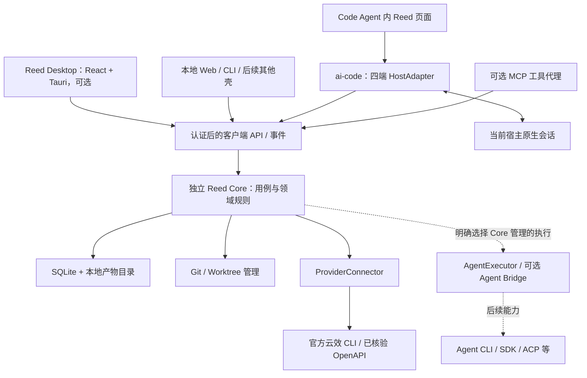
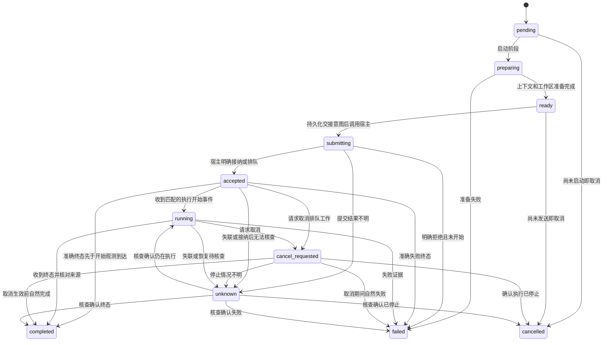
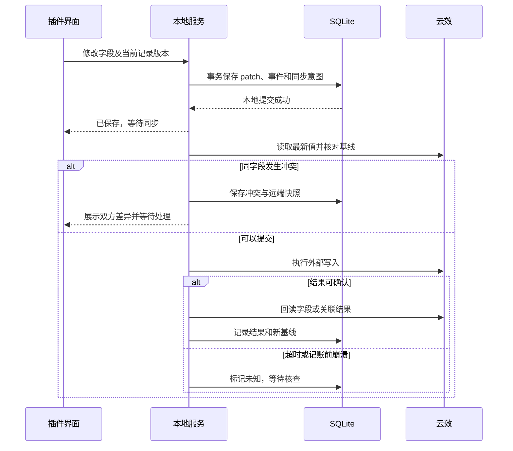

# Reed：架构设计与实施方案

初稿日期：2026-10-27；当前架构修订：2026-10-29（Asia/Shanghai）。状态：设计与实施计划，供评审；本地前端 Demo 已存在，本文的 Core、桌面端与真实四端集成尚未实现。

首轮复核结论（保留历史）：作为分阶段实施的架构方案有条件通过；四端一致的内嵌页面、原生会话控制和隔离开发仍须 P0 逐项验证。初稿补充了可达执行交错、账号主体、目标工作区交接及本地启动通路，并将[同类产品生命周期与交互研究](2026-10-27-workflow-workbench-product-research.md)作为交互依据。2026-10-29 修订只更新以下架构决策与计划，不把旧文档审查或 Demo 成功解释为新方案已运行。条件不满足时阻塞对应功能，不把受限替代方式记为原目标通过。

2026-10-29 用户确定 **Tauri + 独立 Reed Core + 四端适配插件**，性能优先，并改变工程归属：拟建独立 Reed Git 工程，集中维护 Core、共享 React 界面、Tauri 客户端、连接器和产品契约；`ai-code/plugins/reed/` 仅维护不同 Code Agent 的 Reed 适配插件。此决定替代早期“完整产品全部留在插件目录”的方案。独立工程的实际路径、远端地址与公开包名在创建阶段确定，本轮不创建仓库或移动代码。

产品名为 **Reed**，不设中文名，副标题为 **Many agents. One flow.**；ai-code 中拟定插件 ID 为 `reed`。现有 [Demo 与交互设计](../../plugins/reed/docs/design/2026-10-28-reed-interaction-design.md)、业务模型和品牌材料暂留原目录，作为迁移输入，不代表长期产品源码归属。保留已确认的原生浅色、平衡版 R 与系统主题/中英文交互。[名称核查](../../plugins/reed/docs/design/2026-10-28-reed-name-check.md)中的名称和包名边界继续有效。本次仅更新设计文档，不包含实现/测试代码、工程初始化、清单注册、安装、Git 写操作或发布。

## 1. 方案摘要

建设一个本地优先的 Agent 研发工作台：每个本地任务拥有独立的工作流实例，按需求、设计、开发、验证等阶段推进；会话、文档、分支和隔离工作区围绕任务关联。云效作为首个外部需求来源，支持拉取与回写，后续通过相同连接器边界扩展其他系统。

用户可以在 Code Agent 桌面端的 Reed 插件界面直接完成任务管理和阶段操作，也可以打开独立 Tauri 窗口；两者连接同一个 Core。Core 与任何窗口、Tauri API 和宿主进程解耦，关闭或从未启动独立桌面端都不影响插件使用。MCP 只是部分客户端的协议适配；云效首个接入采用官方 CLI 调用 OpenAPI，不要求经过 MCP 或 Gateway。

安装分两步：先用户级安装自带运行条件的 Core（独立 Tauri 客户端可选），再在需要的宿主市场安装 Reed 适配插件。一个操作系统用户、一个本地 profile 对应一个 Core 写入者；不因四个宿主、多个窗口或不同壳而复制数据库。未来增加浏览器、其他桌面壳或自定义客户端，只增加经认证、能力受限的客户端适配，不迁移领域逻辑。

主要投入是完整工程的可信构建、四端差异适配，以及有恢复能力的本地执行与同步。主要风险是宿主缺少公开会话控制接口、远端写入无法确认、多宿主版本与数据库版本不兼容。实施先验证这些边界，再形成真实任务闭环；升级和回退优先保留任务、证据及用户代码。

| 决策 | 内容 |
| --- | --- |
| A01 工程边界 | 独立 Reed 工程承载 Core、共享 UI 和 Tauri；ai-code/plugins/reed 只承载四端适配与插件发行，不复制领域服务 |
| A02 本地权威 | 本地任务、工作流、执行与验收记录由本地服务拥有；外部工作项保留自己的业务事实 |
| A03 单一写入者 | 同一操作系统用户、产品数据配置下只有一个运行服务写数据库；四端共享该服务 |
| A04 三种扩展 | 来源连接器、宿主适配器、阶段执行器分别扩展，互不替代 |
| A05 证据推进 | 规则和 LLM 生成候选决策；状态转换、证据有效性和用户策略决定是否应用 |
| A06 可选 MCP | 普通本地 API、CLI 与 MCP 映射同一应用服务；MCP session 不作为原生会话身份 |
| A07 原生优先 | 优先在用户选择的宿主会话执行；独立外派通过可选 Agent Bridge，明确区分两种执行位置 |
| A08 产物有版本 | 设计、代码和验证结果绑定输入版本；上游变化使相关下游结论待复核，历史保留 |
| A09 视图无副作用 | 任务视图、分支视图、产物视图共享关系数据；浏览不隐式切换 Git 分支或活动会话 |
| A10 两步安装 | Core 用户级独立安装，Tauri 可选；宿主插件经 ai-code 市场分别安装；数据、凭据和工作区独立于两类安装目录 |
| A11 有限首版 | 首版支持可配置阶段列表、前置条件和返工路径，通用拖拽编排器与任意执行 hook 后续评估 |
| A12 能力如实呈现 | 分别记录官方资料、包完整性、协议验证、真实宿主交互和业务验收，不以一种证据代替另一种 |
| A13 执行上下文 | 原生会话同时只承载一个未收敛的受管理 Attempt；创建 worktree 后必须核对实际执行 cwd，不能假设会话已迁移 |
| A14 交互投影 | 任务阶段、Agent 活动、工作区/交付及同步状态分别保存；看板和注意力提示是投影，不是验收事实 |
| A15 壳可替换 | Core 不依赖 Tauri、WebView 或特定宿主；Tauri 是官方独立壳，其他壳通过相同客户端契约接入，能力不因换壳而自动增加 |
| A16 无桌面依赖 | Core-only 安装即可使用四端插件；退出 Tauri 后不得留下 Reed 桌面主进程或专属 WebView，不调用 Core/Bridge 的关闭接口 |
| A17 性能优先 | Core、宿主增量、Tauri 与 Agent 执行器分别计量；第 14.3 节的资源预算是首轮验收门槛，不是已测成绩 |
| A18 双向集成 | HostAdapter 服务“宿主内用 Reed”，AgentExecutor 服务“Reed 内用 Agent”；会话所有者、权限和生命周期明确区分 |

## 2. 目标、范围与非目标

### 2.1 用户目标与对应能力

| 用户目标 | 本方案对应 |
| --- | --- |
| 定义需求—设计—开发—验证流程 | 有版本的工作流模板，每个任务有自己的流程实例和阶段执行记录 |
| 云效作为来源，保留其他来源扩展 | ProviderConnector 契约，云效首个实现；本地任务也可独立创建 |
| 查看任务的会话、分支和文档 | 稳定关系模型及双向导航，允许一个任务跨多个会话、仓库和分支 |
| 每个任务独立生命周期 | 本地 Task ID 独立于任何外部编号；解绑、断网或外部关闭不删除本地历史 |
| 本地存储 | 本机 SQLite、文件产物和本地备份；不建设工作台云存储 |
| 界面修改并同步云效 | 字段级修改、同步意图、冲突处理、结果核查及来源标记 |
| 界面执行各研发阶段 | 阶段操作、准确会话绑定、执行反馈、产物登记和验收 |
| 开发阶段工作区隔离 | 每任务可关联多仓库工作区集合，按仓库创建命名分支和 Git worktree |
| 不开 Reed 独立窗口也可使用插件 | Core 独立安装、发现与启动；四端插件直接连接，不拉起 Tauri 或浏览器 |
| 独立窗口和宿主窗口共享数据 | 同 profile 的 Core 统一写入与事件更新；筛选、抽屉等窗口状态独立 |
| 后续由 Reed 集成多个 Agent | Core 预留执行端口与能力协商，桌面框架不决定可接入的引擎 |

### 2.2 首版产品范围

首版闭环包含真实云效读写，而非只读需求列表：本地建任务或从云效导入，选择默认研发模板，执行并验收四阶段，登记文档，关联原生会话，在隔离工作区开发和验证，完成外部字段同步。任务与分支两种视图同时提供。

四端都是设计目标；各端的页面、绑定、发送、事件和跳转能力必须分别验收。实现顺序以 DSH 完整闭环和 ZCode 共享页面为建议起点，Claude、Codex 的能力验证从 P0 同时进行。某端验证失败不能被另一个端的通过替代；替代交互须明确标为受限方案。

### 2.3 非目标

- 不建设多人 SaaS、云端任务数据库、跨设备状态同步或远程执行集群。
- 不替代宿主自己的 Agent 循环、账号、模型供应商和权限体系。
- 不复制 Agent Bridge 的执行器驱动，也不要求安装 CodeVow 才能运行工作台。
- 不把聊天记录解析、宿主私有数据库或修改宿主缓存作为主要集成接口。
- 首版不提供任意脚本插件市场、自动依赖安装、通用调度平台或强制模型分工。
- Git 提交、推送、合并、创建 PR、部署等动作不由阶段完成隐式触发；如后续支持，须有明确操作及对应授权。

## 3. 当前工程基线与需要扩展的边界

初稿核对 ai-code 的 `main@46e1556e8cc1d1f148c7e7bcd968ebfe625854fc`，ai-mcp 的 `main@5167145a04620be91353a3933276bcd949017619`。2026-10-29 复核时本地 ai-code HEAD 为 `55b2d195bb8bb0639fe3ed98783d4019b7256b0c`，ai-mcp HEAD 仍为上述提交；未核验本次远端状态。当前 Reed 仅有 React/Vite 模拟 Demo，使用浏览器本地存储；新 Core 工程、Tauri 和正式适配插件均未创建。以下事实不能解释为真实集成已经通过。

| 当前事实 | 对方案的影响 | 证据 |
| --- | --- | --- |
| 各插件独立身份、版本、资源闭包；公共层负责校验和发行 | Reed 适配插件保留独立身份；完整产品与 Core 另在独立工程维护 | [仓库架构](../architecture.zh-CN.md#公共层与插件)、[根规则](../../AGENTS.md#维护规则) |
| 公共构建从声明资源生成原生包，没有应用编译阶段 | 需要受控的编译型组件支持和生成产物复验 | [构建实现](../../tooling/plugin_tools/build.py)、[资源渲染](../../tooling/plugin_tools/rendering.py) |
| Codex 发行校验强制 skills-only | 新组件须增加单独 profile 及渠道约束；保留旧 profile | [发行检查](../../tooling/plugin_tools/release/metadata.py) |
| 根测试仅发现固定 Node/Python 入口 | ai-code 接入适配与契约测试；Core/Tauri 的完整测试在 Reed 工程执行 | [测试汇总](../../tests/run-suite.js) |
| DSH 包禁止安装脚本；资源逐项白名单 | 运行服务的启动必须走原生加载或明确产品操作，不借安装脚本安装依赖 | [资源与 DSH 校验](../../tooling/plugin_tools/registry.py) |
| ai-mcp 的 Bridge 管理独立执行会话 | 它是可选执行通路，不是本地任务数据库或桌面会话注册中心 | [既有职责](../architecture.zh-CN.md#ai-code-与-ai-mcp)、[Bridge 说明](https://github.com/Zack-Zz/ai-mcp/blob/5167145a04620be91353a3933276bcd949017619/packages/agent-bridge/README.md) |

当前根架构中“插件不复制本地任务服务”的描述位于派发插件与 Bridge 的契约内。新边界继续遵守该方向：Reed 工程拥有任务领域服务，ai-code 中仅保留其客户端适配，ai-mcp 仍拥有可复用的独立执行能力。公共插件工具不演变成 Core 安装器、Tauri 构建器或通用运行时管理平台。

## 4. 产品结构与运行拓扑

### 4.1 独立 Reed 工程与 ai-code 插件工程

下列是计划中的工程归属，不是已创建的目录或远端仓库。Reed 内部采用一个 Git 工程组织产品，按实际运行/构建边界分包，不拆成多个后台业务服务。

```text
reed/                           拟建独立 Git 工程
  apps/
    core/                       Node/TypeScript 独立服务及 CLI
    desktop/                    Tauri Rust 外壳、系统集成与打包
  packages/
    domain/                     Task、工作流、验收和关联规则
    application/                用例、事务、幂等与操作结果
    infrastructure/             SQLite、同步、文档、Git/worktree
    connectors/                 云效 CLI 及后续来源适配
    contracts/                  客户端/HostAdapter/AgentExecutor 契约
    client/                     私有 IPC、事件游标及可选 MCP 代理
    ui/                         React、样式、品牌资产和宿主无关交互
    execution/                  执行端口、Bridge 客户端与后续驱动
  tooling/                      Core 与 Tauri 的受控构建/安装/升级
  tests/                        业务、恢复、资源和安装验收
  docs/                         产品、设计与支持矩阵

ai-code/plugins/reed/           适配插件工程；一个 ID，多宿主包
  product.json                  仅插件身份、版本、宿主与资源白名单
  adapters/codex/claude/zcode/dsh/
                                原生入口、页面桥、事件与会话绑定
  resources/                    固定 Reed UI/客户端的分发输入声明
  skills/                       宿主内操作说明与结果约定
  tests/                        适配契约、包与真实宿主验收入口
  docs/                         插件安装、配置、能力及限制
```

Reed 工程拥有 Core/Desktop 发行版本与领域契约；ai-code 的 `product.json` 只拥有适配插件版本，双方可以独立升级，不强制同号。Core 版本、插件版本、共享 UI 版本/哈希、协议和 schema 分别记录。公开包名与 CLI 名称另做占用核查，不把拟议目录名当作已注册名称。插件首次正式版仍遵循 ai-code 的 `1.0.0` 规则，本轮不准备版本。

共享 UI、无宿主 view-model、协议及薄客户端的源码只有 Reed 工程一个权威来源。ai-code 拥有各宿主的入口、权限/事件翻译和原生组件装配，不在专用视图中复制领域规则或另建状态机。供多宿主复用的共享前端包不得导入 Tauri API 或特定宿主 SDK；通过受限 ShellBridge 注入打开文件、导航和呈现能力。`apps/desktop` 的专用外壳适配可以调用 Tauri API 实现该桥。ai-code 构建固定版本、固定哈希的发布输入，不引用开发机相对路径或动态拉取 main/latest。已编译页面、字体、宿主 bridge 及最小平台启动器可进入插件包，源码归属与安装包归属分开。跨仓制品验证见第 13 节。

### 4.2 Core 与可替换客户端

Core 是无界面的本地应用服务，不依赖 React、Tauri、WebView、MCP session 或宿主插件缓存。Application 调用存储、来源、工作区和执行端口；客户端只通过认证后的用例/查询/事件契约工作，不能直写数据库。Tauri 是 Reed 提供的一个官方独立壳；本地 Web、CLI、未来其他桌面壳及宿主页面都可实现相同契约，仍须各自认证和声明能力，不意味着支持任意第三方壳执行任意操作。



宿主原生执行不经过 Bridge 创建另一套会话。需要独立执行时，StageRun 记录准确执行模式、执行所有者与 Bridge task/run/session 引用；DSH 不因是插件宿主而自动成为 Bridge 引擎。关闭一个客户端只撤销该连接/订阅，不取消任何已接纳操作。

Tauri Rust 层只承担窗口、系统菜单/通知、文件打开与受限服务发现/启动；领域、数据库、云效、Git 和 Agent 驱动留在 Core。官方支持携带外部程序及 Node 应用，但 sidecar 仅是打包/启动机制，不能据此推导为退出窗口后仍可用的用户级服务；P0 单独验证。[外部程序](https://v2.tauri.app/develop/sidecar/)、[Node sidecar](https://v2.tauri.app/learn/sidecar-nodejs/)

### 4.3 源码、程序、数据和视图状态

| 位置 | 内容 | 生命周期 |
| --- | --- | --- |
| Reed 源码仓库 | Core、领域、共享 UI、Tauri 与产品设计 | 独立 Git 与源码标签管理 |
| ai-code 插件源码 | 四端适配、固定制品引用与插件说明 | ai-code 插件版本及冻结源码管理 |
| 用户级 Core 程序区 | 完整且不可变的 Core/运行时版本、启动入口 | 由 Reed 安装/升级维护，不依赖 Tauri 或宿主存在 |
| 可选 Desktop 程序区 | Tauri 壳与共享 UI | 可单独安装、更新或卸载 |
| 宿主插件安装目录 | 原生清单、薄代理及打包页面资源 | 宿主市场安装/替换；不含 Core 数据库或另一套后台 |
| 系统用户数据目录 | 每 profile 的 SQLite、产物、日志、恢复记录和备份 | Core 统一管理；普通升级/卸载保留 |

同机、同 OS 用户、同 Reed profile 共用同一数据根。首轮数据位置约定为 macOS `~/Library/Application Support/Reed/profiles/<profile-id>/`，Windows `%LOCALAPPDATA%/Reed/profiles/<profile-id>/`，Linux `${XDG_DATA_HOME:-~/.local/share}/Reed/profiles/<profile-id>/`；这是计划路径，不代表本轮创建或已写入。IPC/锁文件放用户私有运行目录，凭据放系统安全存储；P0 核对产品标识映射，避免 Tauri 自带 app-data 路径另建第二份库。

Core 安装登记一个稳定默认 profile，所有首次接入的壳/宿主默认选择它；不按宿主、窗口、仓库或工作目录自动派生另一份数据。只有用户显式选择隔离配置才使用其他 profile，并在连接状态中标明。项目与仓库属于默认 profile 内的业务组织，不等于数据库隔离。

任务、来源、文档、会话/分支关系和流程规则共享；选中任务、抽屉、滚动、未发送输入等属于各窗口。已启用共享的主题/语言偏好通过 Core 保存，并保留系统跟随和宿主限制。localStorage 仅可作可丢弃的视图缓存，不再是正式任务存储；不自动把 Demo 模拟任务导入真实库。

SSH、云端宿主、容器/WSL 与不同 OS 用户不自动共用本机数据。首版不开放跨设备同步；以后跨机接入单独设计身份、路径与执行环境。工作区和项目文档仍可位于用户选择的业务仓库，数据库不放入源码或业务 Git 仓库。

### 4.4 现有材料迁移计划

现有 `plugins/reed/prototype/`、业务模型、交互规格、品牌与名称材料是临时输入。P1 在另行授权创建 Reed 工程后，以保留历史的迁移清单移动产品源码/文档/资产并更新链接；ai-code 留下适配源码和跨仓入口，不长期双份维护。迁移前先核对 Demo 行为、资产许可和实际存储边界；不把模拟数据、浏览器偏好或旧静态验收声明改称真实 Core 数据或四端通过。

本文暂在 ai-code 保留为当前架构决策入口。创建独立工程后，产品架构权威文档随产品迁移，ai-code 只保留插件集成边界与指向固定版本文档的导航；本轮不做物理迁移。

### 4.5 预留 Reed 反向集成多个 Code Agent

HostAdapter 负责“在 Code Agent 桌面端使用 Reed”；AgentExecutor 负责“由 Reed 创建并管理执行会话”。二者复用 Task/StageRun/Attempt、材料快照和工作区契约，但不共享隐含的会话控制权。

| 责任 | 宿主内原生执行 | Core 管理的执行 |
| --- | --- | --- |
| 会话所有者 | 对应宿主，通过可信 HostAdapter 绑定 | 对应执行器或独立 Bridge runtime |
| 发起入口 | 宿主页面，或明确选择该在线宿主的其他客户端 | Tauri、宿主页面或其他已授权壳均可明确选择 |
| 会话/进度 | 原生 thread/session/turn 及准确事件 | executor/run/session/turn、结构化事件及能力 |
| 宿主离线 | 暂停该原生通路，保留关系/结果核查 | 不因某个 UI 宿主离线而取消，但运行时仍需可恢复 |
| 权限与取消 | 原生权限及绑定范围 | 执行器声明的权限交互、取消与停止证据 |

Core 的执行端口预留探测、启动/恢复会话、发送输入、订阅增量、回答权限/用户输入、取消、检查真实目录及收敛结果。详细 schema 在后续执行阶段冻结，不把全部 Agent 的功能压成一个“支持执行”布尔值。会话引用保存 execution owner、引擎版本、机器/profile、run ID 及原生身份；同名 Agent 不代表同一会话，重启不自动接管桌面上正在运行的会话。

优先通过公开 SDK/结构化协议接入，再考虑结构化 CLI，PTY 仅用于需要终端交互的补充。候选包括 [Codex App Server](https://learn.chatgpt.com/docs/app-server)、[Claude Agent SDK](https://code.claude.com/docs/en/agent-sdk/overview) 与 [ACP](https://agentclientprotocol.com/get-started/introduction)。这是未来能力清单，非首版支持承诺；App Server 的实验/生产支持限制、SDK 的第三方认证/额度条件、每个 Agent 的恢复/取消范围都需版本级核实。MCP 可让 Agent 使用 Reed 工具，不替代完整的 Agent 会话和审批控制协议。

优先复用 ai-mcp 的 Bridge 契约和已验收执行能力，经客户端接入，不把驱动拷贝进 ai-code。2026-10-29 源码复核显示，当前 Bridge 的适配列表仅 Claude Code、ZCode、Codex；单 runtime 调度仍串行；close 会中断活动执行。未来“多个 Agent 可选择”与“多个 Agent 并行运行”分开交付，四宿主连接不证明四路执行。Windows 进程停止、交互权限请求、日志有界读取和并发能力须先补齐各自证据，不能直接套用现有结果。

首版只保留端口、能力与准确所有权，并完成原生宿主闭环；P8 再实现独立执行及并发。阶段页面不能在宿主不可用时自动改走 CLI/SDK，也不能通过嵌入外部桌面窗口来宣称完成反向集成。新增执行器无需改写 Core 领域或 Tauri 壳；执行器的依赖和资源只在实际启用时加载。

## 5. 本地任务与工作流

本节业务语义由后续[Reed 业务领域模型](../../plugins/reed/docs/design/2026-10-28-reed-business-domain-model.md)进一步明确，包括范围草稿/基线、轮次、人工提交、父子/依赖和归档；本方案继续负责技术边界。

操作的前置、状态变化及恢复以[业务操作流 F01–F18](../../plugins/reed/docs/design/2026-10-28-reed-business-operation-flows.md)补齐。阶段准备记录可以独立于 AgentAttempt 存在；最终交接才固定本次实际执行输入，并重新核对任务控制、版本、能力及上下文，不从一次准备成功推导永久可发送。

### 5.1 三种身份与版本

Task 使用稳定本地 ID。云效展示编号不是主键；外部引用包含 provider、connection、实例/组织、项目和原始工作项 ID。工作台任务 ID、Bridge task ID、宿主 thread/session ID 分别记录，不共用字段。

WorkflowTemplate 按不可变版本保存阶段、前置条件、执行方式、预期产物、验收规则和返工路径。WorkflowInstance 即一轮流程，固定任务采用的模板版本；模板更新不会改变进行中的实例。用户明确迁移时新建替代实例并校验材料复用，保留旧实例和决策记录。

首次需求澄清可先使用目标草稿，当前初始实例尚未绑定已采纳范围；首次确认形成范围 V1 后绑定，后续阶段据此工作。草稿每次保存不新建整个流程；已采纳范围实质变更才产生新范围和新实例。已完成任务按同范围重新开展时新建轮次，范围版本可保持不变。

每个 Task 同时只有一个活动主流程实例；可有多个历史轮次和本地子任务。一个外部需求可关联多个本地任务，只有明确的同步负责人负责其共享字段回写，见第 10 节。

### 5.2 默认阶段及完成条件

| 阶段 | 输入 | 主要产物 | 默认通过条件 |
| --- | --- | --- | --- |
| 需求 | 外部原文或本地目标、范围和已有资料 | 澄清后的需求、验收条件及待确认事项 | 必要信息完整，未解决阻塞项已处理 |
| 设计 | 已接受的需求版本、仓库基线 | 设计文档、决策与实现范围 | 文档已登记，满足配置的审查和确认条件 |
| 开发 | 有效设计版本、明确工作区与允许范围 | 工作区修改、实现说明和关联提交 | 执行结束，修改与范围核对，所需开发检查通过 |
| 验证 | 实际代码快照、验收条件和环境 | 命令结果、测试报告及人工验收 | 配置的必要验证均有效通过，遗留项符合验收要求 |

验证未通过可回到开发；实现发现设计缺口可回到设计。阶段允许配置跳过或使用人工执行，但须记录依据与替代验收，不用伪造 Agent 成功补齐流程。

### 5.3 任务、阶段、尝试分开管理

- Task 业务处理状态：`active / blocked / paused / completed / cancelled`。归档另作整理属性，保留业务状态与完整历史；恢复归档不代表恢复执行。
- 新建或导入的任务先处于 active 下的待开始状态，只有显式启动才创建执行尝试。浏览外部来源列表不自动创建本地任务；来源收件箱与本地任务列表分开。
- StageRun 是一轮具体阶段工作，固定业务输入、目标、允许的执行路径及验收要求；可有多次 AgentAttempt 或人工提交。人工修订候选不自动改变阶段路径或免除必需证据。具体宿主/会话与起始代码快照绑定 Attempt。已采纳上游输入或验证对象变化时新建 StageRun，旧记录保留。
- AgentAttempt 是 StageRun 的一次 Agent 尝试；重试新增 Attempt，记录前次失败及处理方式，不能覆盖日志或悄悄新开会话。
- 阶段执行结果、验收结果、产物新鲜度分别保存。`execution=completed` 不等于 `acceptance=accepted`；产物变化后的 `freshness=stale` 不抹掉曾经通过的历史事实。

Task 的完成结论绑定固定的 `taskScopeRevision`。收到外部更新先标记来源变化并评估，不直接替换已接受输入；用户接纳实质变更或修改本地验收范围时，在同一事务中增加范围版本、建立新流程轮次，旧完成记录保留。已完成任务因此重开；显式暂停等控制不因范围变更静默解除。当前范围存在必要阶段未验收或失效时，不能展示为无条件完成，也不能自动同步外部完成状态。新轮次不代表旧执行停止，原 Attempt 继续核查，不能借替代轮次提前释放会话或工作区。

下图描述 AgentAttempt 的执行状态；StageRun 还拥有独立的验收与产物有效性。提交前的 ready、调用中的 submitting、宿主接纳后的 accepted 分别记录，阶段准备完成不能直接算作消息已发送。



单个 StageRun 的执行接纳、阶段验收和 Task 推进使用本地记录版本检查；重复点击复用同一操作请求。同一阶段多次候选结果不得按“最后回调”覆盖验收。已接受的结果必须指向明确 AgentAttempt 或人工提交、输入与产物版本；不要求人工执行伪造 Agent 记录。复用材料也需登记来源与本轮适用依据。

取消是独立操作意图，不能覆盖真实执行结果：请求取消后可能 completed、failed 或 cancelled，分别记录意图、宿主响应和实际终态。准确终态可以在开始观测缺失时收敛；若终态在提交接纳回执前到达，保留原始事件并按相同 Attempt 核对，不强制等待一个永远不会到达的开始事件。已收敛后收到重复或矛盾终态进入审计/核查，不反复翻转状态。

暂停 Task 停止新派发和后续自动推进，不等于暂停原生进程；当前结果接收及人工审阅可继续，活动 Attempt 的取消另行操作。恢复暂停先重判当前条件，不重发旧准备。取消 Task 先取消后续派发并请求停止现有执行，只有执行处置已确认后才进入 cancelled；失联时保留活动/待核查标识，迟到完成不自动完成 Task。活动/阻塞任务需明确暂停并撤回未交接准备后归档，存在活动或待核查执行时先处置；恢复归档保留暂停/完成/取消，继续工作须分别恢复或明确重开。归档不替代验收、资源清理或未决同步处理，不能靠隐藏任务绕过占用。

默认“任务完成”表示该范围已通过配置的研发验证，不代表已合并或已发布。PR/MR、集成和发布引用保留独立状态；若某项目把业务完成定义为上线，必须配置相应证据和外部状态映射，不能把默认验证通过直接映射成该项目的最终完成。

### 5.4 规则与 LLM 推断

推断产生 DecisionProposal，包含目标转换、原因、证据引用、输入版本、规则/模型来源及映射版本。Application 在同一事务中检查当前状态、前置条件、证据有效性、用户配置及重复决策后应用，或留待用户处理。

确定性规则负责依赖齐备、必要验证、可执行转换及版本匹配；LLM 用于语义映射、变更影响和成果充分性建议。模型置信度不能单独作为推进授权或测试证据。首版默认展示语义建议；用户可为明确范围开启规则自动推进，后续再扩大自动化范围。

模型请求只携带本次判断所需材料；可通过选定宿主 Agent 或以后实现的模型适配器完成，不要求公共服务拥有单独的云模型账号。本地存储不等于离线推理：使用云 Agent 会发送选定材料；完全离线场景使用规则或经过验证的本地模型。

上游变化按显式依赖传播待复核标记：描述排版变化与验收条件变化可有不同规则。模型只建议受影响范围，不能直接清除失效标记。验证仍以真实命令与环境结果、或明确人工验收为依据。

## 6. 数据归属与关系模型

SQLite 保存当前投影、事务记录和追加事件，首版不建设全量事件溯源引擎。事件用于恢复、审计和界面更新，当前表与事件在同一事务写入，禁止各端维护另一份权威状态。

| 实体 | 关键内容与约束 |
| --- | --- |
| Task | 本地 ID、目标、验收条件、整体状态、`recordRevision`；本地创建不要求外部引用 |
| WorkflowTemplate / Instance | 模板版本、阶段定义、活动实例；同任务活动主实例唯一 |
| StageRun / AgentAttempt | 输入快照、执行状态、验收、原生轮次及结果引用；每次尝试可独立追踪 |
| ExternalItem / TaskExternalLink | 外部唯一引用、最近观察、上次同步基线；导入默认复用已有主任务，派生任务仅建立关联 |
| SessionRef / SessionBinding | 宿主实例、机器/profile、`nativeThreadId`、`nativeSessionId`、可选导航目标、来源、用途与有效时间 |
| WorkspaceSet / RepositoryWorkspace | 一任务可跨多仓库；真实 repo、git common dir、worktree、分支、基线与观察时间 |
| Artifact / ArtifactVersion | 文档/报告/修改快照的用途、内容哈希、存储位置、输入依赖和生产者；历史版本不可覆盖 |
| DeliveryRef | 仓库与托管方、PR/MR 或明确交付引用、关联代码版本、观察状态和时间；不与任务完成或产物验收合并 |
| SyncOperation | 外部写入意图、基线、字段、操作结果及核查状态；本地幂等不等于远端幂等 |
| Operation / Event | 请求 ID、规范化请求摘要、记录版本、服务代际和来源事件 ID；重复请求参数不同则拒绝 |

会话与任务、阶段是多对多的历史关系，但同一原生执行会话默认只有一个未收敛的受管理 Attempt。改变展示或历史关联不转移执行所有权；旧 Attempt 未收敛时，不接纳另一任务向同一会话派发。分支在不同仓库中的同名不能合并；分支重命名、删除后重建通过新观察与历史关联表达，不能只凭名字认作同一段开发。

普通命令统一携带 profile、requestId、expectedRevision 及经过认证的调用来源。身份由运行服务和宿主适配协商，网页传入的任意 sessionId、路径或 approved 标记不能创建权限。成功响应返回记录版本与事件游标；大日志和产物分页读取，不塞入列表响应。

| 建议操作族 | 责任与副作用 |
| --- | --- |
| `task.create/update/linkExternal` | 创建本地任务、修改目标、关联准确外部对象 |
| `workflow.startStage / stage.accept / stage.retry` | 创建阶段/尝试、验收、处理重试；不会隐式改变 Git 交付状态 |
| `session.bind / session.open` | 核验绑定或请求宿主导航；区分已保存关联与真实打开成功 |
| `workspace.prepare / workspace.inspect / workspace.release` | 准备工作区、读真实 Git 状态、受控回收 |
| `artifact.register / artifact.open` | 登记产物版本、按已验证位置打开 |
| `provider.pull / sync.enqueue / sync.reconcile` | 拉取、登记外部修改、核查未知结果和冲突 |
| `host.negotiate / events.read` | 协商能力与兼容版本、按游标恢复界面 |

这些是拟定应用契约，不是已经存在的 CLI/MCP 工具。详细参数和错误 schema 在对应实施阶段冻结，HTTP、CLI 与 MCP 不各自实现一套状态机。

## 7. 会话、分支与双视图

### 7.1 会话绑定和执行反馈

阶段启动首先选择执行模式、宿主、准确会话及目录。现有会话通过宿主公开上下文或可信生命周期事件绑定；新会话只有获得真实身份后才完成绑定。身份尚未返回时持久保存待绑定请求，不能填入“最近会话”。

HostBridge 接口按能力声明 `currentSession / createSessionAtWorkspace / openWorkspace / openSession / submitPrompt / executionEvents / workspaceInfo / cancelExecution`，每项为 `supported / unsupported / unverified`，同时记录宿主版本、来源和实测状态。`createSessionAtWorkspace` 要求能在指定真实目录新建准确会话，不能由“能新建会话”推导。页面据此呈现直接操作、预填、复制或人工绑定，不静默改用另一个宿主或独立执行器。

会话记录分别保存导航 thread ID、运行 session ID 和轮次 ID；MCP 连接 ID 只用于通信关联。对于 fork、子 Agent 或重启，只有明确事件和父子关系才能补录新身份。Codex hooks 的 session_id 不能未经映射验收直接拼成桌面深链。

提交消息包含 Task、StageRun、Attempt 引用、固定输入快照与操作范围。发送前保存意图；接纳、排队、开始执行和终态分别记账。宿主返回接纳不表示阶段完成；缺少反馈时显示未知或待核验，不通过聊天尾句猜测成功。

本地服务先核验绑定和工作区占用，持久化 Attempt 与交接意图，再向宿主适配器发出限次、限绑定、限版本的交接凭据。适配器在实际提交前确认当前上下文，回传接纳及原生轮次；页面刷新不能重新消费同一次交接。宿主缺少可核查的幂等/提交接口时，适配器崩溃或回执丢失进入 unknown，不把本地凭据去重解释成原生消息恰好发送一次。

事件上报以 `sourceInstance + nativeEventId` 去重，携带原生轮次、服务代际及绑定版本。迟到事件进入原 Attempt 历史，不覆盖新 Attempt；未知绑定只进入待关联区。hooks 上报使用短超时和本地待发记录，失败不阻塞原生 Agent 开发，工作台显示观测不完整。

宿主未提供稳定事件 ID 时，适配器在可信入口首次接收事件时产生并持久保存 deliveryId，重试复用该 ID；它只证明相同观测未重复接收，不伪造原生轮次身份。缺少 turn/attempt 关联的 Stop 等事件不能仅凭 cwd、会话最新任务或时间相近归入某个阶段，保留为会话级活动，阶段终态需其他准确证据。

原生会话占用由现有 SessionBinding 与本地事务条件约束实现，不另建重复的分布式锁。只有该会话前序 Attempt 已收敛、上下文重新核对后，才允许下一任务派发；宿主若提供可验证的逐轮次排队协议，可独立验收后放宽。用户从原生界面手动插入消息不受插件锁控制，适配器必须把未归属轮次与工作台发起轮次分开，不据此改绑当前任务。不同原生会话仍可并行，同 worktree 写入另受第 9 节约束。

### 7.2 Git 身份与上下文漂移

在实际执行 cwd 查询仓库根、git common dir、worktree、分支、HEAD 和未提交内容摘要。记录机器与 profile，规范化 remote 时去除凭据。多 remote 仓库由用户确认仓库身份，不把 URL 字符串自动相等视为业务归属证明。

分支为空表示 detached HEAD，不能用任务期望分支补成已观察事实。启动前再次核对目录与代码输入，执行期间在阶段边界和显式刷新时重查；发现用户 checkout、重命名或 worktree 移动，保留原执行快照并提示重新绑定。

任务、分支、文档视图读取同一关联投影。切换视图不执行 checkout、不迁移工作区、不向会话发送消息。“进入工作区”“打开会话”“开始阶段”是独立操作，分别报告结果。

## 8. 文档、代码快照与验证证据

### 8.1 文档管理

任务详情提供需求、设计、实现说明、验证、决策等产物分类，以及来源会话、产生阶段、当前版本和待复核状态。支持登记已有文档、接收 Agent 生成文档、打开本地文件和追溯历史。

正式项目文档可以位于业务仓库，私有过程资料位于本地数据目录；数据库保存索引及依赖，不复制所有宿主聊天全文。外部在线链接是引用，本地保存必要元数据；仅在明确需要离线副本时获取并标记快照时间。

产物登记验证真实文件、已授权根目录、文件类型和解析后的路径；符号链接不得逃逸。Markdown/富文本预览统一处理活动内容，默认不执行文档内脚本。Agent 输出的路径或链接只作为候选，不能直接成为已验证产物。

### 8.2 证据绑定和失效

设计验收固定需求快照、文档内容哈希及代码基线；验证固定实际工作区内容、相关未提交/未跟踪文件、命令与参数、退出状态、环境及时间。不能只保存 commit 或一段“测试通过”的模型摘要。

对外部大文件、生成文件和不可读取内容明确记录快照覆盖范围；无法稳定标识的输入不能宣称完整验证。文档修改保留不可变版本；内容缺失、变动或依赖变更时，相关结论变为待复核。

证据依赖按任务和阶段追踪，代码变更只使相关验证过期；不机械作废所有任务。人工验收记录实际操作者及范围；Agent 写入的 approved 标记不代表用户授权。

## 9. 隔离工作区

默认建议为每个开发任务建立 WorkspaceSet，其中每个仓库对应一个工作区实例。设计阶段可使用只读代码上下文，开始写入前明确目标 worktree；验证使用同一实例或准确重建的代码快照。

工作区准备和原生会话接入是两个独立步骤。worktree ready 后生成目标上下文，宿主必须在该目录创建/打开会话，并回传 observed cwd、仓库和分支供服务核对；匹配前显示“工作区已准备，等待会话接入”，不发送开发指令。当前会话位于原工作树时，不能只在 prompt 写一个新路径就当已切换工作区。没有相应原生能力的宿主使用明确的人工打开与重新绑定流程，该限制进入四端能力矩阵。

一次 Attempt 固定主 cwd 和允许访问的仓库根。宿主不支持多根授权时，跨仓任务通过本地子任务/分别绑定的执行阶段推进，主任务聚合验收；不能假设一个 cwd 自动赋予对所有兄弟 worktree 的访问能力。

准备过程采用可恢复步骤：登记意图与资源归属，解析基线提交，检查目录/分支冲突，创建命名分支与 worktree，初始化允许的运行环境，回读 Git 注册和真实目录，最后标为 ready。相同 requestId 返回相同操作，不能重复创建工作区。

用户选择已提交基线时，主工作区的未提交改动可以保留，新 worktree 明确不包含这些改动；首版不自动 stash 或复制脏改动。若需要基于当前未提交内容开展任务，应另外设计并验收受控快照/补丁导入。可选 Bridge 路径仍遵循它自身的清洁源要求和 detached worktree 行为，不把新工作区管理能力归为 Bridge 已有。

同一真实 worktree 的写入按执行占用仲裁，锁定范围不是仅 Task ID；一个任务的多个会话可以分工读取，但不能默认并行写相同内容。锁能约束受管理操作，无法阻止用户和其他工具在外部修改文件，需检测漂移。

取消先记录请求，再等待宿主或执行器确认停止；自然完成/失败与取消共用终态处置规则。只有准确关联的执行已结束且后续工具/排队工作停止条件满足，才释放会话与 worktree 占用；不能单凭聊天答案结束就认定所有副作用停止。服务失联、租约超时或 PID 不存在不足以证明相关工作已停止。无法确认时保留占用并允许核查，避免另一个阶段在同一目录启动写入。

工作区归属不随一次 Agent 回答结束而消失。已登记的预览服务等长期环境进程可以保留并显示用途，不把它们仍存活等同 Agent 仍在执行；如仍有受管理的代码写操作未结束，则继续保持写入占用。阶段间复用工作区和环境不等于把同一原生会话交给另一任务，环境清理也不自动删除任务历史。

创建中断后核对真实目录、Git worktree 注册和持久化归属。目录或分支已存在但归属不明时停止处理；清理需要证明归属、没有活动执行和需要保留的新内容。异常工作区标为待处理，不自动删目录、删分支或覆盖用户修改。

worktree 只隔离代码目录。端口、临时目录、依赖缓存、测试数据和数据库连接按项目声明配置；首版不自动安装依赖或复制环境凭据。多仓库准备是多个可恢复步骤，部分失败时保留已完成结果并可继续/回收，不宣称跨仓库原子事务。

## 10. 云效连接器与双向同步

### 10.1 连接器边界与能力

ProviderConnector 提供认证检查、项目/工作项类型与字段配置、搜索详情、关系、活动、字段更新和结果核查。通用层保存标准化字段及 provider 原始字段；界面按连接器能力开放操作，不把云效状态 ID、分类或 URL 写入核心模型。

云效首版按此前确认的方向，由 Core 中的连接器通过官方阿里云 CLI 及 `aliyun-cli-devops` 插件调用 OpenAPI；CLI 是传输实现，不是领域模型或另一个同步服务。以 OpenAPI 契约检查字段、分页、回读和错误语义，CLI 未覆盖的操作须另行核验后增加直接 API 适配，不静默切换写入主体。Core 固定 CLI 绝对路径与已检测版本，使用参数数组及本次子进程环境传入凭据，不修改用户全局 CLI 配置；发现本机配置要经用户选择，不能把 Demo 的模拟发现当真实凭据读取。中心版需组织 ID，Region 版需实例接入地址；显示名称可从已核验信息生成或由用户修改。[官方 CLI 安装与配置](https://help.aliyun.com/zh/yunxiao/developer-reference/how-to-install-initialize-and-use-the-apsara-devops-cli)

Token 保存在系统安全存储，页面、工作流、日志和模型输入只见凭据引用；不把 Token 放入 argv、URL 或诊断输出。connection 绑定不可变的接入点、组织与账号主体，凭据引用按产品/profile/connection 隔离。更换主体创建新 connection，旧缓存和 pending/sending/unknown 意图不自动迁移；旧在途操作仍按原主体核查。仅经核验属于同一主体的 Token 刷新可保留 connection；无法核验身份时暂停写入，不能因新账号也有项目权限就发送旧意图。每条同步操作固定 principalRef 与 connection 配置版本，派发前再次比对。

官方搜索接口以项目或项目集为范围，跨独立项目需要聚合；分页窗口 `page * perPage <= 10000`，更大范围按条件拆分并去重。字段和状态配置按项目及类型获取，不能硬编码通用状态列表。[SearchWorkitems](https://help.aliyun.com/zh/yunxiao/developer-reference/searchworkitems)、[工作流状态](https://help.aliyun.com/zh/yunxiao/developer-reference/getworkitemworkflow-get-a-list-of-the-status-of-the-work-item)

增量拉取使用有重叠的时间窗口与外部 ID/更新时间去重，成功完成窗口后再推进游标，定期补充有界全量核对。搜索分页不是远端一致性快照；筛选结果里消失、单次 404 或权限变化不能直接判定外部已删除，先标为不可访问/待核查，保留本地关系。

状态列表不是合法流转动作列表。[GetWorkitemWorkflowInfo](https://help.aliyun.com/zh/yunxiao/developer-reference/getworkitemworkflowinfo-get-work-item-workflow-information) 的公开返回只说明 statuses，不能从中推导所有可选状态都允许直达。P0/P3 需按项目验证权限、前置字段及服务端流转约束；缺少公开动作信息时把可选值标为候选，由真实写入结果判定并展示拒绝原因，不采集私有页面接口来绕过限制。只读状态探测不能算写入权限通过。

| 能力 | 首版处理 |
| --- | --- |
| 拉取需求、任务、缺陷与详情 | 刷新、分页、筛选、父子关系和准确原始引用；列表失败不显示成空数据 |
| 修改标题、描述、负责人、优先级、状态 | 界面预览差异，登记同步意图，按真实字段配置提交，回读结果 |
| 新建外部任务、评论或关联 | 在独立接口验收和未知结果恢复通过后启用；不能沿用更新操作的重试策略 |
| Codeup 分支、提交、MR 关联 | 后续按明确操作回写；其他 Git 托管方不伪装成 Codeup 类型 |

[UpdateWorkitem](https://help.aliyun.com/zh/yunxiao/developer-reference/updateworkitem) 支持字段更新；[外部资源关联](https://help.aliyun.com/zh/yunxiao/developer-reference/new-work-item-associates-external-resources) 描述 Codeup 分支、提交和 MR 等类型。这不证明任意链接或桌面会话都能写进同一个接口。

UpdateWorkitem 公开契约没有响应体，不能要求从成功响应中取完整工作项或新版本；连接器记录请求结果后另调 GetWorkitem 核查。`gmtModified` 可作为观察信息，未建立其作为原子条件写入凭据的证据。官方 CLI 参数、直接 REST body 和 MCP 工具封装分别映射，按目标接口及 CLI 版本验证，不混用包装字段。

### 10.2 字段归属与状态映射

| 数据 | 同步策略 |
| --- | --- |
| 外部原始标题、描述、负责人和业务状态 | 保留远端观察与共同基线；本地编辑作为待同步 patch，不整条覆盖 |
| 本地澄清、工作流阶段、会话、worktree 和证据 | 本地权威，仅通过明确摘要/关联操作选择性回写 |
| 外部父子关系与本地任务拆分 | 分别保存；一个外部需求的多个本地任务不能竞争写同一字段 |
| 映射与自动化策略 | 按 connection、项目、类型及工作流版本配置，记录每次采用的映射版本 |

默认一个外部工作项对应一个主导入任务，派生任务建立关联。每个允许回写的外部字段由明确主导任务表达期望，关联本身不授予写入权；业务负责人、主导任务和实际操作主体分开。聚合完成条件在主任务范围配置，必要子任务按约定范围/成果验收，父任务仍负责自己的集成验证；父子关系不自动传递暂停、取消或归档。多源任务首版最多一个主回写目标，其他来源先作为引用。

云效“处理中”可能对应本地设计、开发或验证，映射是有方向的事件规则，不假设可逆。外部关闭或重新打开触发评估和提示，不直接伪造本地阶段通过；解绑、远端删除或权限丢失不级联删除本地任务。

用户直接编辑来源字段是独立外部操作，预览说明其不改变本地验收；首版明确暂停该主关联下相应字段的自动映射，重判未发送规则意图，在途操作仍核查。恢复映射需预览当前期望，避免后续阶段事件静默覆盖手动修改；具体操作见业务操作流 F15–F17。

### 10.3 同步事务、冲突与未知结果

本地变更、审计事件和待发送意图在同一 SQLite 事务提交。网络调用在事务外执行，成功回读后更新同步基线。页面同时显示本地已保存、远端待同步、冲突和结果未知，不能用一个成功提示合并这几种事实。

同 profile 内，按实际远端对象键（provider、已识别实例、组织和原始工作项 ID）串行写入，不以 connection ID 分开仲裁；不同工作项可有界并发。凭据、缓存和操作主体仍按 connection 隔离，但账号 B 的新 connection 不能绕过账号 A 对同一远端对象的未知在途操作。无法确认两个接入点是否同实例时标为待核对，不能静默视为独立。不同本地 profile、机器和外部用户仍属于第 10.3 节描述的远端并发限制。

仅尚未发送的意图允许按已定义规则合并；sending 之后不改请求内容。基于本地完成的关闭意图绑定准确流程轮次和完成决定，派发前核对其仍代表当前工作；范围替代、同范围重开或模板迁移后重判旧待发意图，不能只比较范围版本。用户直接编辑外部状态绑定明确外部操作决定和来源基线，不伪造本地完成，也不绕过主导、权限和流转条件。unknown/conflict 阻塞该对象的后续依赖写入，默认在前序请求终态及其影响已确认后再基于新基线重算；第 10.4 节的显式人工风险接受是单独记录的例外，不能被普通重试触发。连接器无法证明独立的同对象写入均视为有依赖。旧操作的回执只能更新它自己的结果和观察值，不能覆盖后续编辑产生的期望值。收到成功响应但回读异值时保留冲突或待核查，不能直接记同步通过。



比较上次共同基线、本地期望与当前远端值：单边变更合并；双方改同字段保存冲突。冲突由用户选择保留、合并或放弃该修改，重新形成有版本的同步意图。不能简单按最后更新时间覆盖整条记录。

同步操作状态为 `pending / sending / confirmed / converged / conflict / unknown / failed / cancelled`。`confirmed` 要求可关联的成功响应或证据；核查只看到目标值时记 `converged`，它证明当前值收敛，不能证明该次请求产生了全部副作用，也不能证明仍在途的旧请求之后不会覆盖新值。执行是否已停止、是否允许放行后续请求另有核查结论；converged 不能独自释放该对象写入占用，无法证明时继续保留待处理状态。

远端没有条件写入或幂等键时，本地先读后写仍存在竞争窗口；本地 requestId 只能防重复调度，不能保证云效严格一致或恰好一次。P0/P3 按接口核验远端是否支持条件更新、关联标记、活动追踪和去重。无法消除的并发覆盖风险必须在支持边界中说明，不能以本地 CAS 冒充远端保证。

写入超时、远端成功后本地崩溃、迁移接管时在途请求均进入核查流程。先读取远端字段、操作关联和允许的活动记录；不能确认时暂停该意图，保留其他查询/同步。建单、评论等有追加副作用的操作尤其不能盲重试；即使设置相同状态，也须评估通知和工作流副作用。

安全重试只覆盖确定未发送的请求或已有接口证据允许的操作；按连接器返回的限流信息退避，设置次数上限、随机抖动和人工恢复入口。来源标记、意图 ID 和基线对比阻止“本地变更→远端回流→再次写入”的循环；不能仅依赖远端是否支持自定义字段。

首版默认“使用时同步”：宿主/独立页面活动、用户刷新或本次操作触发有界拉取，合并同 profile 的重复刷新，不按窗口数启动四套轮询。后台同步需用户显式开启，由 Core 单独保持运行；关闭 Tauri 不停止已启用的后台同步。离线保留队列，重连后先核查未知项，再提交可安全发送项。后台同步关闭且无客户端/活动操作时遵循第 11.5 节空闲退出策略；暂停期间待同步只表示已持久保存，不能宣称已发往云效。后续增量事件或 webhook 独立设计，不提前开放公网入口。

### 10.4 未知结果的用户处置与保证范围

远端缺少可查询操作 ID 或终止证明时，不能承诺所有 unknown 都会自动恢复。提供三条明确路径：继续拉取并保留该对象写入暂停；解除同步绑定并保留未决记录；由用户核对远端、查看所有待发差异后，显式接受残余风险并形成新的人工恢复决策。最后一条记录为人工处置，不把旧操作改写成 confirmed，也不声称消除了迟到请求风险；恢复后的漂移继续被检测。旧队列逐项重新核对，不整批自动重发。

人工处置保存在独立 resolution/decision 引用中，标明操作者、输入快照、范围和是否允许释放对象队列；原始执行结果可以仍为 unknown。队列根据该明确处置决定是否放行，不能再次被“所有 unknown 一律阻断”的默认查询卡住。此后迟到结果仍归属原操作，并重新核对后继期望值及冲突，不能反向伪造当时已经确认。

上述处置只影响相应外部对象的同步写入，本地任务、文档和其他对象可继续使用。P3 的必交付包含这一恢复界面和操作记录，不能只给用户一个永久转圈的“等待同步”。

## 11. 两步安装、本地服务、持久化与升级

### 11.1 两步安装与独立运行制品

**第一步：安装 Reed Core。** Reed 工程独立发行用户级、按 OS/arch 区分的 Core 安装内容，包含固定运行时/可执行程序、依赖、迁移和资源，普通使用不要求先装 Node/npm/Rust。主方案为经验证且随包提供的 Node LTS 与构建产物；单文件封装可作 P0 对比方案，不能以封装工具的示例推导 SQLite/原生依赖可用。开发模式可使用已有 Node，但不代表正式安装路径。

提供 Core-only 和 Core + 可选 Tauri Desktop 两种安装选择，均使用同一 Core 管理入口；后装 Desktop 只连接已有服务。安装阶段核验制品、来源、版本及完整性，原子放入用户私有、不可变的版本目录，并登记可信启动器的绝对路径。Core 服务不能从 Tauri `.app` 内部或宿主缓存长期加载必需文件；卸载可选 Desktop 后仍可独立恢复 Core。不会依赖抢占裸名 `reed`，不把用户终端 PATH/nvm 设置作为桌面启动前提。

**第二步：安装宿主适配插件。** 用户在需要的 Codex、Claude Code、ZCode、DSH 市场分别安装 ai-code 的 Reed 插件，完成该宿主必要的启用/信任，再发现 Core、协商协议/profile 并建立连接。插件不携带第二套 Core/SQLite，不静默装运行时、执行 npm 安装或改其他宿主的配置。缺 Core 时提供明确安装入口；有 Core 但未运行时调用已核验固定启动器；不拉起 Tauri 或浏览器作为启动中介。

“无全局 Node”必须覆盖客户端引导链，而不只覆盖 Core 本体。Reed 工程提供无外置 Node/Rust 依赖的最小平台启动器/stdio 代理，负责验证安装登记、调用已安装 Core 的启动入口并转发请求；不含领域、数据库或另一个 Core。Core 安装内容包含该入口，宿主不能可靠使用登记绝对路径时，插件可捆绑同源、固定版本的最小启动器。P0 必须验证每个宿主的路径变量/OS/arch 选择、空格/非 ASCII 用户目录及全新 GUI 登录环境；不得默认 `command: node`、npx、终端 PATH 或宿主内置 Node 可用。

每条 MCP stdio 连接可以有自己的薄代理进程，四条代理不等于四份 Core；进程数量、常驻原因与资源全部进入适配增量。启动器、客户端协议和 Core 程序是不同兼容边界，插件中旧启动器不得绕过维护/显式停止状态或根据“latest”选择运行版本。启动失败返回明确诊断，不递归起进程或转而打开 Desktop。

Core 的本地任务功能不依赖云效 CLI 或任何 Agent 已安装；云效及执行器首次启用时分别检测所需程序、权限和版本，缺失只阻塞相应连接器/执行能力。官方 CLI 的准备在对应配置流程说明，不借“两步安装”承诺所有第三方依赖都已随包提供。

【技术基线】领域与服务使用 TypeScript，界面使用 React，独立壳使用 Tauri，结构化存储使用 SQLite。Node LTS、SQLite 驱动、Tauri/Rust、系统 WebView 最低版本及平台原生依赖在 P0 固定为可验证组合；不沿用早期“用户先装 Node 24”或某次 SQLite 文档状态作为正式支持声明。不把宿主 Electron/内置 Node 当作通用运行时，发行时不临时编译/下载数据库驱动。

Core 默认按需启动，登录后启动和后台常驻是两个明确选项。macOS LaunchAgent、Linux systemd user、Windows 用户级启动管理均指向稳定的用户级启动器，再由它按 profile 的已激活版本启动 Core；不直接写死某个 `.app` 或版本目录的 Node。按需模式禁止无条件 KeepAlive/Restart=always/退出即重启，正常空闲退出不重启；异常退出仅在策略允许、未显式停止且非升级维护时有限退避重试，避免崩溃循环。平台任务的已停止/失败状态也需与产品记录核对。

登录后启动只尝试一次，不自动使 Core 永久驻留；后台同步/常驻才持有相应活动原因。显式停止、维护升级和空闲退出都必须被平台启动管理及插件启动器共同遵守。三平台分别验收，不能以 sidecar、`detached/unref` 或单平台成功代替进程退出/崩溃/升级行为；系统规则需按目标 OS 固定配置。[systemd 重启语义](https://www.freedesktop.org/software/systemd/man/latest/systemd.service.html#Restart=)

### 11.2 服务发现、可信身份与逐端通路

客户端通过 `ensureRuntime` 先连接已有实例。启动竞争按 OS 用户/profile 通过操作系统排他锁产生一个胜者；发布私有连接信息、服务实例 ID、协议/能力与 schema。其他客户端只重试连接，不再起一个写入者。接管必须取得排他所有权并核验旧进程停止，不能只看 PID/心跳或仅凭端口可连；旧代际回调不写入新活动状态。协议不兼容返回诊断，不新建另一个同数据根服务。

优先使用用户私有 IPC。客户端界面通过各自可信桥接入；可选浏览器入口才使用受认证的 loopback HTTP，校验 Host/Origin 和会话能力。长期引导凭据不进入 Web 页面、URL 或提示词，localhost 不构成认证。任意壳都不能借自报 profile、宿主名或 sessionId 取得文件/执行权限。

首版信任边界是当前操作系统用户：不宣称抵御能读取该用户私有文件或任意执行代码的同 UID 恶意进程。服务由用户安装并核验的 Core 启动器启动；插件/其他壳通过已获信任的适配入口注册，私有 IPC 引导凭据保存在受限目录。网页自报 pluginId、sessionId、cwd 或来自 localhost 都不足以取得注册权。

原生适配器注册后只能申请所属 profile、宿主实例和操作范围内的短期绑定能力；生命周期 hook 使用受信任的适配器转发事件，页面只使用宿主桥提供的有限动作。人工粘贴会话链接只建立可导航引用，不能因此获得发消息、取消或阶段终态上报权限。P0 要证明引导凭据的发放方、文件权限/对端身份检查、轮换和失效行为，而不只是成功拿到一个会话 ID。

| 宿主/界面 | 首选数据与事件通路 | P0 必须证明的事项 |
| --- | --- | --- |
| ZCode MCP Apps | 页面调用当前插件 MCP 服务，薄服务通过私有 IPC 访问工作台；hook 走同一可信适配边界 | 工具调用上下文和原生会话如何准确关联；不按 cwd/时间猜测；页面得不到长期凭据 |
| DSH | 客户端插件经宿主提供的后端/RPC 适配访问本地服务；会话事件在明确 Session scope 上读取 | 第三方插件可用的模块入口、权限和后端连接方式；不能只证明内部源码存在 |
| Claude Mod | Mod 在可信执行上下文调用固定工作台薄客户端或受限本地 API，转发当前 session/cwd/turn | Desktop Code 的进程/网络能力和许可、参数边界、事件归属及退出恢复；未验证前不宣称 Mod 可直接任意 fetch |
| Codex | 本地 stdio MCP/可信 hooks 为候选适配入口；内嵌页面桥单独验证 | 包安装、hook 信任、thread/session 映射及 UI 能力；本地页面替代方案不继承原生会话权限，不把机制核对写成 Reed 已通过 |
| 独立本地页面（受限替代） | 同源 loopback 页面，显式本地配对后使用 HttpOnly/SameSite 会话及防跨站校验 | 普通网页不能领凭据或调用写接口；配对不是原生会话绑定；不把长期 Token 放 URL |

P0 反例包括伪造 sessionId、其他 profile 的凭据、过期服务代际、跨 Origin 写入和未完成信任的适配器。若目标宿主无法提供可信上下文，只开放查看/人工导航，不把这一等级当作可执行阶段的完整适配。

### 11.3 存储与崩溃恢复

SQLite 外键、唯一约束、事务和本地版本检查保护状态；网络和 Agent 调用不能长期占用数据库写事务。文件产物先写临时文件、校验哈希并原子落位，再登记索引；恢复时识别未登记文件和未完成登记，不把缺失内容显示为有效证据。

服务启动扫描 preparing、ready、submitting、accepted、running、cancel_requested、sending 等未完成记录，逐项核对外部事实。宿主断开只标观测失联；工作流、任务和外部同步意图仍保留。操作游标、来源去重和本地状态修订支持页面重建，不依赖 localStorage 或 widgetState 恢复业务事实。

备份使用 SQLite 一致性备份能力并绑定产物清单，不能只复制活跃 WAL 模式下的一个数据库文件。恢复前核验 schema、哈希和数据根；导入到其他机器时，路径、工作区和会话绑定需要重新确认，不自动接管原机器任务。

### 11.4 多版本与数据库迁移

Core、Desktop、插件、共享 UI、应用协议、数据库 schema 和宿主版本分别记录。握手协商支持的协议区间、功能与最小 Core 版本；支持矩阵按具体组合验收。任一客户端只在 Core 明确兼容的功能范围内使用；不兼容时提示更新相应组件，不另外启动服务写同一数据库。插件、Tauri 均不执行数据库迁移。

Core 安装/升级由 Reed 自己的用户级管理入口负责，可在无 Tauri 时执行；客户端可以呈现检查/升级请求和进度，但只能调用该管理入口，不能借普通任务写权限自行迁移数据库。只允许替换已有、核验通过的固定程序制品，不接受任意包安装脚本。Tauri updater 仅更新独立壳，其重启不能代替 Core 升级或改变 Core 版本选择。[Tauri updater](https://v2.tauri.app/plugin/updater/)

程序制品可由多个 profile 共享，每个 profile 单独保存已激活 Core 版本与升级记录。每个 profile 的版本切换由控制锁串行化，防止两个升级器或旧插件启动器交错改指针；它只保护启动/切换元数据，不代替贯穿整个服务运行的数据库写入锁。制品目录独立按哈希原子发布，安装新版本不强制所有 profile 同时迁移，不能用全局 latest 指针将另一个 profile 的旧 schema 交给新程序。

| 升级步骤 | 必须持久记录和成立的条件 |
| --- | --- |
| 1. stage | 核验新制品与运行环境，放入独立不可变目录；记录目标、旧版本、协议/schema 范围及制品哈希，尚不影响当前服务 |
| 2. maintenance | 管理入口取得控制锁并写入 profile 维护记录；启动器/系统重启入口统一返回维护状态，不能趁旧进程退出重启旧版 |
| 3. drain | 停止新派发和新增业务写入，允许已有结果入账、取消及诊断；首版有未收敛的受管理 Attempt 时撤回本次维护状态并推迟升级，已 stage 制品保留，不以改成 unknown 代替停止；本机在途 CLI/网络写任务须结束并记账，远端 unknown 原样保留且不放行重发 |
| 4. backup/stop | 旧 Core 停止所有业务写入及事件入账，将已确认事务刷盘并记录最终游标，再生成一致性数据库备份与产物清单；随后关闭连接、释放写入锁并确认旧进程停止。此后迟到 hook 进入第 7.1 节有界待发记录，不假装已提交 Core |
| 5. migrate | 仅目标 Core/其迁移入口取得该 profile 写入锁，按实际 schema 与迁移记录判定，事务迁移并核对一致性；不恢复业务写入、同步或 Agent 派发 |
| 6. activate | 目标程序的 schema/投影/协议健康检查通过后，原子更新 profile 的已激活版本，记录迁移完成，再开放业务能力；客户端重新协商服务代际并补发可确认的事件 |
| 7. recover | 任一步骤崩溃，稳定管理入口根据维护记录、实际 schema、迁移结果和进程锁继续或转诊断；记录缺失/矛盾时停止写入，不靠指针或时间戳猜测 |

迁移前中断且实际 schema 未变，可在核验后恢复旧版；schema 已变化或新版已接受业务写入时，不自动回退程序/恢复旧备份覆盖新数据，保持维护诊断并前向修复。维护记录和激活指针不能作为 schema 事实的唯一来源。启动器在整个切换中检查同一维护状态；升级持久步骤与 OS 自动重启交错必须故障注入验收。

旧版本仍被任一 profile、活动进程、迁移/恢复记录引用时不得回收；Windows 文件占用也不能以强删旧目录处理。插件或 Desktop 更新只替换自身客户端，不私自停服务或升级 Core。受管理执行未来若需跨 Core 升级继续，必须先独立证明执行运行时所有权、事件回放与跨版本恢复，首版不预先开放此路径。

客户端回退不自动降级 schema，也不静默恢复旧备份覆盖新任务。优先保留能够服务旧客户端的兼容 Core；不兼容时进入只读/诊断入口，选择前向修复或用户明确的数据恢复流程。卸载单端插件只移除该端适配，卸载 Desktop 只移除独立壳。卸载 Core 前明确处置活动执行、停用其启动项及注册入口，默认仍保留数据库、产物、凭据与业务 worktree；彻底清理数据/凭据是单独操作，不由包管理器隐含执行。

### 11.5 无桌面运行、空闲退出与停止后台

关闭窗口、退出桌面、停止后台是三个不同动作。默认关闭最后一个窗口后退出可选 Tauri 壳；用户明确选择托盘常驻时单独计量，不把隐藏窗口记为零桌面开销。退出壳在 5 秒内移除桌面连接、订阅和专属进程，不发送执行取消，不关闭 Core、Bridge runtime 或宿主会话。

| 情况 | 必须发生的行为 |
| --- | --- |
| 从未安装/打开 Tauri，仅装 Core 和某端插件 | 插件完成发现、启动和连接；任务读写、同步、文档及该端已验收执行能力可用，无 Reed Desktop 及其专属 WebView；宿主页面渲染进程计入宿主增量 |
| 四端同时首次连接 | 一个 Core 写入者，其他连接复用；每端只可增加自身薄代理，不启动四份后台或四套同步 |
| 独立桌面退出，宿主页面仍活动 | 宿主继续读写并接收事件，活动任务和同步保持原所有者 |
| 任一窗口/宿主崩溃 | 断开相应客户端；不把断开当执行终态、验收或停止其他客户端的依据 |
| Core 意外退出并重启 | 从持久化状态恢复；受管理执行进入核查，不盲目重派；客户端重新协商代际并补齐事件 |
| 用户明确停止后台 | 先处置活动操作并记录停止意图，后停服务；旧 hook/自动重连不得立即重新拉起，用户显式恢复后再启动 |

默认后台同步关闭。最后一个活动客户端租约结束后空闲 60 秒，且无正在执行的用例、Core 持有的 Agent/工具进程、在途远端写入、迁移/备份或产物落盘，Core 在随后 5 秒内持久保存状态、释放锁并退出。仅注册但未使用的 MCP 代理不无限持有活动租约，不能靠高频心跳阻止空闲释放。后台同步或用户选择常驻时显式阻止空闲退出，并进入相应资源场景。

已持久化的待发、冲突和 unknown 记录本身不要求永久驻留；退出不改变其状态，也不释放未核查的执行/工作区占用。若执行由独立 Bridge/引擎运行时持有，只有验证其持续所有权、重连能力且允许服务离开后，Core 才可空闲退出。不能因 Core 进程看似空闲而杀掉未完成交接的子进程。

退出中的新连接必须取消退出或明确返回重连结果；新代际仍须取得排他锁，不能形成双写者。显式停止标记、空闲退出和异常崩溃分别记录；支持无桌面诊断/恢复入口，不能要求重开 Tauri 才能解除故障。阶段执行和云效写入已有授权保持原范围，UI 重建不扩大权限。

### 11.6 多客户端一致性与客户端边界

Tauri、四端插件和其他壳读取同一 Core 投影，通过带游标的事件通知增量更新。一个窗口修改任务，其他已连接窗口应在第 14.3 节的时限内显示同一记录版本；断线、休眠或事件缺口后重新取权威投影。并发编辑用 expectedRevision 拒绝/合并冲突，不按最后回调覆盖；拖拽评审/完成也执行同一个产出和验收用例。

壳的系统能力与业务能力分别声明：任意客户端可按授权管理任务，但原生会话导航、发送和取消只由持有准确宿主绑定/权限的 HostAdapter 完成。Tauri 中可看到关联记录；要操作外部桌面会话，需选择在线且已授权的对应适配器，离线时显示不可用。首版不通过私有数据库或窗口自动化接管任意 Code Agent。

## 12. 四端适配与交互验收

### 12.1 共用与专用部分

四端共用独立 Reed 工程发布的任务投影、应用契约、共享 UI 和客户端库；ai-code 的 Reed 插件只保留各端安装清单、原生桥、权限、可信启动入口、会话绑定与能力声明。DSH、ZCode 及可行的 Codex 页面使用固定版本的同一 Web 组件；Claude Mod 使用宿主组件绘制专用视图，共用无宿主业务逻辑，不要求像素级相同。Tauri 不作为任何宿主插件的嵌入容器或依赖。

| 页面区域 | 用户可以看到和执行的内容 |
| --- | --- |
| 任务列表与详情 | 本地/外部来源、阶段进度、阻塞和下一步；新建、导入、选择流程、编辑允许的字段 |
| 阶段操作区 | 预览输入和产物要求，选择执行 Agent、准确会话和工作区；开始、继续、取消、重试和验收 |
| 分支与工作区 | 从仓库/分支反查任务、会话和验证；显式进入目录或准备隔离工作区 |
| 文档与交付 | 打开需求/设计/报告，查看生产者、内容版本、有效范围和待复核原因 |
| 同步与恢复 | 区分本地保存和远端结果；处理冲突、未知写入、失联执行及待清理工作区 |

从阶段操作区可直接发起设计、开发和验证；文档登记与打开是阶段的一部分。界面不把上述操作隐藏为只能由 Agent 自然语言触发的能力。

MCP Apps 的宿主注册和 bridge 属于插件；页面来自 Reed 的固定发行制品，工具代理连接独立 Core，不拥有另一份数据库。普通业务调用不绕行 Gateway；若以后采用聚合，须实现并验收 UI 资源 URI、metadata、资源读取和权限的完整路由。

### 12.2 已核对接口与验收缺口

接口首次核对日期为 2026-10-27，2026-10-29 补核市场/本地后端机制。它们是候选接口证据，尚无本插件的实际安装、账户和目标宿主版本验收；不承诺上游开发分支适用于所有已发布客户端。

| 宿主 | 候选实现 | 关键缺口与处理 |
| --- | --- | --- |
| DSH Desktop | Cordis/Slots 注册导航和主面板；Session scope 取准确身份；`uiWorkspace.openSession/startSession` 导航；Session prompt 与状态投影 | 固定目标版本，验收客户端模块打包、权限、会话保留、事件恢复和多仓库工作区；创建入口与真实消息提交分开 |
| ZCode Desktop | `ui.surfaces` 注册会话侧栏，MCP Apps HTML；`sendMessage`、`updateModelContext`；hooks 辅助上报 session/cwd | 交互页面当前限本地桌面工作区；页面公开 API 尚未证明直接返回原生 session ID，必须验证页面、hook、Attempt 的可靠关联；不把页面工具事件当整个 Agent 事件 |
| Claude Desktop Code | Mod 专用组件；`session.id/cwd/root/repo`；`prompt.submit`；`turn.start/complete` | EARLY ACCESS 按安装版本锁定类型；repo 信息不能替代真实 cwd 的分支检测；未确认 Mod 可枚举或打开任意其他桌面会话，保留当前会话操作及明确受限导航 |
| Codex Desktop | 已知 thread 深链、创建入口及 prompt/path 预填；可信插件 hooks 上报 session/cwd/turn；MCP Apps 页面另做原型 | 预填不代表发送；hooks session 与导航 thread 的映射须验收；公开 UI 文档主要描述 ChatGPT，不据本机渲染代码或官方 Security 插件推定第三方 Codex 页面完整可用 |

四端的无桌面启动路径分别为：ZCode 的插件 MCP 薄服务、Claude Code Mod 的受信任进程/客户端调用、DSH Host 插件 RPC，以及 Codex 的本地 stdio MCP/已信任入口。它们只调用 Core 固定启动器并连接 Core；后端可能早于页面打开启动，不承诺所有宿主有统一 onOpen 钩子。Codex 的命令 hooks 需独立信任，完整页面入口仍未确认；Claude 限支持 Mods 的本地 Code 会话，不能把普通 Chat、WSL/云端会话视为同等级；ZCode 交互页面限本地桌面工作区。

这次补核的机制来源：[Codex 本地 MCP 插件](https://developers.openai.com/plugins/deploy/desktop-only)、[Codex 插件与 hooks](https://developers.openai.com/plugins/build/plugins)、[Claude Mods](https://code.claude.com/docs/en/plugins/mods/overview)、[ZCode UI Plugin](https://github.com/zai-org/ZCode/blob/main/UI_PLUGIN.en.md)、[DSH 插件管理](https://github.com/deepseek-ai/deepseek-harness/blob/master/packages/boot/plugin-manager/README.md)。机制存在不等于 Reed 已加载或宿主退出后进程生命周期已通过。

隔离开发还需单独验证目标目录交接：DSH 尝试先注册工作区再创建对应 Session；Codex 可用深链 path 引导到目标 worktree，但只有用户发送并回传准确身份后才进入执行；Claude Mod 和 ZCode 当前页面路径优先操作已经位于正确目录的会话，未证实的跨目录创建使用人工打开后重新绑定。四端均不得向旧 cwd 的当前会话直接发送新工作区的开发指令。

接口证据：[DSH 公开客户端接入](https://github.com/deepseek-ai/deepseek-harness/blob/master/docs/subsystems/client-modules.md)、[DSH Slots](https://github.com/deepseek-ai/deepseek-harness/blob/master/packages/client/ui-slots/README.md)、[DSH 导航](https://github.com/deepseek-ai/deepseek-harness/blob/master/packages/client/ui-workspace/src/client/navigation.ts)、[DSH Session](https://github.com/deepseek-ai/deepseek-harness/blob/master/packages/api/session-controller/src/client/contract/session.ts)、[ZCode UI](https://github.com/zai-org/ZCode/blob/main/UI_PLUGIN.en.md)、[ZCode hooks 指南](https://github.com/zai-org/zcode-plugins/blob/main/docs/PLUGIN_DEVELOPMENT.md)、[Claude Mods reference](https://code.claude.com/docs/en/plugins/mods/reference)、[Codex 深链](https://learn.chatgpt.com/docs/reference/commands)、[Codex hooks](https://learn.chatgpt.com/docs/hooks)、[OpenAI UI 说明](https://developers.openai.com/plugins/build/chatgpt-ui)。

本次整体复核明确三项证据边界：DSH 有公开 Client Modules/Slots 接入路径，不仅是内部页面源码；Claude 的公开 Mods reference 提醒 GitHub 类型可能落后于本机生成类型，实际发行版本应固定到验收；OpenAI 的 [Extensions](https://developers.openai.com/plugins/build/extensions) 虽有 global/thread 页面入口，文档描述的是 ChatGPT，仍不证明 Codex Desktop 第三方固定页面。ZCode 的旧 hooks 指南与新版源码存在来源限制差异，不能据旧说明判定 ai-code 市场必然不可用，也不能据 main 源码宣称所有发行版已放开；以已安装目标版本的市场启用/信任实测为准。

### 12.3 能力分级与失败分支

每个 OS/arch、宿主版本和发行包哈希分别记录：L0 安装加载、L1 业务读写、L2 准确会话关联、L3 阶段提交及结果、L4 原生跨会话导航/创建。等级是验收维度，可按单项记录；通过 L1 不推导 L3/L4，文档列表要说明真实可用操作。

P0 必须在四端分别验证最小页面、本地服务连接、身份、消息提交、执行反馈、会话跳转和实际执行 cwd，并在 Core-only 安装、Tauri 从未打开和 Tauri 完全退出三种条件下重复关键链路。Codex 若无法实现内嵌 UI，可记录本地页面加深链的受限候选，但不得替换用户要求的宿主内交互，也不能用 Tauri 窗口冒充四端页面通过。ZCode/Claude 缺少跨会话导航时，能保留关联并指引原生打开，不伪装为直接控制。

本方案四端目标的必需项是宿主内真实页面、任务读写、准确当前会话绑定、阶段提交及结果反馈（L0–L3）；L4 的跨会话创建/导航可逐项标注限制。任一必需项缺失都阻塞“四端完整支持”的结论，Codex 页面入口仍属未解决的 P0 产品能力风险；不能靠增加 Core、Tauri 或 MCP 代码补成未经宿主提供的权限。若 P0 证明某端缺接口，应停在能力结论，另行确认分阶段交付范围，不擅自下调目标或用 Bridge 外部会话替代原生执行。

每个声明支持的“宿主版本＋OS/arch＋插件包哈希＋Core 协议范围”要有可复查的安装录像/步骤、真实 ID、消息接纳与终态、退出/重连及拒绝用例。插件支持矩阵/市场内容只按已验证组合生成；单纯 MCP 工具结果、外部浏览器/Tauri 页面和第一方内部插件均不构成宿主内页面通过。

### 12.4 从同类产品采用的交互

研究依据、固定源码和公开界面观察见[产品研究](2026-10-27-workflow-workbench-product-research.md)。以下是本产品的设计决定，不代表已经实现或完成可用性测试。

- 首页优先提供“待我处理”：需要答复、阶段产物待验收、验证失败、同步冲突等。它是注意力投影，打开或标已读不会改变阶段验收。
- 任务列表支持列表/看板及保留筛选，选择后在详情区显示阶段进度、当前阻塞和一个明确的下一步操作；业务阶段、Agent 活动和同步结果分别标注，避免把执行完毕涂成任务完成。
- “开始设计/开发/验证”展示紧凑的执行准备区，复用已确认的 Agent、会话和工作区选择；输入材料可展开预览。支持先准备而不立即发送，真正发送前完成目标上下文核对。
- 任务详情固定提供“会话、工作区、文档、交付”资源卡；可用时直接原生打开，受限端明确提供导航方式，不显示一个必然失败的按钮。
- 阶段视图聚合产物、验证摘要和活动时间线；界面优先显示用户需要处理的问题。哈希、协议版本和完整日志放诊断详情，不占据普通用户路径。
- 分支视图按仓库/工作区组织关联任务和交付，清楚区分浏览、进入目录与启动执行。拖动看板卡片若涉及阶段推进，只生成同一转换/操作请求并经过前置条件检查，不能直接修改通过状态。
- 可借鉴代码差异评论回到原会话的交互；首版优先使用宿主已有 diff/review 能力并关联反馈，不额外实现完整 IDE。PR 合并、工作区归档、任务完成仍是三个操作事实。
- 窄侧栏和 Claude Mod 使用阶段聚焦视图；完整工作区与文档内容可按宿主能力展开。保留键盘导航和明确状态文本，不只用颜色区别结果；实际可访问性与布局质量另做界面验收。

后续明确的视觉与交互规格见 Reed 插件目录内的[交互设计](../../plugins/reed/docs/design/2026-10-28-reed-interaction-design.md)：任务、会话、分支三个入口互相定位；深浅主题沿用同一结构，默认跟随系统，支持显式覆盖。实时变色及原生组件覆盖能力需逐端验证，不能从静态概念图推定通过。

## 13. 双工程构建、分发与插件市场扩展

### 13.1 产品发行与插件发行分别归属

Reed 工程独立构建和发行 Core-only、可选 Tauri Desktop、契约/客户端及共享 UI 制品。Core 包含实际运行依赖及其版本/许可证，Desktop 按平台完成 Rust/WebView、签名和更新验证；安装器可组合两个已验证组件，但不能让 Core 绑定于 Desktop 的安装位置或退出事件。

ai-code 继续负责 `reed` 适配插件的市场身份、规范标签、Release 附件、四宿主运输方式、源码冻结和市场回执。插件最终登记 catalog，并进入 release workflow 的受控选项与测试；本轮不改清单或流水线。Core 与 Desktop 不作为 ai-code 插件发行包进入市场，也不由市场卸载处理用户数据。

| 发行内容 | 源码/版本权威 | 分发及验证职责 |
| --- | --- | --- |
| Core-only 与运行时 | 独立 Reed 工程 | 用户级安装、单实例、数据迁移、服务恢复和资源门禁 |
| Tauri Desktop | 独立 Reed 工程 | 独立窗口、平台系统集成、签名/升级、完全退出与 Core 解耦 |
| 客户端/契约/共享 UI | 独立 Reed 工程 | 固定版本与哈希、来源证明、支持协议区间和离线资源闭包 |
| 四端 Reed 插件 | ai-code/plugins/reed/product.json | 原生入口、桥接、绑定、宿主依赖检测和真实四端验收 |

领域、数据库和产品运行时不进入 ai-code 根 runtime/shared，也不复制进 Reed 插件。公共层只增加适配插件确实需要的受控编译、外部固定制品来源验证与原生打包规则；不能为了 Reed 引入任意运行时 hook、通用自动安装器或插件依赖管理器。旧插件字节及检查保持可回归。

### 13.2 编译型资源的可信契约

当前 spec.inputs 从已登记输入计算，不能自然覆盖未入包的 TypeScript 源码、依赖锁和编译配置。直接把一次构建出的 JS 当静态源文件白名单，会丢失源码到制品的证明，需要扩展这一契约。

拟在 ai-code 的新组件 profile 中声明适配源码、固定构建入口/锁文件，以及 Reed 外部输入的发行版本、源码 SHA、制品清单和摘要。Reed 侧单独声明 Core/Desktop 的构建输入、运行时闭包及平台；不把 Core 的产品版本复制为插件版本。具体字段在 P1 冻结，不增加任意 shell 命令 hook。

构建遵循以下顺序：

1. 分别冻结 Reed 源码/发布输入与 ai-code 插件源码，记录两个 SHA、对应版本、协议区间和目标平台；外部制品不使用 main/latest 或开发机路径。
2. 各发行流程只构建自身需要的组件：Reed 使用固定工具链/锁定依赖构建相应 Core/Desktop/契约/UI；ai-code 校验并导入已发布的固定 UI/客户端制品，再编译原生适配，不要求每次重建 Core 或 Tauri。产物均在无发布写权限的阶段写源码树外临时空目录。
3. 生成源输入摘要、工具链标识、平台、输出文件与哈希清单，剔除缓存、凭据及私有验收材料。
4. 可信包装工具校验输出闭包、路径、原生清单及资源权限；共同 UI/客户端跨宿主保持同哈希，Claude 专用视图和其他适配资源分别声明；不得夹带 Core/Tauri/数据库/运行缓存。
5. 独立检查根据两个冻结源码及来源链复验必要产物：Reed 侧负责产品组件重建，ai-code 侧复验实际消费的 UI/客户端及原生适配；不隐式绑定两个发行节奏。仅有外部包自己的哈希不构成信任根。外部制品不可核验或来源不同则失败，不在消费者构建中改拉其他版本补齐。
6. Core/Desktop 按 Reed 发行流程回读附件；插件按 ai-code 流程回读完整附件并生成市场计划与回执。两个发行面分别报告，同版本不同公开字节继续拒绝。

构建需消除绝对路径、时间戳和非确定顺序等差异。签名/公证会改变发行包字节时，分别记录可重建的签名前内容、签名输入输出摘要与平台签名验证，不要求重签后的随机字节相同，也不以签名代替源码和内容复验。Node/SQLite/Tauri 平台制品由 Reed 按 OS/arch 固定闭包，P0 通过后才声明支持。

`dist/`、插件构建目录及 node_modules 不进入 Git；生成物只存在于临时构建及受管理发行内容。现有 check_no_dist 仅检查根 dist，实施时须按新组件输出契约增加针对嵌套产物的检查，不把现状误报为已有覆盖。

### 13.3 宿主组件与公共门禁

- Codex 增加明确的组件/渠道 profile 后，才允许对应 MCP、UI 或 hooks；保留 skills-only 的拒绝规则，不整体删除限制。
- Claude Mod、ZCode UI/MCP 与 DSH 客户端模块分别校验原生入口、资源、依赖和权限。DSH 继续拒绝安装脚本，不用任意 install hook 绕过运行依赖设计。
- ai-code 根门禁汇总适配、协议兼容、外部输入与插件包测试；Reed 门禁负责领域/UI/Core/Tauri/安装/性能完整测试。跨仓组合测试固定双方版本与来源；不能用一仓全绿代替另一仓通过，也不让 manifest 指定任意测试命令。
- 技术包验证、公开发行、市场更新、宿主加载、阶段执行和真实业务验收分别出具结果。已有验收不能跨新版本、包哈希或宿主版本复用。

市场只安装宿主适配，不替用户隐式安装 Core 或配置云效凭据。首次打开的检测/连接界面在宿主内完成；无 Desktop 场景必须同样可用。双语用户安装文档在对应工程实际建立入口时编写；本轮中文设计不冒充已可执行的安装指南。

## 14. 权限、观测与运行规模

### 14.1 权限与数据处理

连接器仅访问显式配置且校验后的云效接入点；富文本和外部描述作为业务资料，不赋予指令或执行权限。服务不提供接受任意 shell 字符串的通用远程执行接口；阶段命令、宿主操作和路径按既定项目配置及用户范围校验。

工作流配置、来源材料、Agent 回执和服务内审计都不能代替真实用户授权。安装、信任 hooks、云效写入和工作区操作在产品中明确其作用范围；对已覆盖的范围按策略持续执行，不对每个内部步骤重复询问。

Token、完整环境变量、敏感文档及原始聊天不进入公开包或诊断导出。日志只记录必要关联标识、错误分类和摘要，导出提供脱敏及用户选择。Keychain 等安全存储失败时说明不可用，不降级把凭据写进普通 JSON。

凭据读写与解锁属于 Core/其独立安全存储适配，不得依赖只存在于 Tauri 的插件、app-data vault 或前端常驻口令。P0 需要在从未打开 Desktop 的情况下配置凭据，并在 Core 重启、升级和 Desktop 卸载后再次读取；还需验证系统存储锁定/用户拒绝/无桌面解锁通道的诊断。升级涉及可执行身份或签名变化时保留稳定的凭据命名并核对访问授权；原始凭据不返回普通壳或 Agent 上下文。

### 14.2 观测与故障入口

关键日志携带 traceId、operationId、Task/StageRun/Attempt、workspace、hostInstance、serviceEpoch 和 syncOperation 引用；对外 ID 输出也需按诊断场景脱敏。记录来源时间与本地接收序号，不以不同宿主时钟排序代替因果关系。

界面提供运行服务状态、活动阶段、失联执行、待核查同步、冲突、工作区待清理、过期产物和迁移失败入口。事件按游标增量加载；断线后重取权威投影，缺口不能静默跳过。

### 14.3 性能与资源验收标准

以下均为**首轮设计预算，未测量、未通过**。以用户的 Mac mini M4 / 24 GiB 为首轮参考机，记录实际 macOS/OS 构建、存储、架构、电源状态和全部组件版本。Windows/Linux 后续在各自参考机建立同功能预算和报告，不把 macOS 的占用数值直接写成跨平台成绩。P0 做能力/运行时与基线验证，P2/P6/P7 以对应完整范围执行门禁；不因首次超标自动放宽，变更预算需列实测、原因和产品取舍后显式评审。

固定发行构建、相同数据与连接配置；禁用开发服务器/DevTools/热更新。容量数据集为一万 Task、十万阶段/同步事件、两万产物索引与 1 GiB 分段历史日志；启动不全量读取历史。P0 将正文/事件大小、分页、连接租约、同步轮询间隔及可视视图冻结为带哈希的负载清单，不能用空正文或减小消息替换同一测试。空闲预热 60 秒后采样至少 5 分钟；CPU 每秒采样，去重 footprint 默认每 10 秒至少 30 个样本，报告的是采样峰值，不能冒充连续观测到的真实峰值。

采样器开销在同样工具/频率的空白对照中单列，不把每秒全量扫描进程映射作为轻量采样前提；若采样明显扰动 CPU/响应则重新设计并固定方法。Core-only 空闲测试使用无业务请求的台架租约保活，生产默认空闲退出另测；台架资源单列，不隐藏它的影响。

CPU 统一以**一个逻辑核满载为 100%**，按目标进程集合的 CPU 时间增量/墙钟时间计算，不与整机归一化百分比混用。内存主门禁使用同一目标进程集合的去重 footprint，报告稳态 P95、峰值和每进程诊断；macOS 可用系统多 PID `footprint`，不得简单相加 Node/WebView RSS。宿主基线不计入 Reed 增量预算，但同时报告所有宿主及其子进程总量，避免只报小部分而隐去真实使用成本。

WebView WebContent/Network/GPU 可能不在 Tauri 子进程树内，必须按应用/会话关联纳入；共享系统进程不能全算 Reed 独占或完全漏算。归属/权限不足时，标明不能量化，并采用同一宿主、同一会话/数据的插件启停成对 A/B 测量，至少三组；证据不足不能宣称该项通过。其他 OS 使用对应可比指标并说明与 macOS 的差异。

| 编号/场景 | 固定条件 | 首轮验收预算 |
| --- | --- | --- |
| RSC01 Core-only 空闲 | 无 Tauri、无 Agent/第三方 CLI；台架保活 | Core footprint 稳态 P95 ≤150 MiB；平均 CPU ≤0.5%，1 秒窗口 CPU P95 ≤2%；无桌面/WebView 进程 |
| RSC02 单宿主适配空闲 | 同一宿主启用 Reed，面板关闭；与未启用配对 | 宿主/薄代理的 footprint 增量 ≤40 MiB；平均 CPU 增量 ≤0.2 个百分点；Core 仍满足 RSC01 |
| RSC03 四端适配空闲 | 四端均连接/租约活动，面板关闭；Core 保活 | “同四宿主启用组−未启用组”的去重 footprint 增量 ≤120 MiB，不相加四份单端差值；Core+适配平均 CPU ≤1%；一个 Core 写入者 |
| RSC04 Tauri 独立窗口 | Core 已运行，打开静态任务页 | 相对 Core 基线的桌面及关联 WebView footprint 增量 ≤200 MiB；平均 CPU 增量 ≤0.5 个百分点；托盘模式单列 |
| RSC05 完全退出桌面 | 保持其他宿主连接和相同静态任务负载 | 5 秒内释放桌面专属进程/订阅；随后稳定 60 秒，采样 5 分钟的 Core+适配 footprint P95 ≤打开 Desktop 前同口径基线+20 MiB；执行不被取消另以 T37 验收 |
| RSC06 同步与四客户端更新 | 固定 1,000 条外部项，可控来源每次变更有效载荷 1 KiB，合计 20 次/秒，持续 10 分钟 | Core footprint P95 ≤250 MiB、平均 CPU ≤20%；本地提交到各活动视图更新 P95 ≤250 ms；真实云效网络/CLI 资源及延迟另列 |
| RSC07 1/4 路执行事件 | 可控执行器合计 20 个事件/秒；四路使用不同会话和合法隔离工作区 | Core+实际使用的 Bridge/执行控制运行时去重集合 footprint P95 ≤250 MiB，不能各自分别套预算；事件投影 P95 ≤250 ms；真实 Agent/工具单列并报告整组总量；四路为后续门禁 |
| RSC08 长会话与大日志 | 容量集与 1 GiB 历史日志，1 KiB/事件、合计 20 事件/秒；连续尾随 A1、连续翻页 A2 各独立运行 60 分钟，回收 B 另测；四端日志 UI 组合与 Tauri 组合分别执行 | Core 单页读取额外内存 ≤32 MiB；Core、各适配/UI、Tauri/WebView 和整组分别计量；A1/A2 各自末 30 分钟净增长 ≤15 MiB，停载后 5 分钟回到同数据集同视图基线+30 MiB；不能用 B 的卸载回收掩盖 A1/A2 增长 |
| RSC09 后台同步驻留 | 显式开启，固定一个来源，无变更连续 30 分钟；参考负载每 60 秒拉取一次，在相同间隔下比较 | Core 稳态 P95 ≤150 MiB，平均 CPU ≤0.5%；含 CLI 的峰值/总资源及调用次数单列；客户端数量不增加来源轮询频率 |
| RSC10 宿主页面与开关循环 | 容量集、静态任务页；先单端/四端持续打开，预热 60 秒并采样 5 分钟；再独立执行每端 20 次打开 30 秒/关闭 30 秒 | 持续打开时，相对同宿主插件已启用、面板关闭的测前基线，单端 UI footprint P95 增量 ≤200 MiB，四端组增量 ≤600 MiB；平均 CPU 增量分别 ≤0.5/2 个百分点，不混入关闭期稀释；循环最终关闭后稳定 60 秒再采样 5 分钟，四端组 P95 ≤同四宿主插件已启用且面板关闭的测前基线+40 MiB |

RSC06/07 用可控来源/执行器隔离网络与引擎噪声，只证明 Reed 控制层性能；实际云效 CLI、真实 Agent 与工具进程仍须各自实测及全组报告，不因排除它们就声称真实全链路达到同样资源上限。RSC07 不能用四条模拟流替代四 Agent 并行的功能验收。RSC08 新增的历史数据单独计量，查询采用同负载规模的基线，不用数据库增长掩盖内存持续增长。RSC10 的 UI 增量与 RSC02/03 的薄代理增量分列，Core 仍按自身预算计量；不以 Tauri 打开时的成绩代替四端页面性能。

RSC08 的子用例分别使用独立基线，禁止混合平均或互相抵扣：A1 在同一已挂载日志容器只连续尾随 60 分钟，不切任务、不翻历史、不关闭；A2 在同一任务/容器连续尾随并每 5 秒读取下一固定 256 KiB 历史页（上限 1 MiB），持续 60 分钟，不切任务、关闭或重挂载。允许行级虚拟化，但不能由测试周期重建整个视图而清空缓存。A1/A2 分别检验实时缓冲和历史页缓存，不以单次读页代替。

增长/回落与绝对占用同时验收：RSC08 的 Core footprint P95 仍 ≤250 MiB，适配增量仍受 RSC02/03 约束，单/四端 UI 与 Tauri 增量分别沿用 RSC10 的 200/600 MiB 和 RSC04 的 200 MiB 上限。最后 30 分钟净增长以同集合第 55–60 分钟 P95 减第 25–30 分钟 P95 计算，避免挑选单个 GC 高低点；稳定但巨大的固定缓存也不能因此通过。

B 是独立回收阶段：按 RSC10 的 20 次打开 30 秒/关闭 30 秒节奏操作日志页，并在每轮明确切换两个固定任务；最终关闭日志页后稳定 60 秒再采样 5 分钟，目标集合 P95 应回到同数据集、日志页关闭的测前基线+30 MiB 内，订阅/旧任务缓存无残留增长。B 可以卸载日志容器，不能替代 A1/A2 的长时间挂载测试。所有子用例记录实际页数/事件数、进程集合和前后基线。A1/A2 停载后仍保持相同静态日志视图；最终数据集的一致性快照用于对照实例，按相同可视范围预热后测基线。不能通过换成空页面、遗漏宿主/WebView 或周期重开让泄漏通过。整组 CPU/采样峰值也报告，Core 计算负载按 RSC06 的 20% 上限复核；动态日志与静态 RSC10 分别呈现。

启动至少 30 次，记录 P50/P95/max。正常启动负载无未收敛操作，容量数据集下 Core 新进程至认证、schema 检查、必要恢复及任务查询/合法写入均可用的 P95 ≤2 秒；仅 socket 监听或握手完成不算 ready。Core 已可用时 Tauri 到实际列表/详情可操作 ≤2 秒，Core 停止时整体 ≤3 秒，不用启动画面代替可交互。故障恢复启动单列，10 秒内应可查看恢复/维护诊断；合法写入必须等待安全恢复完成，超预算也不能跳检查放行。新进程冷启动与机器重启/文件缓存冷启动分开报告，不清缓存冒充正常用户操作。客户端读取一页任务的 Core 响应 P95 ≤100 ms；页面事件更新用 traceId 量测完整路径，不能只量服务端发送时间。

生产空闲策略按第 11.5 节验证：最后活动租约离开、后台同步关闭且无不可退出操作后，60 秒空闲+5 秒退出窗口内 Core 停止；静态 MCP 注册不阻止退出。并发重连与退出各演练，只有一个写入者。完全停止时 Reed 自有 Core/Desktop/薄代理进程应为零；若宿主必须常驻代理，则列出原因、数量和剩余资源，不把“无 Desktop”写成“零后台开销”。

后续相对冻结基线，footprint 增长超过 `max(10%, 20 MiB)`、P95 延迟增加超过 `max(15%, 100 ms)`、空闲 CPU 增加超过 0.2 个百分点触发复核；绝对预算仍须满足。异常值和失败样本保留，不能挑最好的一次作为通过。大文档、日志、事件和查询均须有界读取；仅返回分页结果而先读完整文件仍属不合格。

既有 Bridge 也需按此口径重验：本次复核的 Journal.open 会全量读取事件日志并保留记录，readArtifact 先读取完整文件再截页；不能直接把它们作为 1 GiB 日志有界读取的合格实现。后续需由能力所属工程调整并验收，不在 Reed 中另复制一套 Bridge 来规避问题。

Tauri 使用系统 WebView，需在实际目标 OS/WebView 上核验中文输入、拖拽、长列表、文档与终端渲染；不能用空窗口宣传体积推导本产品成绩。[官方 WebView 说明](https://v2.tauri.app/reference/webview-versions/)

## 15. 实施顺序与阶段交付

下表是后续实现方案，当前只获文档修改授权。独立 Reed 工程的建立/迁移、ai-code 插件注册、运行时安装和真实外部写入在对应阶段另行执行；本轮不提前创建目录、写配置或构建程序。阶段依赖与验收优先于时间估计；P0 未通过项阻塞对应交付，不能靠改名为“可选”消除用户的四端要求。

| 阶段 | 主要工作与预计改动边界 | 退出条件 |
| --- | --- | --- |
| P0 能力、生命周期和资源验证 | 验证无全局 Node 的原生启动器/stdio 代理、Core-only/凭据存储、同 profile 单服务、无 Tauri 的四端页面/身份/提交及 worktree 交接；锁定运行时、负载、采样及平台重启策略 | 四端必需能力矩阵、Codex 页面结论和拒绝反例；无桌面首启/读取凭据可用；正常/恢复 ready 分开；重启不会抵消空闲/显式停止；未通过不声明支持 |
| P1 独立工程、迁移与跨仓契约 | 创建 Reed 工程；按清单迁移 Demo/领域/品牌材料；ai-code 留独立 reed 适配工程；固定客户端/HostAdapter/AgentExecutor/连接器契约、外部输入与双仓构建职责 | 产品源码和文档单一权威；迁移前后 Demo/资产与链接可核查；版本/来源/协议各自可追溯；无复制业务或一般化自动安装平台 |
| P2 Core-only 本地核心与恢复 | Reed 工程实现用户级安装/管理入口、任务流程、SQLite、单写者、幂等、事件、备份迁移、无界面诊断与空闲退出 | 无全局 Node/Tauri 时插件完整引导；每 profile 版本激活和升级分步中断可恢复；重启/并发/停止/凭据故障通过；RSC01 与真实 ready/退出预算通过 |
| P3 云效双向同步 | Core 实现官方 CLI 适配、多连接、主体、字段/状态映射、outbox、冲突/unknown 处置；宿主 UI 使用共享契约 | 经授权测试账号真实读写回读；切账号不误发；无桌面也可配置和同步；RSC06/09 控制层与真实 CLI 分别报告 |
| P4 关联、文档与工作区 | Core 管理关系、版本、失效、分支/worktree；共享 React UI 提供双视图和抽屉；适配器回传准确原生上下文 | 真实任务关联多会话/仓库/文档；切视图无 Git 副作用；隔离执行目录可核查；日志/产物有界读取 |
| P5 首条原生阶段闭环 | ai-code DSH 适配作为参考；ZCode 复用固定 UI；Reed Core 负责规则、验收与数据；全程 Core-only | 真实需求→设计→隔离开发→验证→云效回写；ID/产物/目录可核查；不依赖独立窗口、mock 或 Bridge 替代原生会话 |
| P6 四端与可选 Tauri 交互 | ai-code 补齐 Claude/Codex 已验证通路；Reed 工程实现 Tauri 薄壳；主题/语言/个人看板和实时一致性；无桌面/退出/多壳交错 | 四端分别满足目标能力；相同数据跨窗口一致；Tauri 完全退出后插件照常使用；RSC02–05/08/10 及其原生交互通过 |
| P7 双工程发行、兼容与资源门禁 | Reed Core-only/Desktop 安装升级与保数；ai-code product/catalog/release、固定外部制品、双语说明、四市场包；跨版本、多 profile、升级崩溃与 OS 重启交错演练 | 两组源码/制品闭包和组合兼容可核验；旧启动器不误启旧服务/迁移新库；RSC01–06/08–10 对声明平台通过；卸载 Desktop 不影响插件或凭据；真实宿主结果独立报告 |
| P8 后续反向 Agent 集成 | Reed 工程通过 AgentExecutor 对接已验证 Bridge/SDK/结构化 CLI/ACP；审批/会话恢复/取消/PTY 与有界并行分别实现 | 单执行器完整链路后再启用多路；权限、所有权和真实停止可验证；RSC07 及真实总资源通过；不自动接管/替换宿主会话，不列为本轮实现 |

P0 后 P1→P2 为主线；P3/P4 在 Core 契约稳定后可并行，共享 schema 由单一负责人整合。P5 依赖真实 P3/P4；Tauri 壳不阻塞 Core-only 和宿主闭环，P6 再接入独立窗口。跨仓构建验证可提前进行，P7 的公开发行仍需明确授权。P8 属于后续产品能力，首版只要求扩展边界成立，不提前实现统一 Agent 调度平台。

P0 以临时隔离的最小工程验证启动/接口，不将试验源码登记为正式发行；P1 才建立最终双工程和迁移历史材料。P0 不能只测试第一方内置插件或 CLI 而跳过 ai-code 来源安装。Codex 若无必需页面接口，应在扩大全量适配前回报阻塞与可选分阶段范围，不用后面的 Tauri 阶段掩盖该问题。

行为实现采用有效 RED→最小 GREEN→必要重构，不能把环境缺失当失败测试。先做关键正常及失败路径，验证通过后只在新变化或未解决问题需要时扩大测试，避免机械重复全量检查。

## 16. 验收矩阵

| 编号 | 场景 | 必须证明的结果 | 层级 |
| --- | --- | --- | --- |
| T01 | 本地建任务，未配置云效 | 可完成流程实例和产物管理，不依赖外部工作项 | 核心/集成 |
| T02 | 导入同一云效工作项两次 | 主任务不重复，外部引用准确；派生任务可显式关联 | 集成/真实云效 |
| T03 | 修改模板时已有任务执行中 | 老实例不被静默改变；迁移有版本记录 | 核心 |
| T04 | 阶段双击、重复回调及参数冲突 | 一次接纳，重复返回同操作；不同参数同 ID 被拒绝 | 并发 |
| T05 | Agent 结束但缺设计文档或测试失败 | 不通过对应阶段或完成任务，显示缺失依据 | 业务 |
| T06 | 需求/设计/未提交代码变化 | 相关下游结果待复核，旧证据保留，不冒充新版本通过 | 集成 |
| T07 | 四端同时打开和重启 | 同一数据服务与任务投影，恢复不依赖页面缓存 | 真实宿主 |
| T08 | 同任务多会话、fork、切任务、迟到事件 | 准确绑定 Attempt；不猜最近会话，不覆盖新结果 | 协议/真实宿主 |
| T09 | 任务/分支视图切换 | 没有 checkout、自动发消息或工作区迁移 | 界面/真实 Git |
| T10 | 多仓库任务及同名分支 | 仓库/路径/分支身份不混淆，工作区基线可查 | 真实 Git |
| T11 | 创建 worktree 中断或路径已存在 | 可核查归属后继续/保留，不误覆盖或删除 | 故障恢复 |
| T12 | 同 worktree 两次写执行、取消未确认 | 不重叠接纳写任务，未确认停止不提前释放占用 | 并发/真实执行 |
| T13 | 文档移动、删除、越界链接或内容变化 | 标明缺失/待复核，拒绝未授权路径，不执行活动内容 | 安全/界面 |
| T14 | 双方改云效同字段 | 保存冲突及双方差异，不整条覆盖或丢失本地修改 | 真实云效 |
| T15 | 远端成功、本地记账前崩溃 | 恢复先核查；目标值收敛与请求成功分开记录 | 故障恢复 |
| T16 | 评论/建单超时、限流或权限过期 | 不盲重试，不把失败当空列表；有恢复和重新认证入口 | 连接器/真实云效 |
| T17 | 云效回流、本地规则和旧 LLM 建议交错 | 无回环；旧建议不能推进新版本；外部关闭不伪造本地验收 | 核心/集成 |
| T18 | 多版本插件、旧服务仍运行、迟到回调 | 一个写入所有者；不兼容客户端受控拒绝；代际隔离 | 故障/真实宿主 |
| T19 | 迁移中断、插件降级或卸载重装 | 数据保留，备份一致，不自动降 schema 或覆盖新数据 | 升级演练 |
| T20 | 缺构建输入、包篡改、额外活动文件、跨宿主资源差异 | 独立校验失败；不能由包内摘要自证 | 构建/包检查 |
| T21 | 源码和制品含 dist、缓存或凭据 | 源/包门禁拒绝，私有证据不入公开包 | 构建/安全 |
| T22 | 宿主 UI/跳转/直接发送不支持 | 如实声明能力和受限交互，不宣称四端完整通过 | 真实宿主 |
| T23 | 未启用人工风险恢复时，外部写入 A 未知、B 排队、A 迟到完成 | B 在前序影响未确认时不发送；值收敛不能单独释放占用；核查后按新基线重算 B | 故障恢复 |
| T24 | 启动服务的宿主更新/卸载，其他宿主继续连接并重启服务 | 服务仍使用可核验的完整版本制品，不依赖已消失安装目录；兼容校验与数据保留成立 | 升级/真实宿主 |
| T25 | 取消后先收到完成/失败，终态先于开始事件 | 收敛为准确结果，保留取消意图；不丢证据或永久保留已结束执行的占用 | 交错/恢复 |
| T26 | 两任务向同一原生会话交错派发并改变展示绑定 | 未收敛 Attempt 保持所有权，第二任务不自动进入前一轮上下文，迟到事件准确归属 | 并发/真实宿主 |
| T27 | A 主体有 pending/sending/unknown 时配置 B 或刷新 Token | B 建新 connection，旧意图不迁移；同主体刷新经核验；原身份核查不混用缓存与审计 | 连接器/恢复 |
| T28 | 新 worktree 已就绪但原生会话仍在旧目录 | 显示等待接入并拒绝派发开发；目标 cwd/仓库/分支匹配后才启动 | 真实宿主/Git |
| T29 | 伪造身份、跨 profile/Origin、过期代际或未信任适配器 | 可信注册及绑定能力检查拒绝，人工导航引用不授予执行权 | 认证/协议 |
| T30 | 远端无操作查询能力且长期无法证明终态 | 本地任务和其他同步正常；该对象可保留暂停、解绑或明确人工风险处置，不伪造 confirmed | 恢复/界面 |
| T31 | 候选状态存在但当前流转被服务端拒绝 | 不将候选列表当合法动作；解释权限/条件失败，保留本地阶段和待处理差异 | 真实云效 |
| T32 | 看板拖动阶段卡或标记结果已读 | 走正式转换用例；未满足验收条件不能直接通过，已读不等于已验收 | 界面/核心 |
| T33 | Task 暂停、取消或归档时原生执行仍活动 | 不伪装进程已暂停/已取消；处置活动执行后再归档，不借隐藏释放占用 | 业务/恢复 |
| T34 | 云效分页时工作项被更新、移出筛选或权限变化 | 重叠窗口去重与补核查；不把暂不可见当删除并级联清理任务 | 连接器 |
| T35 | A connection 的写入未知，B connection 也能访问同远端对象 | 同 profile 共用规范化对象队列，B 不能绕过 A；仅经核查或明确人工风险接受后放行 | 并发/恢复 |
| T36 | Core-only 安装，机器无全局 Node/Rust，Tauri 从未安装/打开 | Core 运行条件随包完整；四端插件分别发现/启动并完成各自真实页面及操作，无 Reed Desktop 及其专属 WebView；宿主页面渲染进程计入增量；第三方 CLI 缺失有能力级诊断 | 安装/真实宿主 |
| T37 | Tauri 打开后完全退出或卸载 Desktop | 插件继续读写、接收事件与执行；Core 必需资源不位于 Desktop 包中；桌面资源按 RSC05 释放 | 生命周期/真实宿主 |
| T38 | 四端、Tauri 和另一授权测试客户端交错编辑 | 一个 Core/数据库；版本冲突明确；各视图更新满足预算，窗口筛选互不覆盖 | 并发/多客户端 |
| T39 | 空闲退出与新连接、显式停止与旧 hook 重连交错 | 单写者；空闲退出可取消/重连；显式停止不被自动复活；下次明确恢复可用 | 生命周期/竞态 |
| T40 | Core/插件/UI/Desktop 的新旧版本混用 | 按协议/能力范围连接或诊断；插件不迁移库或起第二服务；独立更新、回退与来源追溯成立 | 兼容/双仓发行 |
| T41 | 四市场插件包及固定 Reed 制品来源核验 | 包含正确 UI/桥且资源闭包完整；无 Core/Tauri/数据缓存；两仓 SHA、制品哈希及共同资源一致 | 构建/供应来源 |
| T42 | Core/适配/Tauri/后台同步/大日志在参考机运行 | RSC01–06/08–10、启动/退出和相对回归全部有原始样本；归属不清的指标不算通过 | 性能/容量 |
| T43 | 宿主离线时从独立窗口发起原生阶段 | 保留准确绑定并提示不可用，不静默改走 CLI；显式选择独立执行时创建另一个可追踪会话 | 交互/后续执行 |
| T44 | 后续一/四路独立 Agent、权限请求和取消 | 所有者和运行 ID 清楚；目录隔离与停止证据准确；四路功能验收和 RSC07 分开报告；关闭 UI 不取消执行 | P8/真实 Agent |
| T45 | 无全局 Node/Rust、GUI 登录环境、空格/中文目录下启动插件 | 最小平台启动器/stdio 代理能发现和连接 Core；路径与架构正确；不调用系统 node/npx 或打开 Tauri；多条代理只连接一个 Core | P0/干净安装 |
| T46 | 升级七个步骤逐点崩溃，旧插件/OS 重启同时请求启动 | 维护记录、实际 schema 和写入锁一致；未激活新版不接单；已迁移不误启旧版或覆盖新数据；无桌面诊断/恢复有效 | 升级/故障注入 |
| T47 | 两 profile 使用不同 Core 版本，一方升级或清理旧制品 | 另一 profile 的程序/schema 不被切换；任何活动引用存在时不回收；不能用全局 latest 替代 profile 激活记录 | 多 profile/升级 |
| T48 | 正常空闲退出、异常崩溃、显式停止、登录启动与维护交错 | 按需模式不进入退出重启循环；故障重试有界；停止/维护不被平台管理器或旧 hook 绕过 | OS 生命周期/真实平台 |
| T49 | Core-only 配置凭据，重启/升级后读取，Desktop 卸载或系统存储锁定 | 凭据不依赖 Tauri/vault/前端口令；系统拒绝/锁定时明确诊断；无凭据泄露或明文降级 | Core-only/真实安全存储 |
| T50 | 长日志连续不关闭尾随、连续翻页，以及独立切任务/关闭重开 | RSC08 的 A1/A2 长挂载与 B 回收分别通过，Core、适配、UI/WebView 及整组增长/回落均受测；不得漏测缓存或用周期重开抵消增长 | 容量/真实界面 |
| T51 | IPC 已监听但 schema/恢复或列表尚不可用 | 不宣告业务 ready 或计入正常启动通过；写操作等待安全恢复；恢复诊断可见且不伪造完成 | 启动/恢复/性能 |

每次实测保存源码 SHA、产品/协议/schema、包哈希、宿主与运行时版本、OS/arch、原生 ID、操作输入及原始结果引用。mock、静态类型、包通过和历史记录各自标注，不能替代本版本业务验收。

## 17. 风险、待定项与评审入口

| 项目 | 当前判断 | 关闭条件/责任阶段 |
| --- | --- | --- |
| 产品名与稳定 ID | 用户已定 Reed，无中文名；本地目录/拟定 ID 为 reed，已有同名使用及商标记录 | P1 固定清单身份；公开使用前评审名称检索边界，不能将内部目录可用当商标清权 |
| 四端完整交互 | 官方接口能力不一致，Codex 内嵌通路及各端跨会话控制仍待实测 | P0 锁定目标能力与限制；影响对应宿主交付 |
| 本地运行时和 SQLite 驱动 | 正式 Core-only 包自带运行条件；Node LTS/SQLite 组合和平台闭包待锁定，不要求用户先装 Node | P0/P2 安装与恢复实测，不能由市场安装成功推导运行成功 |
| 可信注册及隔离会话交接 | 通路已细化，各端能否取得可信身份并在指定 worktree 执行尚无实测 | P0 必须展示成功和拒绝反例；不能仅靠 prompt 路径或页面自报 |
| 云效无条件写入/幂等保证 | 按当前已核对页面，不能建立严格并发和恰好一次保证 | P0/P3 逐接口核验；无法消除的限制公开保留 |
| 多宿主服务与升级 | Core 与壳/宿主解耦；已补激活记录、维护互斥、迁移崩溃恢复和启动管理策略，尚无实证 | P2/P6/P7 验证 T45–49，不能只测正常更新和窗口关闭 |
| 执行和工作区漂移 | 宿主可退出，用户可手动改分支；文件锁不能约束所有外部工具 | P4/P5 验证实际 cwd、输入快照、占用与未知结果恢复 |
| 双工程与编译型插件发行 | Core/Desktop 在独立 Reed 工程；ai-code 接入固定 UI/客户端来源，需跨仓来源证明和原生 profile | P1/P7 冻结两个源码与制品，旧插件回归；不扩展为全局依赖安装器 |
| 自动推进范围 | 首版规则执行、LLM 建议；具体自动化按项目配置 | P5/P6 验收原因、输入版本、策略边界和误推进反例 |
| 资源预算 | 第 14.3 节为新设验收门槛，无现有测量；系统 WebView 和宿主增量归属复杂 | P0 建立口径，P2/P6/P7 量测完整范围，未量化不宣称通过 |
| 后续反向 Agent 集成 | 端口已规划；现有 Bridge 不证明并发、四引擎或任意原生会话控制 | P8 按引擎/平台验收，认证/额度及并行单独确认 |
| Core-only 引导与凭据 | 启动器、MCP 代理和安全存储也需独立于全局 Node/Tauri，而非只有 Core 进程独立 | P0/P2 用干净 GUI 环境和真实系统存储测试，缺依赖不能借自动打开 Desktop 补齐 |

当前架构以 A01—A18、双工程归属、两步安装、默认四阶段、数据/执行所有权、资源预算和四端目标为评审入口。用户已确认本轮架构方向；详细 schema、工具链、实际仓库路径及迁移/构建接口在 P0/P1 冻结。本文不作为后续代码写入、工程创建、安装、Git 或发布授权。

## 18. 整体 Review 与修订记录

### 18.1 首轮 Review 记录（保留历史）

初稿阶段主代理审查全文并核对云效契约、公开产品资料和交互参考；独立 Reviewer 只读检查四端执行与本地服务，架构助手独立研究同类产品。下列是当时文档中的设计缺口及处理，不是已经复现的产品运行故障；其中插件内完整产品、运行制品来源和外置 Node 基线已被 2026-10-29 决策替代，不能据旧记录继续实施。

| 编号 | 触发链路与影响 | 文档修订及验证入口 |
| --- | --- | --- |
| R01 终态交错 | 请求取消时自然完成，或结束事件先到；原图缺出口，按图实现可能丢结果和卡住占用 | 第 5.3/9 节分开取消意图与真实终态，统一释放条件；T25 |
| R02 原生会话争用 | A 未结束即把会话改绑给 B；仅按 worktree 占用无法保证消息和结果归属 | 第 6/7 节默认同原生会话一个未收敛 Attempt，复用本地事务约束；T26 |
| R03 主体切换 | connection 换 Token 后仍发送 A 的旧队列，或新 connection 绕过同对象旧在途请求 | 第 10.1 节主体不可变，第 10.3 节跨 connection 的同远端对象仲裁；T27/T35 |
| R04 隔离交接 | worktree ready 后向旧 cwd 的当前会话发开发指令，隔离并未成立 | 第 7/9/12 节增加目标目录接入及实测门槛；T28，P0 |
| R05 同步可恢复性 | unknown 的严格阻断没有明确用户出口，可能永久等待；候选状态也不等于合法转换 | 第 10 节明确人工处置与保证范围，候选/可执行分离；T30/T31 |
| R06 信任与运行条件 | 只写“协商身份”和“可启动服务”，不足以证明四端可连接或执行 | 第 11 节细化可信入口、通路及 Node/SQLite 基线；属待实测条件，T29/P0 |
| R07 产品生命周期与交互 | 导入、暂停、已读、Agent 完成、PR 合并容易被混作研发完成 | 第 5/6/12 节增加来源收件箱、交付引用、注意力投影及操作语义；T32/T33 |

保护机制的责任保持最小：SQLite 事务负责本地记录/占用一致性，会话占用负责消息上下文，worktree 占用负责受管理写入；三者不宣称约束宿主中的手动操作。云效对象队列只解决本客户端请求顺序，不能消除远端无条件写入竞争；不可变制品区只解决安装目录替换，不被扩展成自动安装平台。

本轮验证边界：已核对仓库源码、一手接口资料及同类产品公开源码/文档，查看并保存官方公开界面参考；未安装或登录这些产品、创建插件工程、启动原型服务、调用真实云效写接口或做四端业务验收。文档格式、引用及独立复核由本次交付报告，不把设计中的测试矩阵记为已通过。

### 18.2 2026-10-29 架构与工程边界修订

| 编号 | 用户决定/已识别边界 | 本次文档落点与后续验证 |
| --- | --- | --- |
| R08 独立产品工程 | Core、共享 UI、Tauri 与产品能力归独立 Reed 工程；ai-code 留四端适配插件 | 第 3/4/13/15 节；P1 迁移清单和两个冻结源码，当前没有实际迁移 |
| R09 可替换壳 | Tauri 是官方独立壳，其他壳通过认证契约接入，不复制数据库或越过宿主权限 | 第 4.2/11.6 节；T38/T43 |
| R10 两步安装 | 用户级 Core 自带运行条件；Tauri 可选；各宿主市场独立安装适配 | 第 11.1/13 节；T36/T40/T41，CLI/执行器依赖另检测 |
| R11 无桌面与释放资源 | 从未打开、退出或卸载 Desktop 后插件仍工作；窗口/壳/服务分别退出 | 第 11.5 节；T37/T39/RSC05，不调用 Bridge close 取消执行 |
| R12 性能验收 | Core、宿主增量、WebView、真实 CLI/Agent 分开计量并报告总量 | 第 14.3 节；RSC01–10 是新预算，不是已测成绩；复核补齐宿主页面打开/关闭循环与固定回归采样窗口 |
| R13 双向 Agent 集成 | HostAdapter 与 AgentExecutor 分开；已有 Bridge 串行/关闭/日志行为不能被误报为并行和零开销 | 第 4.5/14.3/15 节；P8/T44，首版只保留边界 |
| R14 云效 CLI 所有权 | 首个传输实现归 Core，保留原同步一致性规则；两端组织配置有差异 | 第 10 节；P3/T14–18/T27/T35，官方 CLI 文档与真实写入分开验收 |

本次仅修改设计材料；主代理复核跨仓职责、安装与生命周期，架构助手只读检查资源口径和执行边界。未创建新仓库、搬迁 Demo、编写实现/测试代码、注册插件、安装程序、运行性能采样或真实业务验收。静态检查与未解决的宿主能力缺口在交付中分别报告。

### 18.3 2026-10-29 整体复审与修订

本次重新通读当前方案；主代理检查两个工程的依赖、Core 安装/升级/退出和业务一致性，独立 code_reviewer 只读检查四端公开路径与资源验收。审查约束为 policy_only，不宣称工具层强制隔离。下列是设计/验收缺口及修订，不是已实现产品的运行故障。

| 编号 | 原缺口与可达影响 | 修订与验证入口 |
| --- | --- | --- |
| R15 引导链仍可能依赖外置运行时 | 只保证 Core 自带 Node，若插件代理仍用全局 node/npx，干净 GUI 环境无法连接，破坏两步安装 | 第 11.1 节明确无外置运行时最小启动器/stdio 代理和平台选择；T45 |
| R16 升级切换无完整恢复协议 | 旧进程停止后崩溃/被重启，启动器可能按旧指针打开新 schema；活动 Attempt 标 unknown 也不代表停止 | 第 11.4 节七步维护/备份/迁移/激活/恢复、per-profile 版本与写入所有权；T46/T47 |
| R17 平台自动重启抵消退出 | 若采用无条件保活，60 秒空闲退出和显式停止会被立即撤销，造成常驻或重启循环 | 第 11.1/11.5 节按需、登录一次与常驻分开；平台管理与启动器共同遵守停止/维护；T48 |
| R18 长日志 UI 未进入资源门禁 | 仅写日志/静态开关可通过，周期重建视图也会清空缓存、掩盖长挂载增长；采样器还可能扰动占用 | 第 14.3 节固定负载/进程集合；A1实时尾随、A2历史页各连续挂载60分钟，B回收另验，不能互抵；RSC08/T50 |
| R19 启动指标缺少业务 ready | socket 已监听但 schema/恢复未完成仍可能被记为启动达标，用户仍不能实际读写任务 | 第 14.3 节定义业务 ready 和可交互；正常与故障恢复分测，安全检查不能为达时限而跳过；T51 |
| R20 无桌面凭据验收未明确 | 若安全存储实现依赖桌面 vault 或前端解锁，Core-only 在重启/升级后可能无法使用连接器 | 第 14.1 节补充 Core-only 凭据生命周期和系统拒绝/锁定场景；属于独立运行验收补全，非已复现实现缺陷；T49 |
| R21 四端证据与目标需固定 | 第一方界面、ChatGPT Extensions、旧指南或开发分支接口不能证明目标桌面版本全链路；原“若要求全部 L3”弱化用户目标 | 第 12.2/12.3 节明确必需 L0–L3 与版本级安装/身份/执行证据；Codex 页面仍为 P0 未关闭阻塞 |

资源预算仍全部为未实测的验收目标；对固定 1 KiB、20 变更/秒的可控同步负载，将 Core 平均 CPU 上限从半个逻辑核收紧为 20%，避免把轻量后台长期繁忙也视为合格。此为性能优先的预算决策，不是已有优化效果。真实 CLI/Agent 和全组资源仍单列。

复审后的结论是可进入 P0 最小能力与生命周期验证，不能据本次文档修订宣称四端完整可落地或资源达标。Codex 必需内嵌界面、目标发行版本的原生身份/提交，以及各 OS 的独立服务和升级行为仍须实际 PoC；其中缺失的宿主能力不能仅靠补代码或改验收名称解决。本轮只修改文档，不创建工程、写实现/测试代码、安装服务或操作真实云效。
