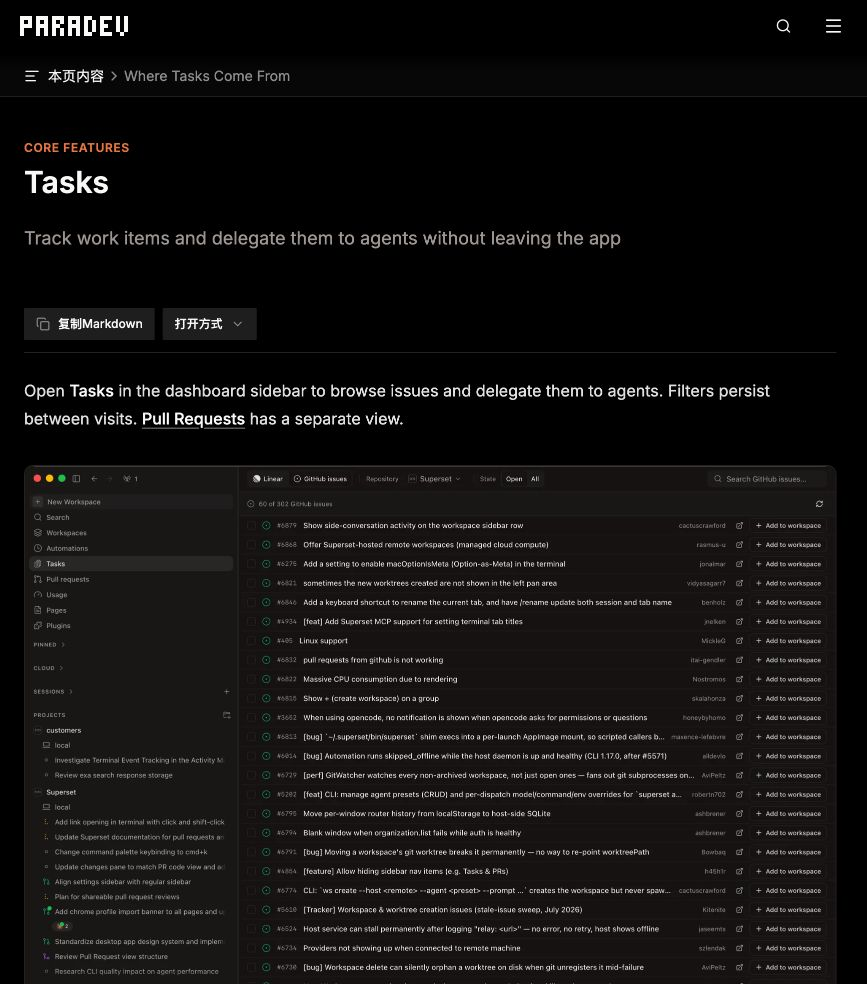
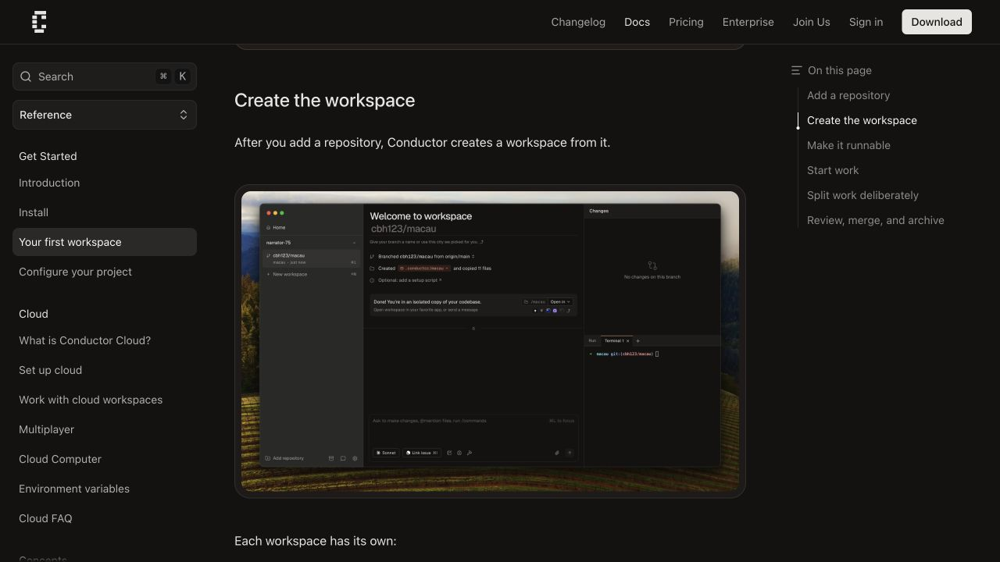

# 工作流工作台：同类产品生命周期与交互研究

日期：2026-10-27（Asia/Shanghai）。性质：架构方案的研究附件，不是安装选型结论或已完成的产品可用性测试。

关联主文档：[架构设计与实施方案](2026-10-27-workflow-workbench-architecture-and-plan.md)。本轮仅研究公开一手资料并修改文档，没有实现插件、安装产品、创建外部资源或操作真实云效数据。

## 1. 研究结论

任务、执行会话、工作区与交付需要独立建模。几个产品的共同做法是将任务内容送入一个有明确代码上下文的执行单元，再通过差异、反馈和 PR 进行人工审查；看板上的 Agent 活动或 PR 状态通常是组合投影，不能直接作为需求验收阶段。

对本产品最有价值的交互是：任务转执行前的输入与工作区准备、任务详情内的关联资源、需要用户处理的注意力入口、差异反馈回到准确会话，以及在关闭/归档前区分代码集成与业务完成。具体采用方案见第 5 节；这些是本次设计判断，尚未通过用户测试。

## 2. 证据边界与版本

| 产品 | 本轮证据 | 不能据此声明 |
| --- | --- | --- |
| Vibe Kanban | 官方文档、退出公告、公开源码 `a019cebf0693f787ef0f8dc2bb8d37edd35527ac` | 当前托管服务可用；本插件能够复现其原生 Agent 管理 |
| Conductor | 官方工作区、工作流、Cloud 与 API 文档；官方文档页面中的界面截图 | 内部数据库结构；当前账户或本机执行效果；纯本地产品 |
| Superset / Paradev | 本轮访问 `docs.superset.sh` 跳转 `docs.paradev.com`；官方编辑链接指向 Paradev 仓库；源码 `2c586e1c6c8d4a9f78c5dd1f38fa1c11837bf773` | 两个名称下所有历史版本具有相同行为；任务数据全部在本地 |
| Linear | 官方 Agent、Issue 属性和 Release 文档；公开 AgentSession 界面参考 | 本地离线能力；其 SaaS 交互可直接作为四桌面插件 API 使用 |

查阅的是本轮可访问的上游资料。源码与文档不一致时保留差异，不把某个开发分支说成已经发布的客户端行为。公开截图来自官方文档，下面的截图是本轮浏览该文档时保存，属于视觉参考，非本机安装产品后的操作实拍。

Vibe 的[2026-04-10 官方公告](https://www.vibekanban.com/blog/shutdown)明确说明公司关闭、项目继续开源维护，远程 issues/comments/projects/organisations 服务拟于 30 天后撤除，本地工作区继续使用。仍可访问的 Cloud 文档保留历史设计价值，不能单独证明当前云端服务可用。本研究不推荐依赖该远程服务。

## 3. 各产品如何组织生命周期

### 3.1 Vibe Kanban：任务、工作区、会话和进程分层

冻结源码中的 TaskStatus 包含 Todo、InProgress、InReview、Done、Cancelled；Workspace 的 task_id 可为空，同时有自己的 archived、pinned、worktree_deleted。Session 归属 Workspace，ExecutionProcess 再归属 Session，进程状态与任务状态分别保存。[Task 模型](https://github.com/BloopAI/vibe-kanban/blob/a019cebf0693f787ef0f8dc2bb8d37edd35527ac/crates/db/src/models/task.rs#L14)、[Workspace 模型](https://github.com/BloopAI/vibe-kanban/blob/a019cebf0693f787ef0f8dc2bb8d37edd35527ac/crates/db/src/models/workspace.rs#L42)、[Session](https://github.com/BloopAI/vibe-kanban/blob/a019cebf0693f787ef0f8dc2bb8d37edd35527ac/crates/db/src/models/session.rs#L23)、[ExecutionProcess](https://github.com/BloopAI/vibe-kanban/blob/a019cebf0693f787ef0f8dc2bb8d37edd35527ac/crates/db/src/models/execution_process.rs#L43)

一个工作区可关联多仓库，各仓库有独立目标分支；同一工作区内可以有多个会话，共享文件但不共享对话历史。这比“一个任务一个会话”更适合复杂研发。[仓库关系](https://github.com/BloopAI/vibe-kanban/blob/a019cebf0693f787ef0f8dc2bb8d37edd35527ac/crates/db/src/models/workspace_repo.rs#L12)、[官方会话说明](https://www.vibekanban.com/docs/workspaces/sessions)、[多仓库说明](https://www.vibekanban.com/docs/workspaces/multi-repo-sessions)

合并接口按选定仓库处理，登记 Merge 记录，并对未固定的工作区执行归档。它展示了工作区整理与代码集成之间的联系，但不能据此推出所有关联仓库、文档和业务验收都已完成。[合并路径](https://github.com/BloopAI/vibe-kanban/blob/a019cebf0693f787ef0f8dc2bb8d37edd35527ac/crates/server/src/routes/workspaces/git.rs#L179)

**采用判断**：借鉴多仓库、会话与进程分层和差异反馈；保留本产品独立的阶段验收。工作区归档不作为本地任务完成规则。

### 3.2 Conductor：工作区是委派单元，分支/PR 是集成单元

官方模型是一个 Project 对应一个仓库，Workspace 对应一个分支和 Git worktree，一个工作区可以承载多个会话和进程。原生流程围绕准备环境、执行、验证、差异审查、检查、PR 和归档展开。[工作区模型](https://www.conductor.build/docs/concepts/workspaces-and-branches)、[首次工作区](https://www.conductor.build/docs/first-workspace)

官方工作流特别把 Diff Viewer 评论转回 Agent 的输入，并在集成前汇总检查；归档后的工作区可以从 History 恢复。这里的生命周期以一条可审查代码流为中心，不等同于完整需求阶段。其 Cloud 使用独立的远程执行环境，本研究只借鉴本地工作区与反馈交互。[工作流](https://www.conductor.build/docs/concepts/workflow)、[Cloud 边界](https://www.conductor.build/docs/cloud)

**采用判断**：借鉴“准备事实可见→执行→反馈→检查”的连续工作区；本产品跨仓 Task 继续使用 WorkspaceSet，不照搬单仓 Project 的限制。

### 3.3 Superset / Paradev：任务入口、工作区看板和 Agent 活动分开

当前 Tasks 文档提供 Linear、GitHub 和原生任务入口；任务内容经模板成为 Agent 输入，可选择立即执行或先准备命令。Tasks 与 PR 是不同页面，列表/看板及筛选并存。[任务入口](https://docs.paradev.com/tasks)

冻结源码中，组织 Task 使用 PostgreSQL 模型，Host 的 Workspace 使用 SQLite；因此“工作区本地运行”不能推导“所有任务信息都只在本地”。Linear live router 直接读写远端 Issue，须与导入原生 Task 的机制区分，不笼统描述成一套完整离线双向镜像。[任务 schema](https://github.com/paradevai/paradev/blob/2c586e1c6c8d4a9f78c5dd1f38fa1c11837bf773/packages/db/src/schema/schema.ts#L204)、[工作区 schema](https://github.com/paradevai/paradev/blob/2c586e1c6c8d4a9f78c5dd1f38fa1c11837bf773/packages/host-service/src/db/schema.ts#L231)、[Linear live router](https://github.com/paradevai/paradev/blob/2c586e1c6c8d4a9f78c5dd1f38fa1c11837bf773/packages/trpc/src/router/integration/linear/live.ts#L53)

工作区看板由归档、PR、Agent 与环境状态计算列；本轮源码有 Finished · unread 等七种结果，与文档六列描述存在差异。这是注意力/集成投影，不是需求、设计、开发、验证阶段。[看板推导](https://github.com/paradevai/paradev/blob/2c586e1c6c8d4a9f78c5dd1f38fa1c11837bf773/apps/desktop/src/renderer/routes/_authenticated/_dashboard/v2-workspaces/utils/deriveBoardColumn/deriveBoardColumn.ts#L77)、[工作区说明](https://docs.paradev.com/workspaces)

官方 Agent 状态说明使用启动包装与生命周期 hooks，并指出状态观测范围受启动路径和 Agent 支持影响。它控制自己的终端和启动流程，这不等于第三方插件能控制已经打开的 Codex、Claude 或 ZCode 会话。[状态观测](https://docs.paradev.com/agent-status)、[原生 Agent 会话](https://docs.paradev.com/agent-sessions)

**采用判断**：借鉴任务到工作区的动作、保留筛选、注意力投影；本产品任务与同步记录仍全部本地存储，不照搬云数据库或修改宿主全局 hook 的方式。

### 3.4 Linear：业务 Issue 与 Agent Run 独立表达

官方 AgentSession 表达一次 Agent 活动，包含待处理、执行、等待输入、结束、错误和失联等状态，并可提供链接跳回具体外部会话。用户从 Issue 进入执行上下文，Agent 活动与 Issue 生命周期没有被压成一个状态。[Agent 交互模型](https://linear.app/developers/agent-interaction)

Release 文档明确提醒 Done 不必然代表客户已可使用，建议需要时把合并后的 Merged 与发布后的 Done 分开。对本产品而言，验证通过、代码集成和外部业务完成也应由独立证据定义。[Release 与状态自动化](https://linear.app/docs/releases)

**采用判断**：借鉴关联会话入口和可读的活动反馈；四阶段与权威任务状态仍由本地工作流维护。Linear 是云服务参照，不作为本地存储实现方案。

## 4. 统一得到的生命周期模型

| 事实 | 本产品归属 | 避免的误用 |
| --- | --- | --- |
| 目标、范围、业务流程 | Task + WorkflowInstance | 云效状态变化直接覆盖所有本地阶段 |
| 某阶段材料和验收 | StageRun + ArtifactVersion | 文档生成或 Agent 说完成就自动通过 |
| 一次执行与重试 | AgentAttempt + 原生轮次 | 进程退出等同研发完成 |
| 持久会话及当前上下文 | SessionRef + 活动绑定 | 会话标题、最近会话或 cwd 代替准确身份 |
| 代码和运行环境 | WorkspaceSet + RepositoryWorkspace | 创建 worktree 就假定现有 Agent 已改目录 |
| 代码集成与交付 | DeliveryRef | PR 已合并就自动满足所有需求和发布条件 |
| 外部协作事实 | ExternalItem + SyncOperation | 本地完成、远端已同步及未知结果混成一条成功消息 |

这些是架构上的分层，不要求用户理解七套技术状态。界面围绕“进行到哪里、现在谁在做、需要我做什么”组织信息，技术标识放详情。

## 5. 值得采用的交互及对应操作

### 5.1 任务列表到工作区：准备与发送分开

本轮查看的 Paradev 官方任务页示例显示来源切换、筛选、搜索及逐行 Add to workspace。其文档说明可选择项目、Agent 和是否自动执行。可借鉴为：选择任务→预览阶段输入→选择/复用工作区与会话→准备→发送。[公开任务参考](https://docs.paradev.com/tasks)

上图为官方文档页截图，未在本机安装 Paradev。对本产品，来源列表的查看不自动导入所有记录，任务准备也不自动运行；用户配置过的默认选项可复用，减少重复选择。

### 5.2 工作区内让准备、会话与变更同时可见

本轮查看的 Conductor 首次工作区示例在同一上下文内放置准备清单、会话、代码变更和终端。用户能先确认执行环境，再继续工作。[公开工作区参考](https://www.conductor.build/docs/first-workspace#create-the-workspace)

上图同样来自官方文档。对本产品，任务详情展示已绑定分支/工作区与当前会话，阶段结果旁直接打开文档和验证报告；窄侧栏按阶段聚焦，不将完整 IDE 塞进所有宿主。

### 5.3 注意力入口与阶段进度分别呈现

Paradev 的活动条和提醒强调执行中、等待用户和未读结果；Linear 的 AgentSession 提供等待输入及外部会话入口。[活动与提醒](https://docs.paradev.com/agent-status)、[会话链接](https://linear.app/developers/agent-interaction#session-external-url)

本产品采用“待我处理”列表，聚合需要答复、结果待验收、验证失败、同步冲突。点击通知回到准确任务和阶段；标已读只清除注意力提示，不改变验收，不释放未知执行占用。

### 5.4 从差异或文档反馈回到准确会话

Conductor 官方工作流将行内差异反馈作为可发送给 Agent 的上下文。借鉴为在文档、验证报告或宿主已有 diff 中选中内容，生成带来源和版本的阶段反馈，再交给该阶段的准确会话；不向“最近打开”的会话发送。[差异反馈流程](https://www.conductor.build/docs/concepts/workflow#verify-review-and-resolve-conflicts)

对于不支持读取选区或原生 diff 的宿主，先提供引用文档/文件与反馈文本的路径，清楚标明能力差异。此处是反馈交接，不直接批准代码、合并或阶段通过。

### 5.5 同步差异与人工恢复有明确出口

双向同步的交互属于本产品建议，不能从同类产品一个在线编辑页面推导其已经解决离线冲突。用户应看到本地期望、最近远端值、同步基线及待发修改，并选择保留/合并/放弃；未知结果单独处理，不用无限 loading 表达。

当前方案提供保留暂停、解除绑定保留记录、或明确人工风险接受后的重新同步。它们都不伪造请求成功，适用边界见主文档第 10 节。

## 6. 交互优先级与验证任务

| 优先级 | 拟采用内容 | 用户收益 | 需要验证 |
| --- | --- | --- | --- |
| 首个闭环 | 任务详情的阶段主操作、资源卡、输入预览和执行目标 | 能从需求直接进入设计、开发和验证 | 用户能否辨认正在操作的会话、分支与阶段 |
| 首个闭环 | 待我处理、结果待验收与错误入口 | 不必逐个会话询问进度 | 已读、已结束和已验收是否容易混淆 |
| 首个闭环 | 任务/分支视图互相定位 | 从业务目标或代码现场均能找到另一端 | 浏览是否触发意外 checkout 或发送 |
| 首个闭环 | 外部字段差异和同步结果 | 可靠修改云效并处理冲突 | 用户是否能区分本地保存和远端成功 |
| 后续增强 | 行内反馈、命令面板和批量准备 | 降低反复复制上下文的成本 | 是否有准确来源和逐项动作范围 |
| 后续评估 | 通用拖拽流程编辑、完整 diff IDE | 更强定制与审阅能力 | 真实需求是否足以覆盖维护成本 |

后续界面走查至少验证五个任务：从云效导入并澄清；找到并修改对应设计文档；在隔离工作区启动开发；处理失败验证并返工；在账号切换/同步未知时辨认并恢复正确操作。当前没有用户访谈、执行计时或可用性测试结果，不给这些交互编造效率数字。

## 7. 不照搬的能力与研究限制

- 独立桌面应用能控制自己的终端和启动环境；四端插件只能使用宿主开放的能力，不能照搬其新建进程或全局 hooks 方案。
- 本地代码执行、离线工作区和全部产品数据本地化是不同事实。每种来源和状态都要按自己的存储、授权与网络边界判断。
- 工作区看板可能按 Agent/PR/未读推导列，而本产品四阶段需要材料和验收；直接套同一状态机容易误推进。
- Vibe 官方退出公告与仍可访问的 Cloud 文档、Paradev 文档列数与当前源码均存在时间/版本差异，本研究明确保留这些差异。
- 本轮只查看公开文档、官方界面素材和部分源码，未登录产品完成端到端任务；因此属于产品与技术研究，不宣称完整 UI 审计、易用性通过或原生宿主验收。

下一轮视觉设计应从本产品已确认的任务和宿主尺寸出发，使用这些参考进行设计走查；本轮不创建界面代码、原型服务或新的生成示意图。
