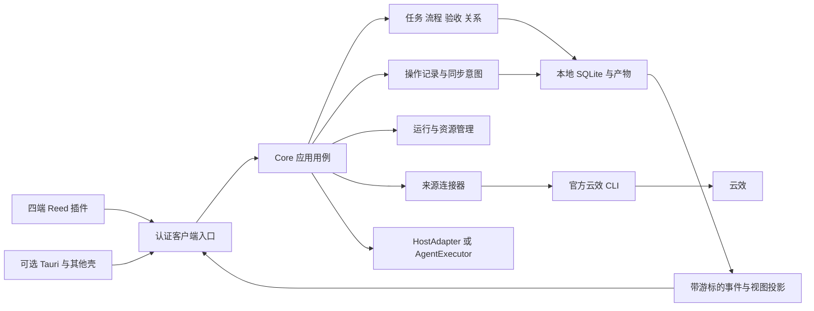

# Reed：借鉴 Orca 的运行与协作机制参考设计

日期：2026-10-29（Asia/Shanghai）。状态：独立参考提案，供后续技术设计与实施评审；没有对应实现或运行验收。

本文保留 Reed 的本地优先研发工作台定位，细化 Core 生命周期、资源回收、操作重试、会话与分支关联、云效同步。Orca 提供工程机制参考，不作为 Reed 的业务模型、宿主能力或性能成绩证明。

## 1. 文档地位与产品边界

### 1.1 与既有设计的关系

- [现行架构与实施方案](2026-10-27-workflow-workbench-architecture-and-plan.md)继续作为整体架构、工程归属、两步安装、四端验证和资源预算的基线；本文不覆盖或直接变更其中的决策。
- [业务领域模型](../../plugins/reed/docs/design/2026-10-28-reed-business-domain-model.md)继续拥有 Task、ScopeRevision、WorkflowInstance、StageRun、AgentAttempt、Acceptance、CompletionDecision 与外部同步的业务语义。
- [业务操作流程](../../plugins/reed/docs/design/2026-10-28-reed-business-operation-flows.md)与[交互设计](../../plugins/reed/docs/design/2026-10-28-reed-interaction-design.md)继续约束产品操作。本文补充故障、并发和恢复时如何保持这些语义。
- 本文是下一轮设计的候选输入，后续采纳时逐条登记与原决策的对应关系；有差异时先提交明确变更，不通过本文静默替换原方案。本文暂存在 ai-code，未来随产品设计材料迁入独立 Reed 工程。

### 1.2 保持的产品选择

| 选择 | 本文约束 |
| --- | --- |
| Reed 是任务驱动的研发工作台 | 组织需求、设计、开发、验证及其产物；不因参考 Orca 而扩展成完整 IDE |
| 独立 Reed 工程 | 拥有 Core、共享 React UI、Tauri、来源连接器、执行契约与产品数据 |
| ai-code 的 Reed 插件 | 仅拥有 Codex、Claude Code、ZCode、DeepSeek Harness 的薄适配与市场发行 |
| Tauri 是可选壳 | 任何受信任客户端都可连接 Core；从未打开或卸载 Tauri 后，插件仍可使用已安装 Core |
| 两步安装 | 先安装用户级 Core，再分别安装需要的宿主插件；插件不偷偷安装另一套服务 |
| 本地数据 | 同 OS 用户、同 profile 共用一个 Core 写入者；任务、证据与凭据独立于插件缓存和 Tauri 安装目录 |
| 云效首个来源 | Core 通过已验证的官方 CLI 适配访问；MCP 是可选客户端通路，不是云效同步或生命周期的前提 |
| 双向 Agent 集成 | HostAdapter 负责宿主内使用 Reed；AgentExecutor 负责 Reed 外派执行，二者不能互相冒充 |

## 2. Orca 参考证据与采用方式

本轮依据本地 `/Users/zhouze/Documents/git_projects/orca` 源码，HEAD 为 `c56d97bf0563bf4260ba41081b3085e28440c851`，检查时工作树干净。下列链接固定到该提交，方便后续定位；本轮没有启动 Orca、运行其测试或测量资源。测试文件中的断言表达作者的验证目标，不表示本机已经通过。

| 证据 | 观察到的机制与源码入口 | Reed 的采用范围 |
| --- | --- | --- |
| O01 | [运行时退出与 profile 所有权](https://github.com/stablyai/orca/blob/c56d97bf0563bf4260ba41081b3085e28440c851/src/main/orcad/orcad-lifecycle.ts#L130)、[实例锁](https://github.com/stablyai/orca/blob/c56d97bf0563bf4260ba41081b3085e28440c851/src/main/orcad/orcad-instance-lock.ts#L119) | 单写入者、精确实例识别、写入者停止后再释放锁；不复制 Electron 生命周期 |
| O02 | [空闲探测器](https://github.com/stablyai/orca/blob/c56d97bf0563bf4260ba41081b3085e28440c851/src/main/orcad/orcad-idle-exit-monitor.ts#L54) | idle/busy/unverifiable 三态探测、连续安静期；按 Reed 自有工作定义阻塞原因 |
| O03 | [终端视图清理](https://github.com/stablyai/orca/blob/c56d97bf0563bf4260ba41081b3085e28440c851/src/renderer/src/components/terminal-pane/terminal-pane-mount-cleanup.ts#L89)、[Agent 休眠资格](https://github.com/stablyai/orca/blob/c56d97bf0563bf4260ba41081b3085e28440c851/src/renderer/src/lib/agent-hibernation-pane-eligibility.ts#L50) | 先卸载视图与重订阅，进程回收另判；不假设四个宿主都支持休眠 |
| O04 | [操作回执存储](https://github.com/stablyai/orca/blob/c56d97bf0563bf4260ba41081b3085e28440c851/src/main/runtime/orchestration/db/mutation-receipts/mutation-receipt-store.ts#L35)、[重启后的未知操作](https://github.com/stablyai/orca/blob/c56d97bf0563bf4260ba41081b3085e28440c851/src/main/runtime/rpc/orchestration-mutation-executor.ts#L177) | 请求身份、输入哈希、持久回执与原操作核查；不承诺远端 exactly-once |
| O05 | [Task 与活动 Dispatch 约束](https://github.com/stablyai/orca/blob/c56d97bf0563bf4260ba41081b3085e28440c851/src/main/runtime/orchestration/db/tasks/task-status-transition.ts#L20)、[Worker 报告结算](https://github.com/stablyai/orca/blob/c56d97bf0563bf4260ba41081b3085e28440c851/src/main/runtime/orchestration/db/dispatch-context/worker-report-settlement.ts#L93) | 学习分层执行与旧结果拒绝；Reed 仍将执行完成、验收和 Task 完成分开 |
| O06 | [附件及会话来源](https://github.com/stablyai/orca/blob/c56d97bf0563bf4260ba41081b3085e28440c851/src/shared/worktree/types.ts#L13)、[稳定工作区身份](https://github.com/stablyai/orca/blob/c56d97bf0563bf4260ba41081b3085e28440c851/src/shared/worktree/identity.ts#L3)、[关联增量合并](https://github.com/stablyai/orca/blob/c56d97bf0563bf4260ba41081b3085e28440c851/src/shared/workspace-attachment-mutation.ts#L15) | 稳定本地 ID、带来源的关系、多客户端增量更新；不复制各平台专用字段不断扩张的结构 |
| O07 | [worktree 准备与最终提交](https://github.com/stablyai/orca/blob/c56d97bf0563bf4260ba41081b3085e28440c851/src/main/git/worktree-create-preparation.ts#L34)、[删除前检查](https://github.com/stablyai/orca/blob/c56d97bf0563bf4260ba41081b3085e28440c851/src/main/git/worktree-removal-preflight.ts#L13) | 可追踪准备操作、归属核验、失败清理和删除预检；首版不照搬预热 worktree 池 |
| O08 | [数据库版本与完整性检查](https://github.com/stablyai/orca/blob/c56d97bf0563bf4260ba41081b3085e28440c851/src/main/persistence/profile-state/profile-state-database.ts#L42) | schema/profile 检查、事务迁移、拒绝旧程序写新 schema；迁移只属于 Core 管理入口 |
| O09 | [Linear 写入分类与回读](https://github.com/stablyai/orca/blob/c56d97bf0563bf4260ba41081b3085e28440c851/src/main/linear/linear-issue-write-support.ts#L85)、[看板状态同步](https://github.com/stablyai/orca/blob/c56d97bf0563bf4260ba41081b3085e28440c851/src/renderer/src/components/sidebar/workspace-board-task-status-sync.ts#L84) | 失败/未确认分开、避免旧意图覆盖新意图；Reed 的 outbox、仲裁与恢复放在 Core |
| O10 | [规模化性能报告门禁](https://github.com/stablyai/orca/blob/c56d97bf0563bf4260ba41081b3085e28440c851/config/scripts/run-terminal-scale-perf-report-gate.mjs#L93)、[UI 反馈规则](https://github.com/stablyai/orca/blob/c56d97bf0563bf4260ba41081b3085e28440c851/docs/STYLEGUIDE.md#L68) | 可执行预算、真实阶段反馈及不夸大的状态文案；保留 Reed 已确认的视觉样式 |

O04 的持久回执机制覆盖其明确登记的操作集合，不能据此推导 O09 的 Linear 写入全部拥有同样保障。O09 的看板队列在 renderer 内按 worktree 排队，也不是跨客户端、跨连接的持久同步仲裁器。本文以下规则是 Reed 的设计要求，不是对 Orca 已实现范围的扩张描述。

## 3. 最小运行结构与责任

这些是同一 Core 内的职责，不增加微服务、通用调度平台或另一套工作流引擎。

| 职责 | 负责 | 不负责 |
| --- | --- | --- |
| 稳定启动/管理入口 | 可信版本选择、profile 发现、启动竞争、显式停止与维护控制 | 数据库领域写入、随意装包或执行来源内容 |
| Core 生命周期管理 | 服务代际、准入、恢复、空闲退出、收敛后释放所有权 | 因窗口关闭取消任务，或凭心跳失联接管活进程 |
| 应用用例与持久操作记录 | 业务前置条件、幂等、事务、外部效果记录、恢复入口 | 在数据库事务中等待 Agent/CLI/网络 |
| 资源管理 | 精确记录受管理资源及所有者，控制订阅、占用与清理 | 接管宿主全部会话，按进程名批量结束 Agent |
| 同步协调 | 持久意图、对象级仲裁、前置条件、冲突和结果核查 | 将本地状态与云效状态压成一个字段 |
| 客户端投影 | 本地筛选、抽屉、导航、可用动作、事件缺口恢复 | 保存第二份业务权威、独立轮询并回写云效 |

## 4. Core 生命周期与单写入者

### 4.1 状态与准入

| 状态 | 允许的行为 | 退出条件 |
| --- | --- | --- |
| stopped | 管理入口读取停止原因和已激活版本；按策略接受显式启动 | 未处于显式停止/维护，且取得 profile 排他所有权 |
| starting | 校验制品、私有 IPC、profile 与 schema；发布启动诊断 | 运行身份及数据库检查成立，进入恢复 |
| recovering | 展示恢复状态；核查未决操作、会话和资源 | 全局恢复完成；个别受影响对象可继续受限 |
| ready | 仅开放已安全恢复且协商兼容的能力 | 空闲退出、用户停止、升级或故障 |
| draining | 拒绝新派发及新增业务写入；允许在途结果入账、查询和受控取消 | 受管理写入停止，状态刷盘，资源处置满足退出原因 |
| maintenance | 管理入口独占升级/恢复流程，客户端只读诊断 | 原方案中的迁移和激活检查通过 |
| faulted | 提供故障与恢复入口，拒绝不安全写入 | 核实实际持有者/schema/副作用后显式恢复 |

`ready` 不是“端口已监听”。必须完成认证、schema 检查、全局恢复屏障，且可安全查询和执行允许的用例。单个来源写入未知可以只阻塞该外部对象，不把整个本地工作台无限锁死；全局数据所有权或完整性不明则不得开放业务写入。

### 4.2 发现与同时启动

1. 客户端先读取私有安装登记和 profile 控制状态，检查显式停止/维护标记，再尝试连接已有 Core；控制状态存在时，旧连接也不能继续新增不允许的工作。
2. 握手验证真实服务身份、profile、服务实例代际和协议/能力范围。长期引导凭据不进入页面、URL、提示词或日志；loopback 可连不等于已认证。
3. 无实例时，由固定启动入口竞争 OS 用户/profile 排他所有权；胜者启动，其他请求有限退避等待同一实例，不各启一个 Core。
4. 锁记录包括进程身份与服务实例随机标识；实际互斥必须依赖平台验证过的排他机制。文件存在、PID、端口、心跳或超时都不能单独证明可接管。
5. 服务在完成必要恢复后发布可用状态。旧代际响应只可归档到原操作；客户端不得用它更新新代际的活动绑定。
6. 版本不兼容时给出诊断和相应组件的更新入口，不另外启动旧 Core 写同一数据根。

排他运行锁保护活跃写入者；短期安装/激活控制锁保护版本选择与维护元数据。两者责任不同，不在每个业务方法外重复套一组分布式锁。PID 复用、启动中崩溃、旧进程延迟退出以及两个客户端同时拉起均须故障注入。

### 4.3 三种离开方式

| 动作 | 行为 |
| --- | --- |
| 关闭某个 Reed 页面 | 释放该页面订阅与视图缓存；保留操作记录和执行所有权 |
| 完全退出 Tauri | 移除 Tauri 连接、专属 WebView 与进程；不停止 Core、宿主会话或已接纳执行 |
| 明确停止后台 | 持久记录停止意图，阻止启动器/hook 自动拉起；先处置受管理活动，再停止 Core；用户明确恢复后才启动 |

按需运行、登录后启动和后台同步常驻沿用原设计的不同选项。静态注册的 MCP 代理、普通保活心跳以及持久化任务处于“进行中”本身，不无限延长 Core 存活。

### 4.4 空闲与退出交错

沿用原设计的默认 **60 秒空闲 + 随后 5 秒退出**预算。探测连续满足以下条件：无活动客户端租约、应用用例、Core 拥有的 Agent/工具进程、本机在途远端写入、迁移/备份或未完成产物落盘；后台同步/常驻未启用。探测返回 busy 或 unverifiable 都重置安静期。

进入 draining 必须与业务准入串行：切换准入代际后再次核对活动记录。请求在准入关闭前已被接纳，就必须计入 drain；关闭后到达的请求得到明确的稍后重连结果。空闲退出在尚未开始不可逆清理时可取消；用户停止和维护不能被普通重连取消。新实例始终等待旧实例完全释放所有权。

持久化的待发、冲突、unknown 记录并不自动要求常驻：本机效果源已停止且剩余核查可由下次启动恢复时，可安全退出并保留对象阻塞。若仍有本机子进程或结果落盘未结束，则不能把“已记 unknown”当作可退出证明。独立执行器能否在 Core 离开后持续持有执行，须单独验收，首版不默认成立。

### 4.5 停止顺序与崩溃恢复

先关闭新操作准入，再收敛应用操作及工具子进程，接收并持久化已到达的结果，停止事件入口和定时工作，完成最终刷盘，关闭存储，核对实例身份后撤销本代际发现记录，最后释放运行锁。清理不能删除后继实例的发现信息或释放其锁。已经接纳的工作必须获得结果或明确的恢复记录，不能因响应连接断开而消失。

清理失败时，不向新实例宣称数据根已经可写；重复 stop 共用同一次停止过程。强制进程退出留下的残留，必须在下一次取得真实排他所有权后核查。停止超时不是操作失败证明，也不证明远端停止。原方案中“有未收敛受管理 Attempt 时推迟首版升级”的约束继续有效。

从旧备份恢复是独立的人工管理流程，先保留恢复前数据与操作记录供核查，再核验实际执行和来源状态；不能把恢复数据库当作撤销备份之后的远端效果。恢复后的自动派发与 outbox 默认暂停，旧控制绑定重新确认，对照保留记录核对后才逐项恢复。若新近操作记录已经不可得，就明确证据缺口，不承诺从旧备份推导出完整的去重历史。

## 5. 资源回收与性能

### 5.1 分开记录资源状态与业务状态

资源至少记录稳定 ID、种类、真实所有者、创建操作、精确执行实例/代际、占用目的、最后可确认活动、回收条件和结果。持久资源与长期占用需要持久记录；短期视图订阅可在内存维护，但断开后必须整体释放。

| 层次 | 可回收内容 | 必须保留或另行判定 |
| --- | --- | --- |
| 页面不可见/关闭 | 编辑器实例、预览渲染、完整日志流、离屏 DOM、页面临时缓存 | 当前操作、任务历史、精简状态订阅按需保留 |
| 连接断开 | 该连接的订阅、临时能力和传输资源 | SessionRef 与历史关系；执行状态转为失联观察，不伪造结束 |
| Core 空闲 | Core 进程、内存缓存和不必要的后台定时器 | 本地持久操作、恢复记录、未核查占用 |
| Reed 自有执行结束 | 自有工具/执行进程、传输与有限日志缓冲 | 会话恢复引用、成果、验证和诊断历史 |
| 任务完成/归档 | 不自动回收代码资源 | worktree、分支、未推送提交及预览进程需分别处置 |

资源状态可表达 active、detached、reclaiming、reclaimed、unknown；其中 detached 仅表示视图/连接脱离，不等于进程已退出。占用记录只对 Reed 受管理写入负责，不宣称禁止用户终端或其他工具修改文件；实际执行/验收仍须核对代码快照。

### 5.2 所有权决定可回收能力

- 宿主原生会话由宿主管理。Reed 释放自身订阅，只有适配器提供并已验收精确停止能力、且本次授权允许时，才可请求取消其受管理执行；不因关闭 Reed 页面结束宿主进程。
- Core/AgentExecutor 创建的进程，保存精确进程实例及子进程归属。取消先发受支持的停止请求，再检查结果；超时升级只作用于已确认归属的实例，不按名称、cwd 或裸 PID 批量终止。
- 休眠不同于卸载 UI。只有执行器明确支持恢复、恢复信息已可靠保存、执行与关联派发均已收敛、没有待处理输入/子执行，且停止对象再次核对成功时，才可评估休眠。
- 首版必须实现视图/订阅释放及安全空闲退出；通用 Agent 休眠属于后续可选能力，不将 Orca 的 PTY 休眠直接搬成四端承诺。视图卸载不能代替长时间挂载下的内存增长检查。

### 5.3 有界数据与后台工作

任务列表、关联关系、事件与日志按游标分页；大文件分段读取，不能先全量读入再返回一页。分别限制事件积压、单页大小、实时尾随环形缓冲和历史页缓存。慢客户端超限后中断该订阅并提供重取投影的游标，不阻塞 Core，也不静默丢失关键业务事实。

断线后先核对服务代际与事件游标；游标过期/有缺口时重取权威投影，再订阅增量。事件用于通知，不取代 SQLite 中的状态。客户端越多不能增加同一来源的轮询频率；后台读取按 Connector/实际来源范围去重，并允许取消不再需要的只读查询。

### 5.4 验收口径

完整门槛引用原架构第 14.3 节 RSC01–RSC10，不在参考文另设一套较宽预算。重点保留 Core-only、四端闭面板、Tauri 完全退出、长日志持续挂载、20 次开关循环与后台同步场景；Node、薄代理、WebView、执行器、CLI 分列并报告整组资源。

将资源释放变成可验证的不变量：旧订阅数归零、页面专属实例销毁、无重复轮询、退出后无专属进程；同时测 footprint、CPU、延迟和增长，不能只凭对象数量下降判定内存通过。Orca 的门禁实现证明这种检查可工程化，不证明 Reed 已达到预算。

## 6. 操作记录、重试与未知结果

### 6.1 三类身份

| 身份 | 作用 |
| --- | --- |
| requestId | 一次用户/客户端意图的稳定请求身份；网络重传与查询恢复继续使用原 ID |
| operationId | Core 接纳后形成的持久操作；关联任务、目标、输入版本和恢复结果 |
| invocationId/外部调用记录 | 一次真实效果调用；记录目标实例、代际、调用是否可能发生及观察结果；一个 AgentAttempt 可产生多个调用 |

请求幂等键按 profile、已认证调用主体和 requestId 作用域识别；连接断开不改变调用主体。规范化输入哈希覆盖动作、业务目标、固定输入和前置版本，不包含凭据明文。相同键/相同输入返回原回执，相同键/不同输入拒绝。

不同客户端可能对同一阶段生成不同 requestId；幂等表不能防止这种重复。Core 必须在同一短事务内检查 expectedRevision、当前 StageRun、允许的 Attempt 数量以及会话/工作区占用，再接纳操作。两个窗口同时开始开发时，一个获得接纳，另一个看到既有操作或版本冲突，不各启动一次。

### 6.2 接纳与执行边界

1. 认证、能力、用户授权范围和业务前置条件检查通过。
2. 短事务内保存操作、固定输入/目标、业务变化、占用及待执行意图，并提交。接纳回执只证明 Core 已承担处理责任。
3. 真正调用前，在短事务内再次检查当前可执行性、目标绑定和对象占用，并原子保存“效果可能发生”的调用记录；事务外执行 CLI、宿主动作或 Git 操作。该点之后发生的新业务决定按已派发处理，不将调用当作尚未发送而直接丢弃。
4. 根据响应、精确宿主事件或远端核查结果，事务保存调用事实、业务投影与事件，再通知客户端。通知失败不回滚已提交事实。
5. 若重启发生在调用记录与结果提交之间，先核查原目标。没有“尚未调用”的可靠证明时，不把缺结果解释成可重发。

持久意图与业务更新需要原子提交；SQLite 事务不跨越外部调用。外部效果与本地提交之间不存在通用原子事务，操作记录解决可追踪与恢复，不提供外部 exactly-once 保证。

### 6.3 状态与重试决策

操作处理状态可表达 accepted、running、awaiting_confirmation、succeeded、failed、cancelled。领域 Attempt、同步意图及清理结果保留自己的状态，不共用此字段推导全部事实。`awaiting_confirmation` 不等于失败；“取消请求已接纳”也不等于 cancelled。

| 已知情况 | 允许的处理 |
| --- | --- |
| 同一请求仍在当前进程处理 | 复用原操作/结果，不重复启动；客户端可脱离等待 |
| 已提交最终结果，响应丢失 | 返回持久回执；需要刷新时只观察，不再次产生效果 |
| 能证明尚未发生外部调用 | 在原操作下有限退避重试，重查权限与业务前置条件 |
| 来源支持并已验证幂等键 | 只有在作用域、保留期及输入均匹配时，复用原键重试 |
| 调用可能发生但无可靠结果 | 进入核查；锁定相应效果目标，禁止重新发一遍碰运气 |
| 业务输入、授权或目标改变 | 不冒充原请求重试；保留旧操作，新意图另建并检查旧效果是否已收敛 |
| 用户取消等待/关闭页面 | 只停止该客户端等待，操作继续；真正取消使用独立的受控动作 |

重试次数、退避和截止时间有界；认证失败、权限不足、非法流转和业务冲突不走自动网络重试。回执历史须定义保留窗口；删除旧明细时保留必要去重墓碑，或通过 Core 可验证的请求有效期/命名空间拒绝旧请求，不能因回执被清理而把同一旧请求重新执行。仅有客户端随机 UUID 或客户端自报时间，不能证明一条缺失回执的请求从未执行或已经过期。

### 6.4 取消和新一轮执行

取消动作记录请求、目标和处理结果；原操作可能自然完成、失败、被取消或仍未知，按事实入账。旧 Attempt 未确认停止时，不释放准确会话和同一可写工作区供新 Attempt 使用。新阶段可以准备材料，但不得抢占。

Core 代际、连接租约失效都不是原生进程退出证明。恢复后以执行器真实查询能力核对；若无法准确关联或停止，则保留 unknown 和占用，提供继续核查/人工风险处置入口。人工处置记录其依据和风险，不改写成“执行成功”或“已确认停止”。

## 7. 会话、分支和工作区关系

### 7.1 身份与定位分开

| 对象 | 稳定身份与观察内容 |
| --- | --- |
| Task | 本地不可变 ID；不使用云效编号、会话标题或分支名充当身份 |
| SessionRef | 本地引用 ID + 宿主/运行实例命名空间 + 准确原生 session/thread ID；provider session ID 另存，不与传输/MCP session 混用 |
| 执行绑定 | Attempt、SessionRef、受信任适配器、当前服务/宿主代际、能力与实际 cwd；断开后重新核验控制权 |
| RepositoryRef | 选定代码库/本地 clone 的身份及经验证的定位；不能仅凭相同目录名或 remote URL 合并两个 clone |
| BranchRef | 本地引用 ID、RepositoryRef、完整 ref 名称、观察到的 tip 与存在状态；名称是定位信息 |
| RepositoryWorkspace | 稳定实例 ID、所属仓库、真实目录、创建操作及观察分支；重命名移动保留实例历史 |
| CodeSnapshot | 明确的提交/工作区内容版本与覆盖范围；脏工作区需记录可核查的差异和材料，不用 HEAD 假装全部内容 |

同名分支删除后重建、目录删除后复用，不能自动继承旧执行绑定或验收。身份连续性必须有可信迁移/改名证据；没有证据则标待确认，保留历史引用。宿主重启后会话是否仍为同一对象也由适配器证明，不能按时间、cwd 和标题猜测。

### 7.2 有类型的关系

每条关系记录两端稳定 ID、用途、所属 Task/StageRun/Attempt、建立方式、来源与确认者、有效/已解除/待确认状态及历史。常见用途包括需求来源、设计讨论、开发执行、验证执行、设计产物、代码交付和参考材料。

人工粘贴、可信适配器报告、用户主动选择、LLM 推断分开记录。推断先产生候选；人工链接可导航，但不授予发送、取消或终态上报权。一个会话历史上可关联多个任务；一次未收敛受管理 Attempt 只能占用一个准确原生执行上下文，同一上下文不能被另一 Attempt 同时控制。

外部对象身份不含连接显示名或凭据账号，连接作为访问路径单列。任务可以引用多个来源，但主回写目标与主导任务仍遵守原领域模型的一对一责任约束，不把引用数量扩张成多方竞争写入。

### 7.3 多窗口修改与双视角

任务页、分支页、会话页读取同一关系投影；改变查看视角不 checkout 分支、不切宿主会话、不启动 Agent。卡片在右侧抽屉打开，保留看板筛选、滚动和选中上下文；关闭抽屉释放自身重订阅。

关系增删优先发送明确的新增/解除意图，并带关系/集合修订；确需整表编辑时携带原始基线，由 Core 合并互不冲突的增量。相同关系的用途、主导权或执行目标冲突必须显式解决，不能通用地取并集。删除关系也不能删除未决操作、历史验收或同步事实。

### 7.4 开发准备与代码资源处置

worktree 创建作为独立操作，分为仓库预检、基线固定、目录准备、环境准备、最终登记和 Agent 交接。每一步记录准确拥有的资源；失败/取消时只清理本操作创建且仍归属自己的部分。首版不为了响应速度提前运行用户 hooks、创建预热池或复制 Orca 的全部 Git 能力。

创建成功不等于宿主会话已进入目录。交接前核对真实 cwd、repo、工作区实例、分支/代码快照及写入占用；不支持切换上下文的宿主应新建可确认目标或提供受限人工交接，不能标成自动隔离通过。

清理工作区是单独操作：检查未提交/未跟踪文件、未推送提交、子模块/嵌套仓库、活动受管理进程和产物引用；无法确认时不自动删除。任务完成、会话结束、关系解除或归档都不触发隐式删除，分支与目录分别记录清理结果。

## 8. Reed 工作流与看板流转

借鉴 Orca 的执行分层，但不采纳“Worker 报告成功即可完成 Reed Task”的语义。Reed 的链路仍为：固定范围/阶段输入 → 一次执行或人工提交 → 明确产物版本与证据 → 阶段验收 → 本轮完成决定 → 按规则生成同步意图。

拖拽、详情按钮、CLI 或 MCP 都调用同一 Core 用例。拖入“评审中”时检查必需产物、执行处置和可核查版本；拖入“完成”时核对当前范围、必要阶段/子任务验收、证据有效性以及 CompletionDecision。失败时保留原列，抽屉说明缺项和可执行的补齐动作，不只在前端禁用按钮。

个人看板是工作投影，保留待办、进行中、评审中、完成；阻塞/暂停、Agent 活动、交付、同步分别展示。云效已完成、PR 已合并、Agent 回答结束或用户读过材料，都不能替代上述检查。若阶段/范围已被新轮次替代，迟到结果归原记录，不覆盖当前阶段。

## 9. 云效连接器与同步责任

### 9.1 配置、身份和能力

Core 拥有 Connector 配置、凭据访问、CLI 调用和同步队列；插件只提供配置、检测与状态映射界面。中心版与 Region 版分别配置接入点/区域和 CLI profile，多个连接独立保存；发现本机配置只生成可编辑草稿，经用户确认才建立连接，不自动同步全部组织/项目。

连接检测先证明 CLI 程序及版本、接入点、认证主体和可访问范围，再选择组织/项目与映射。能否仅凭 Token 枚举组织、查询合法状态流转、携带条件版本或指定幂等键，必须按所选 CLI/服务版本实际验证；不可用时仅补问必要字段，不把配置界面上的模拟发现当作已验证能力。凭据不返回普通页面和 Agent 上下文。

外部对象规范身份沿用原设计的 provider、已识别实例、组织和原始 workItem ID；区域/接入点用于识别实际实例，项目放在观察与映射上下文，不因项目归属变化另建仲裁键。Connector ID 表达访问路径与访问主体。两个连接访问同一规范对象时共用写入仲裁，不因换账号或改连接名称变成两个不同对象；无法证明是同一实例的别名时先人工确认，不能盲目合并。若后续来源证明 ID 只在项目内唯一，先修订该来源身份契约并承接原队列和未决影响，不静默换键。

### 9.2 CLI 的受控执行

使用固定、核验过的官方 CLI 可执行路径与结构化参数，显式选择连接配置；不依赖用户当前 shell/profile，不提供任意 shell 字符串接口。按已验证能力选择有界 JSON 输出或明确的解析契约，限制 stdout/stderr、并发、执行时长，错误和审计均脱敏。具体命令与参数留待 CLI 能力验证后固定，不在参考文创造未核实接口。

读调用可取消/重试，但取消不伪造“读取成功”。写调用开始后，CLI 超时、断网、杀掉本机进程、输出不可解析或中断等待，都可能对应远端已执行；只有可靠证据证明未调用/未产生效果时才认定可安全重试。CLI 退出码为零先说明程序报告成功，仍按该命令已验证的响应/回读契约记录远端确认程度。

### 9.3 持久同步意图

SyncIntent 保存明确来源：Task、范围/流程轮次、CompletionDecision 或本次直接外部编辑决定、主回写关系、字段级自动/人工策略、映射版本、Connector/访问主体、规范目标、远端基线、本地期望、授权范围及顺序。真实派发形成不可变调用记录；核查证据追加保存。

本地业务决定与待发意图在同一事务提交；同步器从 Core 的持久 outbox 处理，不由任何页面直接读队列后回写。首版按规范外部对象串行化写入，即使来自不同 Connector、不同字段或不同窗口也共享一个顺序；读取可以去重并发。保守的对象级顺序避免状态/字段的跨字段约束被拆散，不预建复杂字段并行调度。

选取待发意图、核对前置条件与占用目标、记录调用开始在同一短事务中完成；占用与未知调用或未处置冲突关联并持久保存，不因内存队列重建、租约过期或重启被自动释放。首版无法证明独立的同对象写入均视为有依赖，后继改另一字段也不能绕过旧冲突；明确处置并采用新基线后再推进。该仲裁仅覆盖同一 profile 的 Reed 写入；其他 profile、机器和直接在云效修改的用户属于外部并发，仍受第 9.5 节的服务端能力边界约束。

| 同步处理状态 | 含义与下一步 |
| --- | --- |
| queued | 意图已持久保存、尚未调用；发送前重查依据、主导权、权限和基线 |
| dispatching | 已记录效果调用，可能触达远端；崩溃恢复不能直接重发 |
| awaiting_confirmation | 结果未知，持续核查或等待明确处置；相同对象后续写入受阻 |
| confirmed | 按适用契约确认该次写入结果；仍不代表本地任务已验收 |
| converged | 当前值与期望一致，只说明当前值；原调用仍可能需要核查，不能单凭此值释放未知调用阻塞 |
| conflict | 远端并发修改、流转条件或映射前置不成立，保留三方值和对象阻塞，明确处置后再检查后继意图 |
| rejected | 权限/业务/接口明确拒绝且已确认未产生该效果；修改条件后另建适用意图 |
| superseded/cancelled | 仅用于未派发且依据已失效/被替代的意图；已派发历史不改写 |

表中是处理阶段的参考描述，不要求将原架构的 pending/sending/unknown 等状态名称改成另一组枚举。尤其将“原调用是否收敛”和“当前远端值是否一致”保存为独立事实；展示 converged 不自动将 unknown 调用改为 confirmed。

### 9.4 派发前检查与映射

每次真实写入前，核对连接主体未变、意图未过期、主导关系仍适用、权限/授权仍有效、目标仍存在，以及所需远端版本和合法流转条件。仅自动规则意图要求对应字段的自动映射启用；人工外部编辑依据本次明确决定和远端基线校验，不能被它自己设置的自动映射暂停阻止。自动关闭意图必须引用仍能代表当前工作的具体 CompletionDecision，同范围重开也会使旧关闭意图重新判断。

映射固定来源实例/项目/工作项类型与状态 ID、规则版本，不按中英文显示名相等就自动回写。需求阶段与外部状态并非天然一一对应；多对一、不可逆或缺失映射须可见。LLM 只能提出带依据的映射/流转候选，由用户或明确规则采纳；执行时由确定性规则检查。

本地接受可生成外部期望；远端变化先更新 ExternalItem 观察和候选，不直接接受本地阶段。直接修改云效字段使用单独的外部编辑用例，并按原模型暂停该字段自动映射；这个入口不能被规则借用来绕过 Reed 验收。

### 9.5 拉取与字段冲突

保存远端原始状态/修订、观察时间、连接主体和同步游标；具备可靠增量接口时使用增量，没有时采用有重叠窗口、去重和周期对账的有界扫描。游标只在对应批次持久提交后前进，失败不跳过。删除、不可见、权限丢失分别观察，不因一次缺失就删除本地任务。

同步前比较远端基线 B、当前远端 R 与本地期望 D：

| 条件 | 处理 |
| --- | --- |
| R = B 且 D 不同 | 具备有效依据时可尝试条件写入；无条件写能力时仍有读取到写入间的竞态 |
| R = D | 记录当前一致；不推导原请求已成功、迟到副作用已结束或任意后续写入已安全 |
| R、B、D 均不同 | 对相同字段标冲突，不静默用本地覆盖远端 |
| 本地/远端改动字段互不重叠 | 仅在字段语义及服务约束允许时生成合并候选；列表、负责人和状态等不盲目拼接 |
| 状态不存在或流转不合法 | 保留原意图，刷新能力/映射并明确处置；不凭 UI 名称跳状态 |

若所选云效接口没有经过验证的条件写能力，先读后写不能阻止其他云效用户在间隙修改。此类能力标明限制；高影响状态采用更保守的人工确认或受控写入策略并回读，但人工确认同样不提供服务端 CAS。不得宣称已经消除并发覆盖，不能通过换成 MCP 获得不存在的服务端保证。

### 9.6 未知结果、过期意图与部分成功

已派发调用未知时，按原目标、主体和请求线索回查；有可靠请求记录/幂等契约则据此恢复。只看到远端值相同，无法证明原调用已终止；旧调用若可能迟到覆盖，继续阻塞同一对象，或在明确风险处置后才能推进后续意图。

沿用原架构第 10.4 节的三条路径：继续核查并暂停写入；解除绑定但保留未决记录；用户查看远端和待发差异后明确接受残余风险，形成独立处置决定。决定记录允许放行的对象、范围和队列位置；查询后续可发送项时必须考虑该决定，不能再次仅凭旧 unknown 将队列永久卡住。旧调用仍保留 unknown，放行不等于结果确认，后续漂移和迟到结果继续核对。

本地新期望可以保存，未发送的旧意图可被替代；已发送的旧意图必须保留并先核查。完成决定失效、同范围重开、映射升级或主导关系转移，都不能改变旧调用含义。旧写入后来成功时归原意图，不把当前 Task 改回完成；后续是否修正远端，基于新观察和新的明确决定，不自动“反向补偿”重开云效。

换 Token、改 Connector、解绑、删除配置或导入到另一台机器，均不清除未决对象阻塞。经核验属于同一主体的 Token 刷新可以保留连接、更新安全存储引用并继续核查，旧调用主体与历史不变。无法核验身份时先暂停写入；主体、组织或实例改变时新建连接，旧意图不自动迁移。凭据不可用时保留核查记录及安全诊断，不能静默换账号重发。

多字段、批次或多次 CLI 调用不假设原子性。保存每个已调用部分、确认字段及未决效果；成功部分不回滚成“从未发生”，失败部分不能无差别重放整个批次。当前值一致、人工接受风险和真实调用确认分别记录。

## 10. 恢复与交互表达

恢复使用同一批应用用例和持久记录，不另建只靠日志猜测的状态修复器。每个入口显示本地已保存内容、可能发生的外部效果、受影响对象、最后一次核查及允许的下一步；原始凭据和完整聊天不进入诊断导出。

| 场景 | 用户看到 | 合法动作 |
| --- | --- | --- |
| Core 恢复中 | 当前恢复步骤及受限能力 | 查看诊断、等待；不反复点“开始开发” |
| Agent 失联 | 最后确认活动、准确会话/工作区、状态未知 | 导航到原宿主、重新核查、受支持的取消与风险处置 |
| 工作区准备失败 | 已完成步骤、残留目录和具体错误 | 核查/重试未完成步骤、清理本操作资源 |
| 云效写入未确认 | 本地已保存，云效结果待核查；新期望与原调用分列 | 核查原写入、查看远端、按明确规则处置 |
| 同步冲突 | 基线、本地期望、远端当前值及变化原因 | 接受远端、按新基线重提本地期望或取消未发意图 |
| 看板条件不足 | 保留原列，列出缺少的材料/验收及其所属阶段 | 打开右侧抽屉补齐、执行验证或处理旧执行 |

“重试执行”“继续核查”“重新同步当前期望”是不同动作，不共用一个无说明的重试按钮。客户端重新打开时根据 operationId 重建状态；不将每次挂载变成再次提交，也不因后台操作结束抢走用户当前任务/分支视角。

## 11. 关键交错与责任检查

| 交错 | 必须保持的事实 | 对应机制 |
| --- | --- | --- |
| 四个插件同时发现 Core 未运行 | 一个写入者；无隐式 Tauri 窗口 | 运行锁、固定启动入口、协议/profile 握手 |
| 空闲检查刚结束，新开始请求到达 | 接纳的请求要么参与 drain，要么明确未接纳；不能丢失或双执行 | 准入代际与进入 draining 的串行检查 |
| 两个窗口同时开始同一 StageRun | 最多一个首版活动 Attempt；两个请求都可查询结果 | expectedRevision、领域约束、占用与操作原子接纳 |
| Agent 已开始，Core 在记录回执前崩溃 | 原执行可能仍在，重启不直接新派发 | 持久调用记录、准确实例核查、unknown 占用 |
| 两个窗口各自添加/解除不同关联 | 保留各自增量；主导和执行目标冲突不能自动合并 | 稳定关系 ID、原始基线、Core 合并/冲突用例 |
| 云效写入超时，另一 Connector 写同一对象 | 后者不能绕过旧未知结果 | 规范外部身份、对象级持久写顺序 |
| 完成关闭已发送，同范围任务重开 | 旧调用继续核查，当前任务不被迟到结果完成 | CompletionDecision 引用、不可变调用、当前轮次核查 |
| 远端已出现期望值，但原调用未结束 | 仅标当前一致，防止迟到旧写覆盖新写 | 结果确认与当前值一致分开，保持对象阻塞 |
| Desktop 退出，宿主正在执行 | Desktop 资源释放，执行与 Core 按各自策略继续 | 客户端订阅、执行所有权、Core 生命周期分层 |
| 分支同名重建或目录被复用 | 新对象不继承原控制权/验收 | 对象实例身份、历史观察与重新确认 |

## 12. 后续实施顺序与验收

### 12.1 作为原计划的细化输入

| 顺序 | 产出 | 必须先回答 |
| --- | --- | --- |
| RFP0 能力与边界验证 | 四端可信绑定、无 Tauri 启动、CLI 能力表、制品与数据根实验 | 谁能准确控制原生会话；CLI 的条件写/回查/停止证据有哪些 |
| RFP1 Core 运行骨架 | 单 profile 单写入者、准入、恢复、显式停止、客户端重连及事件游标 | 同时启动、空闲退出交错和崩溃能否安全恢复 |
| RFP2 操作与关系闭环 | 持久回执、StageRun/Attempt 约束、会话/工作区占用、双视角 | 响应丢失和多窗口提交是否不会重复执行 |
| RFP3 云效同步闭环 | Connector 身份、持久 outbox、主导/映射、冲突/未知处理 | 多连接、旧意图、部分成功与外部并发能否准确表达 |
| RFP4 资源与发行验收 | Tauri/宿主资源释放、完整 RSC 门禁、安装升级与跨仓组合验证 | 无桌面模式与长时间挂载是否都达到原预算 |

这些不是新增五个独立项目，也不替换原 P0–P8 排期。实现位置仍按原工程边界；在原阶段开始时采纳对应参考条目并补入该阶段的可执行验收。RFP4 不表示性能最后才做，RFP0 即建立基线，各阶段持续阻断回归。

### 12.2 最小验收场景

以下均为**待实现、待执行**场景，不是已有测试结果。故障注入、模拟来源与真实宿主/云效验收分别留证。

| 编号 | 场景与通过条件 |
| --- | --- |
| RF01 | 干净用户环境仅装 Core 与一个插件，从未安装 Tauri；在该端完成已声明能力，业务数据落到同一 profile |
| RF02 | 四端同时拉起、客户端版本不一致及启动中崩溃；无双写者，不兼容端不创建第二 Core |
| RF03 | 旧 PID 复用、锁内容不完整、心跳失联、旧实例延迟清理；不能误接管活写入者或释放新实例锁 |
| RF04 | 按需空闲退出、退出瞬间新请求、显式停止后 hook/自动重连；满足原时间预算且不越过停止/维护 |
| RF05 | 页面关闭、完全退出 Tauri、宿主崩溃分别演练；视图释放，操作历史及其他端能力不被取消 |
| RF06 | 长日志持续挂载及每端 20 次开关；订阅/缓存有界且满足 RSC，不能靠定期重挂载过关 |
| RF07 | 同请求重传、异输入复用、不同窗口重复开始；回执一致、冲突可见、只接纳一个首版活动 Attempt |
| RF08 | 在接纳提交、效果调用前后、结果持久化前后逐点崩溃；已提交操作可恢复，不盲目重发未知效果 |
| RF09 | 取消与自然结束竞态、Core 重启后的旧代际结果；原 Attempt 准确收敛，未确认时不释放写入占用 |
| RF10 | 同名会话、Fork、分支改名/重建、目录复用；不按标题/路径猜测身份，不继承旧执行权限 |
| RF11 | 两窗口并发增删关联；非冲突增量保留，主导/执行语义冲突要求处置；双视角一致且查看无 Git 副作用 |
| RF12 | worktree 创建失败/取消/被其他对象接管、目录脏及有子模块；不清理非本操作资源，残留可核查 |
| RF13 | 拖入评审/完成、CLI/MCP 直接调用及云效关闭输入；统一检查当前产物、验收和证据，无法绕过 |
| RF14 | 两个 Connector 访问同一对象、项目归属变化、同主体 Token 刷新及换主体；原仲裁/未决影响保留，同主体可继续核查，换主体不迁移旧意图 |
| RF15 | CLI 退出成功、超时、输出损坏、断网和进程被取消；分别判定确认程度，不把本机停止当远端撤销 |
| RF16 | 拉取分页/游标提交前后失败、重复页、权限丢失和对象删除；不跳数据、不重复导入、不误删本地 Task |
| RF17 | B/R/D 冲突、前序标题冲突后修改状态、人工编辑暂停自动映射及无 CAS 交错；后继不绕过冲突，人工意图不被自身暂停阻止，远端保证如实呈现 |
| RF18 | 关闭 queued/dispatching 时发生同范围重开、完成依据失效、映射变化和主导转移；过期未发意图被处置，已发调用保留核查 |
| RF19 | 当前远端值等于 D、随后迟到旧调用产生效果；当前一致不冒充调用确认，后续写入不被错误放行 |
| RF20 | 批次部分成功、回执清理后旧请求重放、旧备份恢复及人工风险放行；不整批重复写，证据缺口明确，已批准放行不被旧 unknown 永久卡住 |

### 12.3 验证材料与未决项

每份验收固定 Core、插件、UI、Tauri、宿主与 CLI/来源版本，记录 profile、程序制品/源码、负载与故障注入点。性能沿用原 RSC 方法；实际宿主、真实云效合法写入、远端回查与恢复行为分别出具证据，不能由模拟事件或包校验替代。

尚须验证的能力包括四端准确会话绑定/取消/终态事件、云效 CLI 的组织发现/条件写/可核查请求、三平台锁与进程树停止、无 Desktop 的凭据存取、SQLite 驱动与一致性备份。能力缺失时限制对应动作并如实呈现；不因此重定义 Reed 的业务完成或宣称整套适配已经落地。

本次交付仅新增本文，不修改原架构、领域、交互或 Demo；不初始化 Reed 工程，不新增运行时、API、数据库迁移、测试实现、安装项或发行配置。
