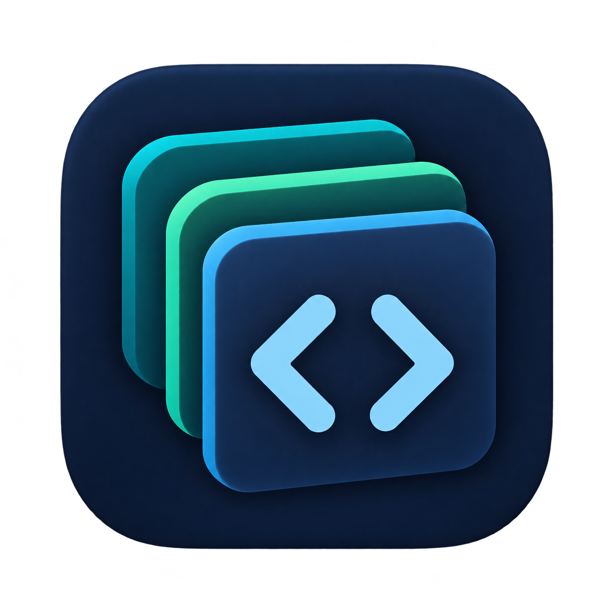

# CodeStack

[English](README.md) | 简体中文

CodeStack `codestack` 1.0.0 已发布，旧插件 ID 已退役。
[已发布记录](https://github.com/Zack-Zz/ai-code/blob/main/published/index.json)
是可安装版本的权威来源，已发行快照保持不可变。

CodeStack 为编码助手提供多个语言和技术栈中精选的项目规范，当前覆盖 Java 写法、
SQL/JPA/MyBatis 易错点及前端共享的多语言文案组织约定。插件 ID 为
`codestack`。正式版通过同一个 `ai-code` 市场分发，
可安装版本以[当前发行记录](https://github.com/Zack-Zz/ai-code/blob/main/published/index.json)为准。

## 安装

按宿主选择安装路径：[Codex 桌面端与 CLI](https://github.com/Zack-Zz/ai-code/blob/main/docs/installation.zh-CN.md#codex)、
[Claude Code 桌面端与 CLI](https://github.com/Zack-Zz/ai-code/blob/main/docs/installation.zh-CN.md#claude-code)、
[ZCode 桌面端与 macOS 应用内置 CLI](https://github.com/Zack-Zz/ai-code/blob/main/docs/installation.zh-CN.md#zcode)，或
[DeepSeek Harness 桌面端与独立 npm CLI](https://github.com/Zack-Zz/ai-code/blob/main/docs/installation.zh-CN.md#deepseek-harness)。

从共享的 `ai-code` 市场选择 `codestack`。

## 使用

通过宿主原生插件机制安装、启用后，直接描述普通开发或审查任务：

- “为已有 Java 类增加这个字段和访问方法。”
- “沿用生产构造方式，为这个服务增加测试。”
- “修复订单列表逐条查询客户信息的问题。”
- “审查这份 MyBatis Mapper 与 XML 的参数绑定。”
- “为这个支持多语言的 React 页面增加确认弹窗和操作反馈。”
- “审查这个多语言 Vue 表单的校验提示文案。”

`code-standards` 技能以相关任务自动选用为目标，也可以在需要时显式调用。
原生发现和实际行为需要在宿主中验证，安装成功不代表每次任务都会使用技能。
各插件分别安装。CodeStack 可以独立于 CodeVow 与 Agent Delegation 使用，无需依赖这两个插件。

## 具体要求

- 注释语言按用户要求、项目或模块语言、宿主或系统语言的顺序选择；英文规则不强制英文注释。
- 手写字段、方法、构造函数和参数完整写多行 Javadoc；方法内只注释核心逻辑。
- 特殊测试实例在测试类内部准备，不增加生产代码中的测试专用构造函数或变相入口。
- 优先复用适用的已有实现，同一业务规则集中维护；语义不同的实现保持独立。
- 业务类型和 Spring 组件优先顶级类型，确有具体必要性才保留嵌套，不迁移无关历史代码。
- SQL 访问有边界，禁止逐条查询及懒加载、并行或缓存兜底中的隐藏变体；成本结论需要相应证据。
- 按本次实际机制选择 JPA、MyBatis 规则，可以同时应用；MapStruct Mapper 或无关 XML 不代表 MyBatis。
- 前端产品已经支持或明确要求多语言时，本次涉及的固定用户可见文案必须收敛到独立、统一维护的语言资源区域，页面、组件和动作通过 key 引用。覆盖标签、占位符、可访问性文案、弹窗、校验和反馈；动态业务数据保持为数据。资源可以沿用既有国际化方案，按语言或业务域拆分。

前端约定由 JavaScript/TypeScript、React、Vue 等技术栈共用。单语言产品、仅涉及后端的
TypeScript 任务和不涉及文案的改动不因此引入国际化要求；Java 约定不泛化到前端代码。
没有额外获批规则时，不建立独立的 TypeScript、React 或 Vue 规则引用。

执行内容只有一个英文技能及按需读取的英文规则，不要求项目新增配置、AGENTS 指令、
运行时、Hook 或独立 Agent。沿用当前任务的工作流、工具与依赖；审查请求按授权范围报告发现。
本插件不提供排版规则、通用教程或超出明确支持范围的规则。这些是明确采用的项目约定；
行为改善和宿主自动选择需要实测证据，不能从规则文件存在推导。

## 资源与许可证

- [技能入口](skills/code-standards/SKILL.md)
- [Java](skills/code-standards/references/java.md)、[数据访问](skills/code-standards/references/data-access.md)、[JPA](skills/code-standards/references/jpa.md)、[MyBatis](skills/code-standards/references/mybatis.md)、[前端](skills/code-standards/references/frontend.md)
- [评测用例](evals/cases.md)：仅用于源码评测的输入和验收标准

执行资源按显式白名单打包，包括技能、规则、图标与许可证，并附带可移植的中英 README。
评测输入不进入安装包。正式发布与真实宿主验收分别报告。

[MIT](LICENSE)，维护者 Zack-Zz。

## DeepSeek Harness

插件包与[自定义市场索引](https://raw.githubusercontent.com/Zack-Zz/ai-code/main/published/dsh/index.json)均已发布。
桌面端自带 Node.js 与 pnpm，无需另行安装 npm CLI。桌面端与独立 npm CLI 步骤见
[Harness 安装指南](https://github.com/Zack-Zz/ai-code/blob/main/docs/installation.zh-CN.md#deepseek-harness)。
已发行包的 `engines.dsh` 与 DSH peerDependencies 均精确锁定 `0.2.1-rc.2`；
桌面端 `0.2.1-rc.3` 尚未被当前声明覆盖。真实桌面端、实际加载、自动选择、长会话和
生命周期验收仍待完成，构建和包检查不能代替宿主验收。技能使用官方 `/code-standards` 显式调用。两个插件通过各自的官方文件系统提供方读取包内资源，启停互不替代。

身份变更的卸载和重装步骤见[本次迁移说明](https://github.com/Zack-Zz/ai-code/blob/main/docs/migrations/2026-10-27-plugin-identities.zh-CN.md)。
