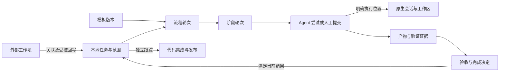

# Reed：业务领域模型

日期：2026-10-28（Asia/Shanghai）。状态：业务建模评审稿，尚未实现。

2026-10-29 工程归属更新：本稿中的领域规则由拟建独立 Reed 工程的 Core 拥有，Tauri 与各宿主页面是同一业务的客户端；ai-code 仅维护四端 Reed 适配插件。本文暂留原位，后续随产品材料迁移；当前架构、两步安装、共享数据及性能门槛以[架构与实施方案](../../../../docs/design/2026-10-27-workflow-workbench-architecture-and-plan.md)为准，不从目录位置推导产品继续内置插件。

产品名称 **Reed**，副标题 **Many agents. One flow.**。本稿承接[架构方案](../../../../docs/design/2026-10-27-workflow-workbench-architecture-and-plan.md)和[交互设计](2026-10-28-reed-interaction-design.md)，明确业务概念、关系、生命周期、完成条件与来源归属。只做业务设计，不定义数据库表、字段类型、接口参数、代码类或部署方式；不改变当前视觉选择。

操作的前置、事实变化、失败及恢复以[业务操作流](2026-10-28-reed-business-operation-flows.md)为配套规格，包含 F01–F18 和逐项走查；阅读模型时不能将关联、候选、执行结果或整理操作理解成自动推进。

## 1. 核心业务决策

| 编号 | 决策 |
| --- | --- |
| B01 | Task 是 Reed 中独立推进和验收的一件工作，本地身份稳定；不以云效编号、会话或分支作为任务身份 |
| B02 | 任务类型、流程阶段分开：需求、缺陷、调研可以采用不同模板；「需求阶段」不是一种特殊任务实体 |
| B03 | 工作流模板规定做事方法；流程实例就是一次流程轮次，不再增加一层 WorkflowRound |
| B04 | 一个任务最多有一个当前主流程轮次；阶段返工保留历史，同范围重试不不断新建整个流程 |
| B05 | 目标草稿与已采纳范围分开；首次确认形成范围 V1，之后实质范围变更形成新版本及新轮次 |
| B06 | 阶段工作、执行尝试、验收、证据有效性分别表达；Agent 结束不能直接推导阶段通过 |
| B07 | 人工完成阶段是正常路径，允许没有 AgentAttempt；以人工提交和验收提供来源，不伪造 Agent 执行 |
| B08 | 父子任务表示范围拆分，前置依赖表示推进条件；生命周期不沿关系自动传递 |
| B09 | 会话、分支、工作区和文档可跨阶段关联；执行归属必须准确，历史关联不赋予执行权限 |
| B10 | 本地任务与外部工作项可以多对多引用；首版每任务至多一个主回写目标，每外部项只有一个主导任务 |
| B11 | 任务完成绑定本轮范围、验收及证据；PR 合并、发布和云效同步分别记录 |
| B12 | 归档是整理属性；已读是注意力属性，均不替代业务完成、取消或资源清理 |

## 2. 业务语言

| 概念 | 业务含义 | 与相邻概念的区别 |
| --- | --- | --- |
| Reed 项目 Project | 组织一组工作，关联候选仓库和外部来源范围 | 不等于一个 Git 仓库或一个云效项目；任务可以暂未归组 |
| 任务 Task | 有目标、范围和验收责任的一件工作 | 不等于一次聊天、一条外部工作项或一次 Agent 调用 |
| 范围版本 ScopeRevision | 已采纳的目标、验收条件、必要交付及范围边界 | 草稿保存、改标题、换显示位置不必产生新范围版本 |
| 模板版本 WorkflowTemplateVersion | 阶段、前置条件、执行方式、产物和验收规则的定义 | 定义不随正在执行的任务一起变化 |
| 流程轮次 WorkflowInstance | 任务采用某模板版本完成某一轮工作的过程 | 不是每次执行重试；已结束或被替代的轮次保留 |
| 阶段 Stage | 模板中的一个业务步骤，如设计、验证 | 名称和顺序不是永久身份；模板可以配置其他步骤 |
| 阶段轮次 StageRun | 针对已固定业务输入、目标及验收要求开展的一轮阶段工作 | 同一阶段可返工多轮；当前阶段的候选产物可反复修改 |
| Agent 尝试 AgentAttempt | 为一个 StageRun 发起的一次可追踪 Agent 执行 | 可包含多轮原生对话、工具调用和等待答复，不按聊天消息拆分 |
| 人工提交 ManualSubmission | 人工提交材料及其输入、成果和执行说明 | 不冒充 AgentAttempt 或自动工具的运行结果 |
| 验收 Acceptance | 谁依据什么规则和证据接受、要求修改或明确豁免什么 | 既不同于执行退出，也不同于用户读过结果 |
| 产物 Artifact / Version | 文档、报告、代码成果等业务材料及其明确版本 | 文件路径只说明位置，不能说明内容版本及有效性 |
| 外部工作项 ExternalItem | 云效等来源系统中可准确识别的工作对象及观察事实 | 由来源系统拥有，不被本地 Task 状态替代 |
| 交付引用 DeliveryRef | 提交、PR/MR、合并或发布等交付事实 | 研发验收不自动产生 Git/发布动作，合并也不自动代表上线 |

「负责人」还须区分三种含义：任务的业务责任人、实际执行 Agent/人工，以及外部工作项里的负责人字段。外部回写的主导任务不是一个人，也不等于上述任何负责人字段。

### 2.1 为操作闭环补齐的业务记录

| 记录 | 归属及含义 | 重要约束 |
| --- | --- | --- |
| 验收项 AcceptanceCriterion | 已采纳范围中的可单独判断、可引用的承诺 | 区分必要性、通过依据与责任；取消已承诺条件走范围变更，不借跳过步骤抹掉 |
| 变更/关联建议 Proposal | 某任务/材料/映射的候选及其来源、依据版本和影响 | 提出、采用、放弃、过期分别记录；新候选不自动替代已采用内容 |
| 阶段准备 StagePreparation | 归属 Task/StageRun 的执行计划及目标选择 | 保存计划或创建资源不等于执行；可没有 AgentAttempt，实际交接前固定输入并再核对 |
| 完成决定 CompletionDecision | 某范围和流程轮次基于确切验收/证据形成的结论 | 历史发生事实保留，当前适用性可有效、待复核或被后轮替代；关闭意图引用具体决定 |
| 取消意图 | Task 对新派发的控制及对活动执行的处置请求 | 取消中可作为界面提示，不能提前伪造 Task 或原生执行已取消 |

这些是既有任务/流程中的业务记录，不要求新建五个独立系统或通用审批引擎。其具体数据结构留待后续设计。

## 3. 五组业务边界

| 边界 | 拥有的业务事实 | 引用其他边界的内容 |
| --- | --- | --- |
| 工作定义 | 项目归属、任务目标、已采纳范围、任务关系 | 外部来源原文、参考材料 |
| 流程与验收 | 模板版本、流程/阶段轮次、推进条件、验收与完成决定 | 任务范围、产物和执行结果 |
| 执行协作 | 执行尝试、人工提交、实际执行目标、观测结果 | 准确会话、工作区与输入快照 |
| 资源与证据 | 会话/代码资源引用、材料版本、验证证据、交付事实 | 产生它们的任务、阶段和执行来源 |
| 外部协作 | 外部对象、关联、映射、同步意图与核查/处置 | 主导任务及其允许对外表达的结果 |

这是业务职责划分，不要求拆成五个服务、数据库或软件包。四端是进入同一业务的渠道；MCP、HTTP 或原生桥不产生另一套任务模型。

图表示业务依赖，箭头不是自动执行、授权或创建资源的动作。

## 4. 关系与归属

| 关系 | 首版约束 |
| --- | --- |
| 项目—任务 | 一个项目包含多任务；任务当前属于零或一个项目，可先在未归组中工作 |
| 项目—仓库/来源项目 | 一个项目可跨多个仓库和外部项目；这些对象不因此具有相同身份 |
| 任务—范围版本 | 一个任务有多个历史版本，最多一个当前已采纳版本；首次需求确认前可只有草稿 |
| 任务—流程轮次 | 一个任务有多个历史轮次，最多一个当前主轮次；轮次固定模板版本，范围确认后固定范围版本 |
| 流程轮次—阶段轮次 | 一个阶段可有多轮返工；首版主流程阶段顺序推进，同一阶段只有一个当前待完成轮次 |
| 阶段轮次—执行来源 | 可有零到多个 AgentAttempt/人工提交；首版不默认并行执行同一阶段的多个候选尝试 |
| 任务/阶段—会话 | 历史上多对多；执行时一个未收敛 Attempt 归属一个明确原生执行会话，该会话不能同时被另一受管理 Attempt 占用 |
| 任务—工作区集合 | 一个任务可有多个历史集合；每个集合含一个或多个按仓库区分的工作区 |
| 任务/阶段—产物版本 | 多对多引用；产物有自己的历史，接受和复用均指向明确版本 |
| 任务—外部工作项 | 多对多引用；主回写关系另受单一主导规则约束 |
| 任务—任务 | 拆分、必要依赖、普通关联分别有明确含义，不用一种无类型链接表达所有关系 |

任务的生命不依赖资源的生命：关掉会话窗口、删除远端分支或断开来源连接不会删除任务。工作区也不随一次 Agent 回答结束而消失。

## 5. 任务、草稿与已采纳范围

### 5.1 一件任务的基本内容

业务上至少说明目标及当前处理情况；启动执行前补齐本阶段需要的范围。范围包括要解决的问题、包含/排除的内容、可判断的验收条件、必要交付与必要子任务。类型、优先级、项目和责任人用于组织；它们本身不决定阶段通过。

首版可按需求、缺陷、改进、调研、维护区分类型，类型不强制对应固定模板。调研可只有分析与结论阶段；小任务可采用简化模板，跳过步骤必须符合明确规则并保留依据。

### 5.2 草稿确认与变更

首次需求澄清期间，目标/验收草稿可持续编辑；每次保存不是一个新流程轮次。初始需求 StageRun 固定启动时的输入，澄清稿属于它的候选成果；初始流程可以尚未绑定已采纳范围。

首次「确认需求/确认范围」将明确版本固化为范围 V1，并绑定当前流程轮次；随后设计、开发和验证使用这份范围。没有需求阶段的模板，在进入受范围约束的阶段前完成相同的范围确认。

范围已采纳后，外部更新、用户编辑或 LLM 分析先产生待采纳变更。用户/已授权策略采纳实质范围变化时形成 V2，并建立当前新流程轮次；旧 V1 及其完成事实不被改写。排版、显示标题或负责人等变更，只有确实影响目标/验收时才改变范围。

已暂停任务采纳新范围仍保留暂停；采纳变更不等于恢复执行。当前轮次更新与旧执行处置分别记录，见第 6.3 节。

已完成任务扩展范围或重新开展同范围工作，保留 Task 身份并建立新流程轮次；只有范围实质改变才升范围版本。独立的新问题可以另建关联任务，不要求一律重开旧任务。

新轮次可以引用此前有效材料，但必须核对当前依赖并登记本轮接受/复用依据；不能复制一个旧的「通过」标记就视为本轮已经完成。

### 5.3 子任务与依赖

- 首版拆分关系为单父任务结构；一个子任务最多一个拆分父任务，不允许形成环。一个任务仍可与多个其他任务建立普通关联。
- 每个子任务都有独立范围、流程和验收；父任务暂停、取消、完成或归档不自动改变子任务状态。批量处置将来若支持，必须展示逐项范围与结果。
- 父范围先固定必要交付约定和验收责任，可先列待确认拆分；子任务范围确认后，登记其准确版本及成果如何满足既有约定，父任务完成前必须补齐。这种履约/证据绑定不自动升级父范围；改变必要性、交付边界或验收约定则必须变更父范围，不能以补齐引用为名偷改范围。
- 必要子任务被取消不等于完成。取消必要性需要明确变更父任务范围/验收，不能通过移除列表行绕过。
- 子任务未来增加新范围，不自动推翻父任务对旧约定范围的历史验收；若原约定成果失效，或父任务明确接纳新范围，才对相关父结论触发复核。
- 前置依赖说明「开始某阶段」或「接受某结果」需要什么已接受成果，引用目标版本并标明阻断位置。父子并不意味着所有阶段都必须串行。
- 拒绝形成相互阻断的必要依赖；历史引用和普通关联不作为阻断。首版不把它扩成任意 DAG 调度器。

关系编辑须先预览对既有交付约定的影响。拆分与依赖合在一起判断必要等待：父 P 等必要子 C，而 C 又等 P 完成，即使两类关系各自无环也必须拒绝。移动、替换必要子任务不自动属于整理；只有约定不变的准确履约重绑才可不升父范围。

## 6. 模板、流程轮次、阶段与尝试

### 6.1 模板与当前轮次

模板版本定义阶段、允许的执行方式、前置成果、预期产物、接受规则、返工与完成条件。默认是需求→设计→开发→验证，但业务模型不把这四个名称写成唯一合法阶段。

流程轮次表达针对某个约定的工作过程。模板发布新版本不改变已有轮次；明确迁移模板时创建替代轮次并核对材料复用，避免静默改变进行中的验收标准。

模板编辑先形成草稿，发布固化版本。迁移先预览阶段、条件及材料对应，按准确标准判断复用，不能按同名阶段直接继承通过。暂停保持；已归档先恢复显示；已完成/已取消任务继续工作须明确「重开并迁移」，模板发布或编辑不隐式重开。

### 6.2 变更究竟落在哪一层

| 变化 | 业务处理 | 保留内容 |
| --- | --- | --- |
| 原生会话继续答复、Agent 继续工具调用 | 同一个 Attempt 继续 | 同一执行归属和输入 |
| 执行失败后重新执行，业务输入和标准未变 | 同一 StageRun 新建 Attempt | 原失败及已产生材料 |
| 待验收候选被要求修改，目标/接受标准未变 | 同一 StageRun 新建尝试或人工提交 | 历次候选版本与反馈 |
| 设计已接受，随后需要重新开展设计 | 当前流程内新建设计 StageRun | 旧接受与后续结果的复核关系 |
| 已接受上游输入、阶段目标，或影响权限/必需证据的约定执行路径改变 | 新建相应 StageRun | 原输入、产物和接受历史 |
| 验证的实际代码发生变化 | 新建验证 StageRun，固定新代码快照 | 原快照的测试结果不冒充新结果 |
| 任务验收范围实质改变并被采纳 | 新范围版本＋新流程轮次 | 原范围及其完成结论 |
| 已完成任务按同范围重开 | 同范围下新流程轮次 | 历史完成，重新判定本轮有效性 |

StageRun 固定业务输入、允许的执行路径、必需证据及验收范围；Attempt 固定本次具体宿主、原生会话、工作区和起始代码快照。更换宿主/会话仍须核对前序执行终态和本次上下文；若实际业务输入或验证对象变化，不能只称为重试。

Agent 草稿由人工修订，属于同一约定下的候选材料变化，可以在原 StageRun 登记人工提交；人工修订不免除原有自动执行/验证要求。只有改变约定执行路径，并影响权限、输入或必需证据时，才按上表另建 StageRun，不能用人工提交绕过阶段条件。

开发失败后的部分修改可以作为同一目标下继续尝试的中间成果，但要明确保留/接续的内容，记录新的执行快照；这不意味着每次工具写文件都新建 StageRun。验证阶段则固定被验证的代码对象，代码改变就不再是同一个验证目标。

### 6.3 被替代的业务轮次与仍活动的执行

新流程或新 StageRun 成为当前，不代表旧 Attempt 已停止。旧执行仍按准确原生归属收敛，迟到消息、产物和结果归入原记录。新轮次可准备材料，但在旧执行停止情况未确认前，不能抢占同一会话或写工作区。

业务选择哪一轮有效，与执行是否真正停止是两个判断。页面可以展示当前新范围及「旧执行待处置」，不能靠切换当前轮次清除后者。

### 6.4 Agent、人工和复用材料

AgentAttempt 表达受管理 Agent 的执行；模型供应商、宿主、模型和阶段角色不视为同一概念，也不预设固定模型分工。

StageRun 可以没有 AgentAttempt：人工完成后登记 ManualSubmission，说明实际来源、适用输入、材料及说明；验收仍需满足模板要求。人工声明「测试通过」不能冒充可核查命令记录，明确允许的人工验收与工具验证应区分证据类型。

复用已有成果也需明确来源版本和当前适用范围，可通过人工提交或已授权规则登记；不伪造新的执行记录。验收接受的是明确来源、输入及成果，不强迫所有结果来自 Agent。

## 7. 生命周期采用多组事实

| 对象/维度 | 业务表达 | 不能直接推导 |
| --- | --- | --- |
| Task 业务处理 | 活动、阻塞、暂停、完成、取消 | Agent 是否正在执行、远端是否已同步 |
| Task 整理 | 正常显示/已归档，保留业务处理状态 | 工作已通过、资源已删除 |
| 流程轮次 | 当前开展、已完成、被替代、取消 | 其中所有原生执行均已停止 |
| 阶段成果接受 | 待处理、待验收、接受、要求修改、按规则跳过 | Agent 已启动/结束或产物仍适用 |
| Agent 执行 | 待准备、待交接、提交中、已接纳、执行中、取消请求、完成/失败/已取消/未知 | 用户已验收、Task 完成 |
| 材料/结论适用性 | 当前有效、待复核、缺失/不可核查 | 历史接受从未发生 |
| 交付 | 未创建、审查、合并、发布等已观察事实 | 本地任务所有目标均满足 |
| 同步 | 待发送、已发送、已确认、当前值一致、冲突、结果未知等 | 本地目标已完成 |

Task 的阻塞要有原因和阻断位置；已暂停时保留这些原因。解除阻塞不自动恢复人工暂停，恢复暂停后如仍有必要阻塞则显示阻塞。没有启动阶段的新任务处于活动下的「待开始」。

暂停只停止新派发和后续自动推进，不能假装暂停原生进程。暂停期间接收结果、答复原生活动及人工审阅可以继续；恢复暂停重新核对当前范围、依赖、采用材料和占用，不重启旧尝试或直接发送旧准备。Task 取消先表达取消意图并禁新派发，处理活动执行，处置确认后才形成取消结论；自然完成/失败的 Attempt 按事实保留，不能改成已取消，也不自动完成 Task。阶段接受和 Task 完成仍独立决定。

归档是整理属性，保留业务状态。活动/阻塞任务先明确暂停并撤回未交接准备再归档，暂停/完成/取消任务满足执行处置条件后可直接归档；存在活动或未核查执行时先处理，不能借隐藏任务释放资源。恢复归档只恢复显示并保留暂停/完成/取消，分别通过显式恢复或重开继续，不重启旧执行。有效未决同步及其全局处理入口继续保留。

已完成或已取消任务继续工作须明确重开，同范围创建新流程轮次而不升范围版本；取消待处置期间不能靠编辑、模板迁移或恢复归档绕过原取消意图。

## 8. 会话、代码现场与材料证据

### 8.1 会话关联与执行绑定

SessionRef 是原生会话的准确引用和可观察活动。Task/Stage 的历史关联表达「这段讨论与此工作有关」；Attempt 的执行绑定表达「这一次执行发生在这个原生上下文」。二者不能互相替代。

一个阶段可关联需求讨论、设计、开发等多个会话；一个长会话历史上可讨论多个任务。一个未收敛受管理 Attempt 只归属准确的一个原生执行会话；Fork 产生新引用，不能自动继承控制权。

粘贴链接可以建立可导航关联，不提供发消息/取消/终态确认的权力。预填、用户真正发送、宿主接纳和开始执行分别有事实；只有准确证据到达后才更新对应执行状态。

### 8.2 仓库、分支、工作区与代码快照

| 对象 | 业务责任 |
| --- | --- |
| RepositoryRef | 识别哪一份代码库；名字相同不代表同一仓库 |
| BranchRef | 识别仓库内的命名开发线及观察历史；不是唯一执行目录 |
| RepositoryWorkspace | 一份实际可执行目录、观察分支和基线；可以是任务隔离目录 |
| WorkspaceSet | 一次跨仓任务所需的多个工作区的业务集合 |
| CodeSnapshot | 某次执行起点、开发结果或验证对象的明确内容版本与覆盖范围 |

Task 与分支的关系说明开发/验证用途及相关轮次；工作区的占用属于仍活动的受管理执行。创建了分支或 worktree 不证明原生会话已进入该目录；必须核对真实上下文。

首版默认任务隔离目录，同一真实工作区的受管理写入不能重叠。长驻预览环境与 Agent 代码写入分别观察；前者仍在运行不自动表示 Agent 仍工作，后者未确认停止也不能提前释放。

### 8.3 产物版本、证据与接受

Artifact 表达一个持续存在的业务材料，如「补偿设计」。ArtifactVersion 表达准确内容及产生来源；路径、标题、当前文件内容发生变化时，历史接受仍引用原版本。

验证报告、工具结果、人工检查及代码快照都是证据，但可信程度和适用范围不同。阶段接受固定材料版本、验收条件、输入与决策者；不能只绑定一个可被随时覆盖的路径。

新候选版本不替换已接受输入；只有明确采用新版，或旧证据实际丢失/变动时，才按实际依赖影响下游。相同文档的排版改变与验收范围变化不同；某仓代码变化也不能机械作废不相关任务的所有证据。进行中任务定位最早受影响的必要阶段，下游历史保留并标待复核；已完成任务保留历史完成，明确其当前适用性待复核，继续工作需重开。

原材料复用须逐项比对本轮输入差异、验收标准和必需证据，并明确接受复用、补证或重做；保留原生产来源及本轮复用决定。被标待复核不表示历史通过从未发生，也不能作为当前有效完成依据。

## 9. 验收与任务完成

一次阶段接受需要说明：接受哪一个 StageRun 的哪一版成果、来自哪次 AgentAttempt 或人工提交、依据哪些输入/条件和证据、由谁按什么已授权规则作出决定。要求修改和明确豁免也记录依据；Agent 文本中的 approved 不是用户决定。

Task「具备完成条件」和「已形成完成决定」分开。默认完成条件是：

1. 当前已采纳范围明确，必要验收条件具有对应结论。
2. 当前轮次的必要阶段已接受，或按明确规则获准跳过。
3. 材料、代码和验证证据对当前范围仍有效，必要依赖已满足。
4. 范围要求的必要子任务约定成果已接受；跨仓集成验证由父任务自己的验收承担。
5. 没有妨碍确认成果或资源安全的未处置执行，且实际完成决定由用户或已授权规则产生。

完成记录固定范围版本、流程轮次、阶段/子任务结论及证据版本。它不是页面计数器达到 100% 后的隐式赋值。

首版本地研发完成不以云效回写成功为前置；否则「完成才回写关闭」与「远端关闭才完成」容易形成循环。同步失败保留完成事实并形成待处理事项。项目若要求合并/发布作为完成条件，可明确加入对应交付证据，不从默认研发验证直接推断上线。

## 10. 外部来源、映射与回写责任

### 10.1 外部对象与连接

ExternalItem 身份按来源、已识别实例/组织及原始对象识别；外部展示编号和访问账号都不代替对象身份。Connection 说明以什么主体访问它；更换账号建立新连接，不把旧写入意图转成新账号的请求。

ExternalLink 说明来源关系及用途。云效父子关系保留为外部事实，不自动创建本地拆分关系；用户导入/拆分时明确决定。一个任务可以引用多个来源，一个外部需求也可以关联多个本地任务。

### 10.2 首版单一主导

- 每个外部工作项最多一个主导导入任务；重复导入打开该主任务，派生任务仅贡献或引用成果。
- 每个本地 Task 最多一个主回写目标，其他来源为参考；首版不让一个 Task 同时主导多个外部对象的共享字段。
- 允许回写的每个字段都由明确的主导任务表达期望，不能由几个关联子任务分别竞争修改。
- 主导任务只是业务归属；真正写入还需对应用户授权、映射规则和来源权限，不能凭关系获得写权限。
- 转移主导关系需要明确交接原意图和基线，未决写入不能因解绑、新连接或新主导而消失。

### 10.3 同步意图是独立业务事实

同步意图说明谁基于哪个任务范围、流程轮次和业务决定，期望修改哪个外部对象的哪些字段、基于什么已观察值、采用哪个映射。它既不是 Task 当前状态，也不是网络请求成功提示。按本地完成规则推进远端状态的意图必须引用相应完成决定，不能只绑定范围版本。

用户直接编辑外部状态属于独立外部操作，绑定这次明确决定及远端基线，不要求伪造本地完成。界面说明仅修改来源；仍受主导、权限、合法流转、版本及未知影响约束，不能以该决定接受本地阶段。来源修改的入口也不能被规则用来绕过本地完成条件。

首版直接编辑某来源字段时，明确暂停该字段在此主关联下的自动映射，并重判其尚未发送的规则意图；已发意图照常核查。后续规则不能静默覆盖手动期望，恢复自动映射须明确预览当前期望；其他字段和本地流程不因此暂停。

解绑、复联和新主关联不会默认清除这一手动字段决定；复联保留映射暂停，用户预览当前期望并明确恢复后才启用，主导交接也必须明确保留或恢复。未决队列已经清空不表示手动优先级失效。

外部状态变化可以提出本地变更建议；本地阶段接受可以按规则提出外部状态修改。两种方向各有规则，不假设可逆。远端已关闭不会让本地设计和验证自动通过。

尚未发送、基于本地完成的关闭意图，在其完成决定不再代表当前工作时重新判断并取消/替代；范围替代、同范围重开或模板迁移均适用。实际派发前也核对这份依据，不能让旧轮次因范围版本相同而继续关闭远端。直接外部编辑另核对其明确决定与当前上下文，不能混成来自本地验收的规则结果。已经发送的意图不能改写原含义，先核查结果再决定后续修改；旧结果只归属原意图，不覆盖后来的本地期望。

冲突保留基线、本地期望与远端当前值。值一致只证明当前收敛，不证明原请求成功或迟到副作用结束。人工风险处置是独立决定，不伪造成功；同一远端对象的未决写入也不能换个连接绕过。

## 11. 关键业务动作与产生的事实

下表是业务语言，不是 API 路由、数据库事件表或可自动执行的命令。

| 业务动作 | 产生/改变的事实 | 不附带的动作 |
| --- | --- | --- |
| 创建/导入任务 | 本地 Task、草稿、来源关系及初始流程选择 | 不启动 Agent、不批量导入所有来源 |
| 确认需求范围 | 固化范围版本并建立本轮依据 | 不接受设计或自动开始开发 |
| 采纳范围变更 | 新范围和替代流程轮次，待复核关系 | 不宣布旧执行已停止 |
| 准备阶段 | 输入及执行准备、资源选择 | 不等于指令已经发送 |
| 发起 Agent 执行 | 明确的 Attempt 及交接事实 | 不等于接纳、开始或成功 |
| 人工提交材料 | ManualSubmission 与产物来源 | 不伪造 Agent/测试记录 |
| 接受/要求修改成果 | 明确版本的接受/反馈决定 | 不改写历史，也不自动 Git 提交 |
| 拆分子任务/设置依赖 | 范围分解或必要前置约定 | 不继承父生命周期或写入权 |
| 关联会话/分支/文档 | 可导航关系与来源 | 不迁移执行或取得控制权限 |
| 完成本轮任务 | 固定范围和证据的完成决定 | 不直接合并、发布或认定云效已同步 |
| 暂停/取消/归档 | 各自明确的调度意图、业务结论或整理属性 | 不混作停止执行、完成或删除 |
| 请求外部修改/处置冲突 | 独立的同步意图或人工处置 | 不覆盖本地验收和未知历史 |

## 12. 用样本检验模型

样本全部虚构，沿用交互稿 REQ-1042「成员导入失败后自动补偿」。

| 场景 | 模型应表达的结果 |
| --- | --- |
| 无云效账号，先建本地任务 | Task 和初始流程可存在；范围草稿未确认，没有 ExternalItem 也能推进 |
| 浏览后导入同一云效需求两次 | 复用准确外部对象及主任务；不新建第二个主导生命周期 |
| 澄清需求并反复保存草稿 | 同轮需求工作持续；确认形成范围 V1，不按每次编辑创建新流程 |
| 设计会话结束，设计 V2 待验收 | Attempt 已结束、ArtifactVersion V2 已登记，StageRun 尚未接受 |
| 用户要求补充日志说明，接受标准未变 | 同一 StageRun 继续尝试，产出 V3；V2 和反馈仍保留 |
| 人工整理既有方案并提交 | ManualSubmission 提供准确材料来源，验收不要求虚构 AgentAttempt |
| 已接受设计新增超出原约定的能力 | 先提出范围变更；接纳后范围 V2 和新轮次，原已接受成果按依赖复核 |
| 同范围修正设计缺口，开发已经在运行 | 新设计 StageRun，旧开发执行继续准确跟踪；不能抢占其会话或工作区 |
| 开发中途失败，继续已保留的部分修改 | 在原目标下新 Attempt，记录接续材料与起始快照，不抹掉失败 |
| 验证快照 C1 通过，随后代码成为 C2 | C1 历史结果保留；C2 新验证 StageRun，当前不能沿用原通过 |
| 父任务拆出后端、前端两个必要子任务 | 两个 Task 各自执行；父任务引用约定范围，仍需自身集成验收 |
| 子任务完成 V1 后独立扩展 V2 | 父任务对原约定 V1 的历史不自动被扩展撤销；实际成果变动按依赖复核 |
| 父范围已确认，必要子任务随后确认范围 V1 | 核对并绑定符合既定交付约定的成果；约定不变不升父范围，改变约定需明确变更 |
| 当前任务暂停或归档 | 后续派发/视图整理按各自语义处理，活动执行和其他任务不被悄悄改状态 |
| 云效显示完成，本地仍缺验证 | 外部状态是观察事实，本地保留未验收并提示差异 |
| 本地完成，云效关闭写入超时 | 完成记录保留，同步意图未知；不盲重发、不改成已同步 |
| 同范围重开时上一轮还有未发送关闭意图 | 原完成决定不再代表当前工作，旧关闭重判取消/替代，不因范围版本未变而继续发送 |
| 改用另一个宿主或账号 | 任务身份不变；新执行重新核对，新连接不承接旧主体未知意图 |

## 13. 首版保持的业务约束

1. 一个 Task 最多一个当前主流程轮次；同名任务或外部编号不作为去重身份。
2. 已采纳范围、模板及历史验收有明确版本，旧记录不能通过修改当前材料被反向改写。
3. 阶段成果接受指向明确执行/人工来源和产物版本；缺少来源不以聊天摘要补齐。
4. 必要阶段未接受或证据待复核时，当前范围不能无条件显示完成。
5. 同一原生会话与同一真实工作区分别约束受管理执行；新业务轮次不释放未确认停止的旧执行。
6. 一个外部对象的主导任务、实际操作主体和业务负责人分开，不从关联关系推导写入权限。
7. 拆分、依赖、参考、当前执行四种关系不得互换；必要依赖和父子结构不得产生阻断环。
8. 归档、已读、切换视图、打开目录或会话不推进验收，不执行隐式 checkout/发送/删除。
9. 本地完成、Agent 活动、交付、外部状态和同步结果各有事实来源，不能共用一个「完成」字段。
10. LLM 可以建议映射、关联和影响范围，不能自行制造用户授权、测试证据或验收决定。

## 14. 当前取舍与后续设计入口

本稿按个人本地产品建模：不引入多人组织/角色权限、通用调度图、自动资源清理、远程团队工作区或一套独立 Agent 管理平台。项目归属、类型和依赖只覆盖已需要的研发组织方式。

阶段配置可扩展，但首版主流程顺序推进；独立任务或子任务可以并行。更复杂的同阶段多 Agent 并发、跨任务共享写工作区、一个任务主导多个外部回写目标，需有真实业务需求后再补相应规则。

下一层设计应从本稿映射领域对象和业务操作，再确定本地数据结构与接口。当前不确定性主要在四端能否提供准确原生事实，以及来源系统允许哪些流转；这些改变适配能力，不改变 Task、验收、证据和来源归属的业务定义。

本轮业务建模中细化了初始范围确认、轮次分层、人工提交、父子/依赖、归档语义和外部主导关系；相应架构/交互段落保持一致。验证范围为设计规则及样本走查，不构成数据库、并发执行、真实云效或四端业务验收。

## 15. 操作规格与本轮细化

[业务操作流](2026-10-28-reed-business-operation-flows.md)补齐 F01–F18 的前置、步骤、业务结果、失败恢复和一致性检查，并提供场景走查与 Review 记录。其共同判断 G1–G7 是本模型业务约束在操作时的应用，不是一套新的权威状态或通用审批平台。

本轮新增的明确决定包括：保存草稿后的范围确认关口；活动任务先暂停再归档；暂停/归档恢复及取消后重开；候选与采用版本分离；完成决定的当前适用性；父子/依赖混合阻断环；本轮复用的具体接受路径；模板迁移不隐式重开。只更新设计文档，不将这些规则声称为已实现。
