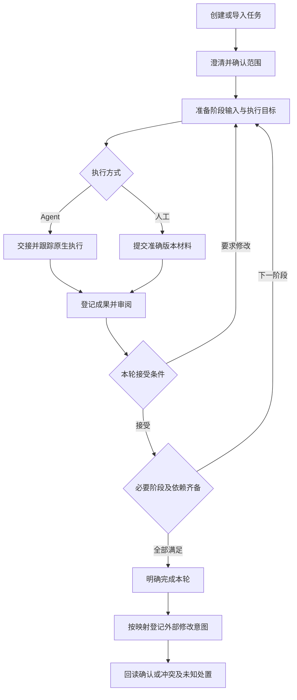

# Reed：业务操作流与一致性规则

日期：2026-10-28（Asia/Shanghai）。状态：设计评审稿；本文描述拟实现业务，不是已运行的功能。

2026-10-29 工程归属更新：F01–F18 的业务前置、转换和验收由拟建独立 Reed Core 统一执行；Tauri、四端适配与未来其他壳调用相同用例。退出界面不产生业务取消，宿主原生执行与 Core 管理的独立执行分别绑定所有者。本文暂留原位、尚未迁移，当前安装/生命周期/实施阶段以[架构方案](../../../../docs/design/2026-10-27-workflow-workbench-architecture-and-plan.md)为准。

本稿细化[业务领域模型](2026-10-28-reed-business-domain-model.md)，与[交互设计](2026-10-28-reed-interaction-design.md)、[架构方案](../../../../docs/design/2026-10-27-workflow-workbench-architecture-and-plan.md)配套。范围为操作、业务前置、事实变化、异常及恢复；不定义数据库、接口、代码或新增视觉方案。

## 1. 操作覆盖目录

| 流程 | 覆盖操作 | 主要业务结果 |
| --- | --- | --- |
| F01 | 新建项目、任务归组/移动、关联仓库和来源范围 | 组织关系与默认选择，不迁移既有执行 |
| F02 | 创建/编辑/发布模板、选用版本、配置推进规则 | 固定可采用的工作方法与自动化范围 |
| F03 | 本地新建、保存草稿、澄清、首次确认范围 | Task、范围 V1 与首轮流程依据 |
| F04 | 来源浏览、导入、重复导入、参考关联 | 唯一主导任务或显式参考关系 |
| F05 | 准备阶段、工作区准备、选择会话、保存/撤回准备 | 尚未执行的计划与准确交接目标 |
| F06 | 提交/预填、继续答复、观测结果、取消尝试、核查执行 | 准确执行归属及实际结果 |
| F07 | 登记/打开材料、人工提交、更新候选、复用成果 | 有来源、版本及适用范围的材料 |
| F08 | 审阅、接受、要求修改、跳过/豁免、更正验收 | 本轮成果的明确判定 |
| F09 | 开发成果提交验证、运行验证、失败返工 | 对准确代码对象的验证与后续处理 |
| F10 | 提出/采纳/放弃范围变更、同范围重开、迁移模板 | 新业务依据、替代轮次与材料复用决定 |
| F11 | 拆分、关联依赖、改变关系、登记子任务履约 | 独立任务及父任务的交付约定 |
| F12 | 暂停/恢复、取消任务、归档/恢复归档 | 明确的推进控制与业务状态 |
| F13 | 关联/打开/解除会话或分支、Fork、重绑、漂移处理 | 可追溯关系，不转移活动执行 |
| F14 | 完成本轮、登记 PR/合并/发布、查看完成历史 | 明确版本的完成决定与独立交付事实 |
| F15 | 拉取来源更新、编辑来源字段、配置/采纳映射 | 保留基线与方向的业务变更 |
| F16 | 发送同步、撤回未发送意图、冲突处理、未知结果核查/处置 | 外部修改的可解释结果 |
| F17 | 解绑来源、交接主导任务、停用/重连、更换账号 | 不丢未决操作的协作关系变化 |
| F18 | 离线/重连、重复操作、并发更新、已读/关注、历史纠正 | 恢复权威事实和可继续处理的入口 |

每个流程的完成含义只限右列。保存不等于发送，发送不等于接纳，接纳不等于执行结束，执行结束不等于验收；归档、已读与外部同步分别有自己的结果。

## 2. 共同操作契约

### 2.1 参与者与业务决定

用户可以执行已允许的业务操作；确定性规则只能在用户明确启用的操作、项目/任务和条件内代办。Agent/LLM 可提供材料、关联或推进建议，不能以自己的完成描述产生授权。原生宿主和第三方来源提供观察事实，不能替代本地验收。

任何改变业务依据的操作都能说明：谁提出、针对哪个任务/轮次、采用哪些准确版本、需要哪些条件、已改变什么、尚待什么。拒绝和待核查也必须有明确结果，不用无限等待表示。

### 2.2 各操作复用的判断

| 判断 | 何时核对 | 不满足时 |
| --- | --- | --- |
| G1 对象与操作权 | 所有写操作 | 保留输入，说明只读/权限问题；关联链接不是授权 |
| G2 当前业务依据 | 确认范围、接受/完成、实际交接及外部发送前 | 版本已变则展示差异并重判，不对旧快照继续确认 |
| G3 任务推进控制 | 新阶段/尝试、Agent 实际发送和本地自动推进前 | 暂停、取消待处置、已归档或已结束时不派发；阻塞按本操作必要条件判断；外部同步另按 G6 |
| G4 输入与成果有效 | 启动、验收、复用和完成前 | 缺失、待复核或非当前采用输入时停在准确阶段 |
| G5 执行上下文及占用 | 阶段交接和重绑前 | 会话/目录不符或前序未收敛则等待、核查或另选允许目标 |
| G6 来源写入条件 | 生成/发送外部意图及交接主导前 | 身份、权限、主导、映射或同对象未决影响未明确时不写 |
| G7 重复与过期决定 | 重复提交、迟到观察、规则建议执行时 | 同一操作返回已有结果；过期或不同内容需重新决定，不能制造第二次副作用 |

准备时通过的检查不永久有效，真正交接或确认时仍按同一业务条件重新核对。这里要求的是已有业务约束的最终判定，不另造一套重复状态机或权限体系。

### 2.3 状态控制矩阵

| 情况 | 可继续做的事 | 被阻止的事/恢复入口 |
| --- | --- | --- |
| 活动 | 在前置条件内准备、执行、登记、验收 | 条件不满足的操作仍拒绝 |
| 阻塞 | 阅读、补资料、处理相应阻塞；不受该阻塞影响的操作 | 阻塞位置上的推进；解除后重判，不直接发旧准备 |
| 暂停 | 收取既有结果、答复原生活动、登记及人工审阅当前成果 | 新派发/后续自动推进；显式恢复后重判当前情况 |
| 取消待处置 | 核查、请求停止、接收准确终态和保留成果 | 新派发、当前成果最终验收和完成；先完成取消处置 |
| 已完成/已取消 | 阅读、必要历史纠正、独立交付记录及已授权的来源操作 | 新本地工作需明确重开；来源操作不能更改已接受范围或隐式重开 |
| 已归档 | 查历史、处理既有未决结果与同步 | 新工作/新来源编辑先恢复可见性，再按业务状态判断；活动归档前须明确暂停 |

「阻塞」必须指明受影响操作。云效连接不可用通常只阻止对应同步，不把全部本地任务冻结。暂停允许用户对已结束的当前成果明确验收；仍不自动派发后续阶段，满足全部条件时也可由用户明确完成任务。

G3 管本地流程派发，G6 管独立来源操作。任务完成后可根据有效完成决定发送关闭意图；取消、暂停或归档也不阻止真实回执和既有意图的必要核查。是否可发送仍核对该意图自己的授权、当前适用性、主体及同对象未决影响，不能由 Task 结束/归档状态一律放行或一律拒绝。

## 3. 端到端业务主线

图中的返回必须按 F08–F10 判断是新尝试、新阶段轮次还是新流程轮次；不是无条件重复发送。规则自动推进也走相同前置判断。

## 4. 建立工作与业务依据

### F01 项目、归组与资源范围

**前置**：用户选择本地工作范围；新建任务不要求先配置项目、仓库或云效。

1. 新建 Reed 项目，填写组织用途，可选择候选仓库及来源项目范围。
2. 创建/移动任务到项目，预览原关联和新默认配置；保存组织关系。
3. 新默认模板、仓库、映射仅作为后续选择；已有轮次、会话、工作区、范围及主回写目标保持原业务依据。
4. 如需采用新的输入、模板或来源目标，分别进入 F10/F17，不在归组动作里偷偷迁移。

**失败/恢复**：仓库或来源不可访问时保留项目与现有任务，标明候选不可用；不把查不到当作已删除。解除项目归组保留 Task 和历史；首版不提供物理删除已保存业务历史的捷径。

### F02 模板与推进规则

**前置**：已明确流程目标；首次可直接采用默认四阶段模板。

1. 编辑模板草稿：阶段稳定标识、顺序、允许路径、材料、前置、必要条件、跳过和返工规则。
2. 检查必要条件是否可判定、是否有相互阻断，以及没有需求阶段时的范围确认入口。
3. 发布固化一个版本；修改已发布内容产生新草稿，不影响已采用的任务。
4. 任务选用准确版本，首次没有选定模板时可保存待配置，不能直接开始受其约束的阶段。
5. 自动化规则明确触发、操作、范围及证据要求；默认人工确认。LLM 建议先预览，采用前按 G1–G7 核对。
6. 已有轮次采用新版走 F10 的迁移预览，不由模板发布批量触发。

**失败/恢复**：缺必要结果定义或有阻断环时不能发布；草稿可继续修改。关停自动化停止新决定，不假装停止已发执行或撤销已发送同步。

### F03 本地创建、草稿与首次确认

**前置**：至少有任务目标；选择模板时看到本轮采用的版本。

1. 保存 Task、目标草稿及模板选择；默认模板生成初始主轮次，需求阶段待开始，没有执行副作用。
2. 人工编辑或通过 F05–F07 取得澄清候选，逐项补齐验收条件、范围边界与必要交付。
3. 「保存草稿」只保存候选；「确认需求范围」预览准确版本、必要条件和未决事项。
4. 按 G2/G4 确认，固化范围 V1，并将需求成果及当前初始轮次绑定该版本；下一阶段仅变为可准备。
5. 无需求阶段的模板，在第一个受范围约束的阶段前执行同样确认，不能直接绕过。

**失败/恢复**：有必需缺项则留在需求阶段；确认时草稿被另一端更新，则保留差异，不确认旧页内容。保存成功回执丢失先查本次操作是否已保存，不能重复建任务；已采纳后再编辑进入 F10，不修改 V1。

### F04 来源浏览、导入与参考关联

**前置**：来源连接可准确识别账号、实例/组织及业务对象，有相应读取权限。

1. 按用户指定项目/条件浏览，失败显示不可用；浏览不建立 Task。
2. 选择对象，预览原始信息、拟用模板和「主导导入／仅参考已有任务」用途。
3. 最终导入时重新检查准确外部身份及已有主导任务；多端同时导入返回同一个已建立主任务。
4. 没有主导时建立本地 Task/草稿与关联；已有主导时打开已有任务，派生工作需显式新建并仅关联参考。
5. 外部父子关系保留为来源事实；创建本地拆分需另走 F11。

**失败/恢复**：读取中断可重新读取；保存中断先核对导入结果。对已解绑历史项重导入时展示历史任务和未决操作，由用户选择复联/新建；不借新建主导绕开旧在途写入。只读导入不证明具备写权限，也不立刻回写状态。

## 5. 从准备到执行结果

### F05 阶段准备、资源准备与撤回

**前置**：当前任务/轮次允许此操作，上游采用版本及必要依赖明确。

只查看/保存计划草稿与开始新的资源准备分开；后者和新的阶段工作、最终交接均须满足相应推进控制，不能在暂停状态偷偷准备并派发。

1. 选择当前阶段的工作目标、已采用材料与允许路径，保存阶段准备；准备是计划，不是已发送的执行。
2. 选择/复用本任务工作区；需要创建时预览仓库、基线、分支和目录，再显式准备。多仓库逐项显示结果。
3. 保留已创建资源的归属；部分失败可继续未完成步骤，不覆盖未知目录，不自动删除已完成部分。
4. 选择宿主及准确会话，核对实际目录/仓库/分支；不能把旧会话提示词中的路径当作迁移。
5. 全部就绪后展示输入预览与该端真实动作：直接交接、打开预填或人工导航；最终交接进入 F06。
6. 保存准备不派发。撤回未交接准备只关闭计划，保留已创建目录及草稿；资源清理另行处理。

**失败/恢复**：材料变化则准备待复核；会话忙于其他任务则等待或另选允许目标。已交接或是否发送不明的准备不能以关面板当作撤回，转 F06 核查后处置；未知执行不解占用。

阶段准备是归属 Task/StageRun 的业务记录，可以没有 AgentAttempt。进入可追踪的 Agent 交接时建立 Attempt 并固定实际输入；准备创建工作区的结果可以独立保留，不伪造 Agent 已启动。

### F06 原生交接、等待答复、终态与取消尝试

**前置**：F05 已准备；最终动作重新满足 G2–G5/G7，宿主能力已验证；暂停或取消意图到达时不再发送。

1. 固定本次输入和交接范围，建立准确 Attempt；同一 StageRun 的前序尝试未收敛时不接受普通重试。
2. 直接提交端登记交接后发送；只记发送中，准确接纳证据到达才记已接纳，开始证据到达才记执行中。
3. 仅预填端记「待用户发送」；用户实际发送、身份/输入/目录核对及回执关联成功后再推进。纯导航端只记导航，不假称执行。
4. 用户在原生会话答复属于当前 Attempt 的继续；未经关联的原生手动轮次单独观察，不能猜为本任务执行。
5. 准确结束后登记实际结果和产物引用，转 F07/F08；终态先于开始/接纳观察到达时保留并核对，不等待缺失事件无限卡住。
6. 取消尝试先记录取消请求，再核对宿主结果；实际可能完成、失败或取消，均保留真实结果。
7. 只有准确执行及相关受管理写入确认停止后释放会话/工作区占用；预览环境可独立保留。

**失败/恢复**：确定未提交才允许安全重试；交接回执丢失、预填后是否发送不明或宿主失联进入结果核查，不重发。已向宿主预填而要撤回时须核对发送情况及交接失效，不能只删本地记录；Reed 不宣称能阻止用户在原生界面手动发送。

无法确认停止时可保留并核查；如需继续工作，显式替代相关阶段并选择独立会话/隔离工作区、核对基线，旧执行仍可见。不得把它当作原 StageRun 的普通重试，或借换轮次释放原资源；任务最终完成仍要处理妨碍成果/资源安全的未决执行。

### F07 产物登记、人工提交、更新候选及复用

**前置**：知道材料来源、适用任务/阶段和准确版本；拥有该材料的访问范围。

1. 登记文件/外链或接收 Agent 产物，核对可访问内容、位置及来源，形成 ArtifactVersion 或明确的引用快照。
2. 人工完成/修订时登记 ManualSubmission 和材料版本；不生成虚假的 Agent/工具运行成功。
3. 新内容形成新候选版本；不会替换已接受输入。可查看、比较、打开原文，缺失时保留历史并写明不可核查。
4. 复用旧材料时展示原来源、版本、当前输入差异、必要证据及接受标准，逐项判为「本轮接受复用／补证／重做」。
5. 本轮复用登记新的适用/接受依据，保留原生产者；验证代码对象不同不得复用旧通过结论。

**失败/恢复**：缺失或越界材料不算有效成果；用户可重新定位/补交，不删除旧接受。在线资料未取离线快照时明确访问限制。登记、已读、下载或生成文档不等于验收。

## 6. 验收、返工与完成

### F08 审阅、接受、退回、跳过及判定更正

**前置**：选择准确 StageRun、候选版本及来源；本次操作不被取消待处置/归档等控制阻止，未决尝试不会继续改变待确认成果。

1. 展示当前采用输入、验收条件、候选材料及证据；审阅不改变接受事实。
2. 点击接受时重新核对版本、必要条件、证据及实际决定来源；只接受明确版本，登记本轮依据。
3. 当前阶段接受后重新计算最早未满足的必要阶段；默认仅允许准备下一阶段，不自动发送。
4. 要求修改时保存反馈：标准未变则同一 StageRun 新尝试/人工提交；采用输入或标准变动则 F10 判定新阶段/新轮次。
5. 跳过只能按模板规则处理可跳过的步骤，保留理由及替代依据；取消已承诺验收条件属于范围变更，不能以跳过绕过。
6. 发现误判可登记纠正决定和原因，原接受保留为历史；相关依赖与完成决定重新评估，不能直接删除审计历史。

**失败/恢复**：确认期间材料更新则拒绝旧决定并展示差异；当前 StageRun 尚有可能改变成果的未收敛尝试时可审阅/登记但不最终接受。暂停期间人工验收不解除暂停；规则建议过期须重判，不能重放旧建议。

### F09 开发交付验证与失败返工

**前置**：本轮采用的设计/范围有效，开发成果和实际代码覆盖范围明确。

1. 开发结束先核对修改与范围，登记代码成果和检查证据，明确接受后进入验证准备。
2. 固定待验证代码快照、验收项、环境和必要检查，按 F05–F08 执行并验收。
3. 失败保留失败项和报告；判定为环境问题、实现问题、设计问题或范围变化，不把环境失败记成有效验证通过。
4. 同范围实现返工新建开发 StageRun；设计缺口按 F10 采用新设计/返工，范围扩展另建范围/流程。
5. 修订后形成新的代码对象，重新建立验证 StageRun；先前通过和失败都只属于原快照。

**失败/恢复**：代码在验证中或验收前变化，保留原快照结果并将当前适用性待复核；用户选择回到准确快照或验证新快照，不能把旧报告换个标题就通过。多仓库必须核对约定仓库和集成结果，不以单仓通过代替全部。

### F10 新候选、采用新版、范围变更、重开与模板迁移

**前置**：明确变更意图及影响范围；已归档任务先恢复显示，已结束任务继续工作必须明确重开。

1. 保存候选/建议，展示相对当前采用版本的差异；放弃候选不影响原接受依据。
2. 确定采用前检查 Task 状态、旧执行、必要子交付及待发外部意图，选择下列业务动作。

| 采用情形 | 当前业务依据怎样变化 | 当前工作点及保留事实 |
| --- | --- | --- |
| 新候选未采用 | 不变 | 原接受输入继续有效，不因新文件存在而回退 |
| 同范围采用新的设计等上游输入 | 新建最早受影响的 StageRun | 当前阶段回到最早需重做/复核处，下游历史保留，停止过期准备 |
| 已采纳范围实质变化 | 固化新范围、建立替代流程轮次 | 逐项判断旧材料复用；原执行仍需处置 |
| 已完成/已取消任务按同范围继续 | 明确重开，新建流程轮次，范围版本不变 | 旧完成/取消为历史；旧关闭意图重判 |
| 采用新模板 | 预览阶段/条件/材料对应后创建替代轮次 | 同名阶段不自动复用；暂停保持，完成/取消须「重开并迁移」 |

3. 对新轮次逐项确认复用、补证、重做，不能直接克隆通过标记；若新模板改变业务验收承诺，还要形成范围变更。
4. 旧业务轮次被替代但旧 Attempt 继续按原归属收敛；旧目录不可抢占，迟到成果不能覆盖新轮次。
5. 当前未发送、基于本地结果的关闭等意图按原完成决定是否仍适用重判；直接外部编辑按自己的决定及当前上下文判断。已经发送的操作保留原含义并核查，不假称撤回。

**失败/恢复**：未确认迁移前不改当前轮次。活动/阻塞任务按新条件重判，暂停保持；归档状态不因迁移解除，完成/取消不因编辑或模板发布隐式重开。无法自动判断的影响留待处理，不把模型置信度当采用决定。

已接受证据实际丢失/变化即使没有采用新候选，也会触发依赖复核。进行中任务定位最早受影响处；已完成任务保留历史完成但标明当前适用性待复核，旧关闭不能继续以此为有效依据；继续工作仍须明确重开。

已固定且仍可读取的旧文档版本，不因外部路径出现另一候选就自动失效。若声明验收对象是当前工作区，则工作区代码变化会使旧验证不能代表当前对象；需要明确回到原快照或验证新快照，不能以「尚未采用」掩盖代码漂移。

### F11 拆分、依赖及履约变更

**前置**：明确父任务交付约定或阶段前置，而不是仅为了列表分组。

1. 创建子 Task 并选择其独立模板/目标；拆分单父且无环，普通关联不创建父子关系。
2. 标明必要/可选交付及父任务的集成验收责任；必要子范围确认后绑定准确版本和符合既定约定的成果。
3. 新增依赖时说明阻断的是开始、验收或完成，以及所需准确结果；检查所有必要关系合成后是否存在相互等待。
4. 移动、替换、移除必要子任务或依赖前预览对已采纳约定的影响：履约重绑且约定不变可直接登记，改变必要性/边界/标准走 F10。
5. 子任务完成仅提供其约定成果；父任务仍按自身范围验收。子任务取消或归档不视为履约。

**失败/恢复**：P 等待必要子任务 C，而 C 又要求 P 完成，必须拒绝这个混合阻断环。已完成子任务后续扩展新范围不自动撤销旧履约；原约定证据失效则复核相应父结论，不能冻结所有无关任务。

### F12 暂停、恢复、取消、归档与恢复归档

**前置**：用户看到该任务活动/待核查执行、待交接准备和未决同步；每个动作明确显示自己的影响。

| 动作 | 业务步骤与结果 |
| --- | --- |
| 暂停 | 记录人工暂停，阻止新派发及后续自动推进；既有执行、答复与终态继续记录，允许独立人工审阅 |
| 恢复暂停 | 解除人工暂停后重判范围、采用材料、依赖和占用；仍阻塞则显示阻塞；不重启旧尝试、不直接发送旧准备 |
| 取消任务 | 先记录取消意图并禁新派发，撤回确定未发送的交接；请求停止活动尝试，未知则保留「取消待处置」；实际处置确认后形成取消结论 |
| 归档活动/阻塞任务 | 无活动或待核查执行后，明确执行「暂停并归档」；撤回待交接准备并保留草稿，不只隐藏任务 |
| 归档暂停/完成/取消任务 | 满足执行处置条件后仅改变整理属性；保留业务状态、资料和资源 |
| 恢复归档 | 只恢复显示并保留暂停/完成/取消状态；继续工作分别走恢复暂停或 F10 明确重开 |

**交错处理**：取消期间 Attempt 自然完成/失败，按准确结果登记，Task 不因此自动完成；待处置取消不因改标题、换视图或恢复归档而消失。Task 取消不级联取消子任务，若未来提供批量操作需逐项预览。

归档不撤销已登记的外部同步；原意图按授权、当前业务依据及核查条件处理，未决项仍出现在全局待处理入口。不能用归档释放外部对象占用，也不将同步未知等同所有本地执行仍在运行。

### F13 会话、分支与工作区关联操作

**前置**：区分历史参考、可导航引用、当前执行目标，以及真实存在的仓库/工作区。

1. 从任务或资源视图选择准确对象，显示已关联任务/用途、宿主或仓库及最后观察事实。
2. 参考关联只登记关系；要用作执行目标，另走 F05/F06 核对身份/目录及占用。
3. 打开原生会话、文档或目录分别报告实际导航结果；选中列表、切视图不产生 checkout 或发送。
4. Fork/新建会话产生新引用，历史继承关系可见，控制权限和目录不继承；重新绑定不转移活动 Attempt。
5. 解除历史关联保留产生过的执行和证据来源；当前执行绑定必须先停止/核查，不能直接改绑给另一 Task。
6. 目录、分支或身份漂移时并列显示期望与实际；失效当前准备，重新定位/关联后再判可执行。

**失败/恢复**：链接仅能导航、宿主不支持枚举/跳转时说明能力限制，不猜最近会话。删除后同名分支不自动接管旧历史。清理工作区须另行确认归属、停止和需保留修改；首版不提供强制删除捷径。

### F14 完成本轮及交付记录

**前置**：满足领域模型 §9 的全部完成条件，包括有效必要阶段/依赖、必要子交付、当前证据和未决执行处理。

1. 展示本轮范围、成果、验证、复用/跳过依据、必要子任务和交付条件，指出未满足事项。
2. 用户或已授权规则形成完成决定，固定准确流程轮次、范围、条件与证据；不只按阶段进度百分比完成。
3. 按已生效映射形成待发外部意图，仍不显示外部已完成/已同步。
4. PR/MR、合并或发布由明确操作/观察登记其准确代码和来源；这些事实不自动完成 Task，也不因 Task 完成触发 Git/部署动作。
5. 后续结论失效按 F10 标明当前适用性；查看完成历史不重新触发规则或创建第二条关闭意图。

**失败/恢复**：任一依据变动，保留审阅页面并重判；本地完成保存结果不明先核对已有决定。云效失败或未知不撤销本地完成；若项目要求上线，未取得规定发布证据时不能完成。

## 7. 外部双向协作与恢复

### F15 拉取、编辑外部字段与采用映射

**前置**：准确来源对象、连接主体和字段归属已知；本地范围与外部原文不是一份可随意互相覆盖的文本。

1. 拉取并记录远端观察及时间，与共同基线、本地期望比较。列表中消失/单次不可访问先标待核查，不级联删除 Task。
2. 未涉及本地编辑的外部字段可更新观察；远端实质需求变化先形成待采用建议，不改本地已接受范围。
3. 用户编辑允许的外部字段后，本地保存期望及相应同步意图；字段同时被双方改动则显示差异，不整条覆盖。
4. 主导任务、有效映射、操作授权和真实写权限共同决定是否可发；可选状态仅为候选，服务端可能拒绝流转。
5. 映射指定来源/项目/类型、工作流版本、方向、触发及目标含义；发布新版本不改写在途意图，待发项需明确重判/替代。
6. 采纳/拒绝 LLM 建议必须核对当前版本和作用范围；建议过期即失效，不用高置信度绕过检查。
7. 已确认写入的回流只更新观察及基线，不把同一业务决定重新变成一次本地变更或重复回写。相同来源事件、决定与映射重复到达时复用已有结果；新的实质来源变化再形成新建议，不能自动写回旧范围。

**失败/恢复**：拒绝远端变更建议只表示不改本地范围，仍保留最新来源观察和差异；不因此自动把旧范围写回远端。撤回未发同步时明确本地编辑保留或放弃，不回滚已接受范围和材料。

直接编辑外部状态时，预览明确写「仅修改来源状态，本地阶段/验收保持原事实」，确认后形成独立外部操作决定。它不要求本地 Task 已完成，也不免除 G6；按本地完成自动关闭的规则则必须引用有效完成决定，不能借这个手动入口绕过条件。

首版提交直接外部字段编辑时，在预览中明确该字段的自动映射将暂停；同字段尚未发送的规则意图重判撤回/替代，已发送的先核查。后续阶段事件可以形成建议，但不能静默覆盖手动期望。恢复自动映射时预览当前会写什么；放弃未发手动编辑也要说明是否恢复原映射，不能借此重放旧意图。暂停只作用于该主关联的相应字段，不冻结本地工作或其他字段。

### F16 发送、确认、冲突与未知结果处置

**前置**：最终发送重新核对 G2/G6/G7；同一远端对象按已有顺序处理，跨连接不能绕过未决影响。

1. 将本地期望、基线、字段、主体、映射及相关业务决定固定为一条意图；只有未发意图可按明确规则合并/撤回。发送期间的新编辑属于后继期望，不能改写在途正文；旧回执不覆盖后来的本地期望。
2. 发送前核对远端当前值与业务依据。基于本地完成的关闭意图还核对完成决定仍代表当前工作，同范围重开也会使其不适用；直接外部编辑则核对自己的明确决定和当前上下文，不冒称本地已完成。
3. 明确冲突则保存差异并暂停后续依赖写入；明确无发送/明确拒绝则保存原因，按允许方式修正或重试。
4. 已发送结果按下表处理，不能让一个成功提示覆盖全部字段/操作。

| 观察结果 | 业务结论与后续 |
| --- | --- |
| 可准确关联成功且回读符合 | 记录请求结果及新基线；没有其他待发/冲突/未知才展示相应范围已同步 |
| 成功响应但回读不符 | 保存异值/冲突并核查，不直接显示同步成功 |
| 超时、回执丢失或发送后本地中断 | 原意图结果未知；先核查，不以普通重试再发 |
| 仅看见远端值已等于期望 | 记录当前值一致；不足以证明原请求或迟到影响结束，不单凭此释放队列 |
| 已核查终态及影响 | 基于新的远端观察重算后续期望，不重放旧请求正文 |

5. 冲突处理逐字段选择保留/合并/放弃，预览新期望及基线后形成新意图，旧记录保留。
6. 无法核查的未知结果提供三条出口：保留该对象写入暂停、解绑并保留未决记录、或用户明确接受残余迟到风险后形成独立人工处置决定；不把原操作改成已确认。
7. 人工处置说明输入快照、操作范围及是否放行队列；迟到结果归原意图并重新检查后继漂移，不伪造当时已成功。

**失败/恢复**：同一对象后续依赖写入仍受未决占用影响，其他对象和本地任务可继续。账号/权限失效按 F17 重连；建单、评论等追加副作用必须在专门能力验收后启用，不能复用字段覆盖的重试假设。

**远端并发保证界限**：发送前读取和发送后回读不是原子防覆盖。读取基线 X 后，远端用户可能先改为 Y，本次写 Z 再覆盖 Y；若来源没有已证实的条件更新能力，回读 Z 也未必能发现这次覆盖。首版只能按实际接口能力声明保证，不承诺严格一致或恰好一次；若项目要求严格避免此类覆盖而连接器不能证明满足，则阻止相应自动/直接写入，保留只读或变更建议。是否具备条件写入、通知副作用及核查能力，留待真实来源接口验收，不从本地串行推导。

### F17 解绑、主导交接与账号变化

**前置**：展示来源关系、主导归属、待发/在途/未知操作及其原主体；参考关系和回写关系分别处理。

1. 解除参考关联只改当前关系，历史输入和来源证据保留；主回写解绑同时撤回未发送意图，已发送/未知继续记录及核查。
2. 原始外部对象和未决影响不因解绑消失；重新关联、重导入、新账号都不能绕过同对象写入限制。复联时展示并保留历史手动字段的映射暂停；只有预览「当前会写什么」并由用户明确恢复后才重新启用，不能仅展示历史就默认清除暂停。
3. 主导交接须核对新任务是否已有主目标、是否承担完整外部交付约定及必要贡献者；旧待发意图撤回，新任务明确采用基线和映射，决定保留或恢复已有手动字段暂停，不能直接继承原请求或默认恢复自动覆盖。
4. 旧在途影响未确认时，仅保留参考关联，不能直接接管可写主导；经核查或 F16 明确处置后再决定，实际写入仍需新主体授权。
5. 同主体凭据刷新经核验后可恢复连接；更换主体/组织建立新连接，旧意图不迁移。
6. 停用连接停止新的网络访问与派发；不能撤销已发请求，保留结果及原主体引用。重新获得对应合法访问后继续核查；凭据处理不删除业务历史。

**失败/恢复**：新账号即使也有项目权限，也不替旧账号发意图。主导交接预览未确认或条件变化时保持原归属；本地 Task 不因解绑/来源删除而取消或删除。

## 8. 重复、离线、并发与注意力

### F18 观察恢复与用户继续处理

**前置**：知道当前投影和最近观察时间；恢复不以页面缓存替代本地权威事实。

1. 本地服务不可用时，已有投影标明时间并只读；可保留未提交草稿，不能提示已保存或已发送。
2. 宿主失联时，Task 与活动执行仍存在；重连先按准确原生身份核查，旧执行未明确前不派发替代尝试到同一资源。
3. 重复动作返回该次业务决定/操作的已有结果；不知道是否已发送时核查，不由页面刷新创建第二次执行。
4. 另一端已改动当前依据时，保留输入和差异，重新基线后决定；迟到结果归历史，不覆盖新范围或新期望。
5. 待我处理按任务去重，事项指向准确阶段、来源或资源；标已读仅清注意力，问题是否解决按原业务事实判断。
6. 来源不可用、同步未知、当前执行未知分别呈现；不能将它们都归为任务已失败或全部流程被阻塞。

**失败/恢复**：核查不能取得事实时保留明确待处理入口，不用猜测补齐；人工更正记录新增依据，不删除原观察或改变历史当时含义。

## 9. 操作后应该显示什么

| 操作结束时 | 正确反馈 | 后续入口 |
| --- | --- | --- |
| 草稿保存 | 已保存草稿，尚未确认范围 | 确认需求范围 |
| 范围确认 | 已采用范围 V1，下一阶段待准备 | 准备设计/指定阶段 |
| 工作区创建 | 工作区已准备，等待会话接入 | 接入准确会话 |
| 原生预填 | 待用户发送 | 在原生宿主继续 |
| 已接纳 | 宿主已接纳，等待/正在执行 | 查看准确会话 |
| Agent 结束 | 已产出，待验收或缺少材料 | 审阅/补齐 |
| 本地完成 | 本轮已完成，交付/同步另列 | 查看完成依据及同步 |
| 暂停并归档后恢复 | 恢复显示，任务仍暂停 | 显式恢复流程 |
| 同步结果未知 | 本地已保存，远端结果待核查 | 核查/人工处置 |

## 10. 设计走查矩阵

下表是基于业务规则的静态场景走查，尚未运行实现测试。

| 编号 | 可达操作序列 | 必须保持的结果 | 对应流程 |
| --- | --- | --- | --- |
| W01 | 保存草稿后直接准备设计 | 未确认范围则不能进入受范围约束阶段 | F03/F05 |
| W02 | 无需求阶段模板启动开发 | 仍先确认范围 | F02/F03 |
| W03 | 两端同时导入同一外部项 | 同一主任务，主导不重复 | F04 |
| W04 | 工作区就绪但当前会话在旧目录 | 不发送，显示接入路径 | F05/F06 |
| W05 | 准备完成后暂停，再点击发送 | G3 拒绝，恢复后也不重放过期准备 | F06/F12 |
| W06 | 预填后是否已发送无法确认 | 核查而非再次发送或简单撤回 | F06 |
| W07 | 请求取消后先到自然完成 | 记录 Attempt 实际完成，Task 不自动完成 | F06/F12 |
| W08 | 执行终态早于接纳/开始观测 | 准确核对后收敛，不永久等待 | F06 |
| W09 | 暂停期间材料到达并人工接受 | 保留暂停，不派发下一阶段 | F08/F12 |
| W10 | 活动无执行任务归档，随后依赖满足 | 已明确暂停，仍不派发 | F12 |
| W11 | 恢复已取消任务的归档 | 仍已取消，需明确重开 | F10/F12 |
| W12 | 完成/取消任务仅编辑或迁移模板 | 不能隐式重开；重开迁移有独立决定 | F10 |
| W13 | 新设计候选存在但未采用 | 原接受输入不变 | F07/F10 |
| W14 | 采用新设计或旧证据确实失效 | 定位最早受影响阶段；已完成结论标待复核 | F08/F10 |
| W15 | Agent 草稿由人工修订 | 记新候选来源，不免除必需验证 | F07/F08 |
| W16 | 验证 C1 后代码变 C2 | C1 结果保留，C2 不沿用通过 | F09 |
| W17 | 同名阶段迁移并复用旧材料 | 逐项核对标准与证据，不复制通过标记 | F10 |
| W18 | 父必要交付替换/移除 | 不作为整理偷偷改范围 | F11 |
| W19 | P 等子任务 C，C 又等 P 完成 | 拒绝合成的必要阻断环 | F11 |
| W20 | 子任务新扩 V2，父约定为 V1 | 按原履约和真实证据判断，不盲追最新 | F11 |
| W21 | 同范围重开而旧关闭尚未发送 | 旧完成依据失效，关闭撤回/替代 | F10/F16 |
| W22 | 旧关闭已发送后重开，结果迟到 | 原意图核查，不能覆盖新期望 | F10/F16 |
| W23 | 远端当前值一致但旧请求未知 | 不据此释放该对象后续写入 | F16 |
| W24 | 解绑未知操作后以新连接重导入 | 不能绕过原外部对象未决影响 | F17 |
| W25 | 主导交接到已有主目标/范围不全的子任务 | 拒绝接管，保留参考关系或明确重定约定 | F17 |
| W26 | 归档任务仍有未知同步 | 全局待处理可见，不丢未决历史 | F12/F16 |
| W27 | 仅标已读或打开原生会话 | 不改变验收、取消或同步占用 | F13/F18 |
| W28 | 服务断开时保存/发送，恢复后重复点击 | 说明未确认，先核对已有结果，不假成功 | F18 |
| W29 | 本地决定写入云效，拉取到相同值并重收事件 | 更新原观察/基线，不再生成同一写意图或反向改本地范围 | F15/F16 |
| W30 | 标题 A 正在发送时本地又编辑为 B，A 回执迟到 | A 只更新其结果，B 仍是后继期望，不能被覆盖 | F16/F18 |
| W31 | Task 已完成/归档，仍有基于有效完成决定的关闭或核查 | G6 独立判断，不被 Agent 派发禁令误挡，也不因归档无条件放行 | F12/F14/F16 |
| W32 | 前置读取后远端并发改同字段，来源无原子条件写证明 | 不声称回读可严格防覆盖；按项目保证要求限制对应写入能力 | F16 |
| W33 | 本地验证未结束，用户明确编辑云效状态为完成 | 按独立外部决定及 G6 判定可否写入，本地仍未验收；自动完成规则不得借此绕过 | F15/F16 |
| W34 | 用户手动修改来源状态后，下个阶段事件产生自动映射 | 该字段自动映射暂停，展示建议而非覆盖；明确恢复时预览当前期望 | F15/F16 |
| W35 | 手动字段已确认、无未决写入，解绑后重新主关联 | 仍保留字段映射暂停；只有预览当前期望后明确恢复，不能因没有未决队列而自动启用 | F17 |

## 11. Review 记录与验证边界

首轮由主代理梳理资源交接、完成及外部协作，架构助手只读检查生命周期与迁移，确认下列设计覆盖缺口并在本稿落定。这里不是已复现的运行缺陷。

| 编号 | 原缺口与可达影响 | 本轮修订 |
| --- | --- | --- |
| R01 | 草稿保存到设计启动缺明确范围确认入口 | F03/G4、W01/W02 |
| R02 | 暂停期间成果到达和恢复未定义，可能重发旧准备 | F08/F12、W05/W09 |
| R03 | 活动任务归档后依赖到达可能继续派发 | 明确暂停并归档、恢复保留暂停；F12/W10 |
| R04 | 取消、自然结束和重开之间可能偷换业务状态 | F06/F10/F12、W07/W11/W12 |
| R05 | 新候选与明确采用混淆，完成后有效性不清 | F07/F10、W13/W14 |
| R06 | 父子和依赖分别无环仍可能合成互相等待 | F11/W18/W19 |
| R07 | 复用只有原则，无本轮接受/补证/重做路径 | F07/F10、W17 |
| R08 | 模板迁移可能丢暂停或隐式重开已结束任务 | F02/F10、W12/W17 |
| R09 | G3 的「实际发送」未区分 Agent 交接和外部同步，可能误挡本地完成后的关闭 | G3/G6 明确分工及状态矩阵修订；W31 |
| R10 | 前置读取与回读可能被误读为严格防远端并发覆盖 | F16 补具体竞争窗口及条件能力要求；W32；真实来源能力仍待验收 |
| R11 | 所有外部完成状态都强制引用本地完成，且手动修改可能被旧映射或复联默认值覆盖 | F15–F17 区分独立外部决定，字段映射在复联时仍保留暂停，恢复需明确预览；本地验收不被替代；W33–W35 |

R01–R08 来自首轮业务覆盖分析；R09 是独立 Reviewer 确认的规格接口矛盾，R10 为独立 Review 提醒、经主代理补充的保证边界，不作为已发生数据覆盖的结论；R11 来自主代理对手动来源编辑的交叉走查。修订后再按最终稿限定复核。当前只交付业务规则及操作走查；图示、文档校验和静态 Review 均不证明四端、云效或故障恢复已实际运行通过。
