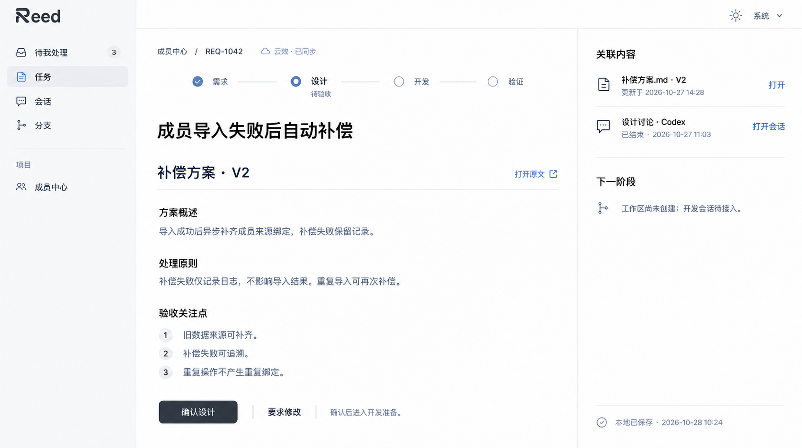
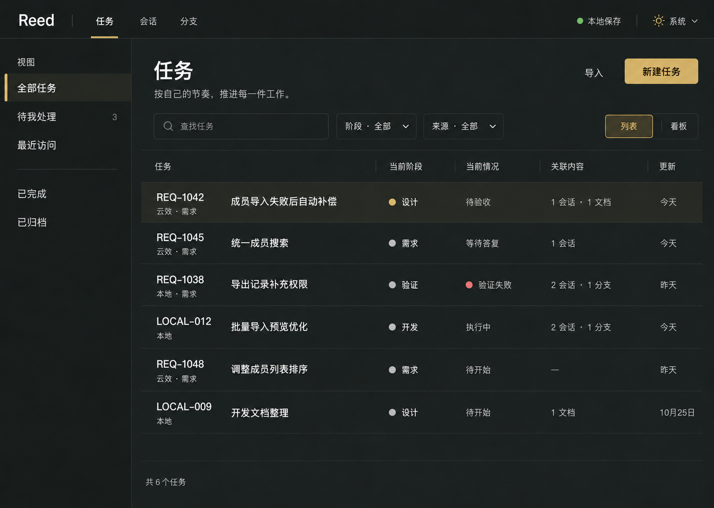
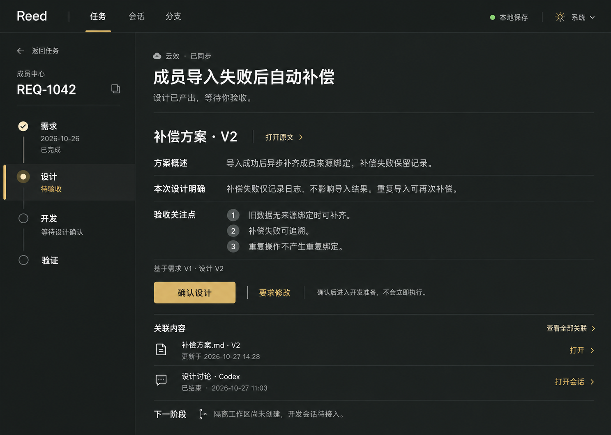
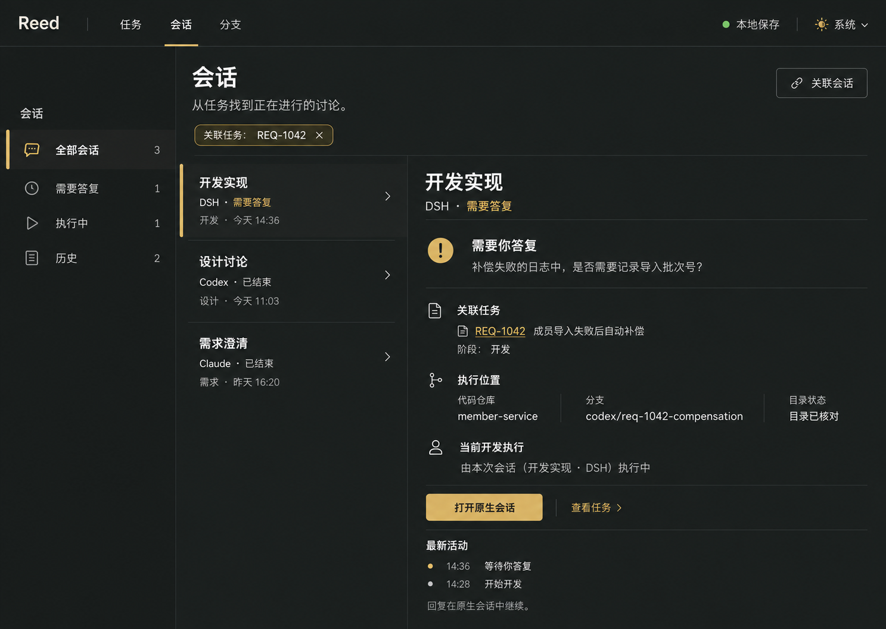
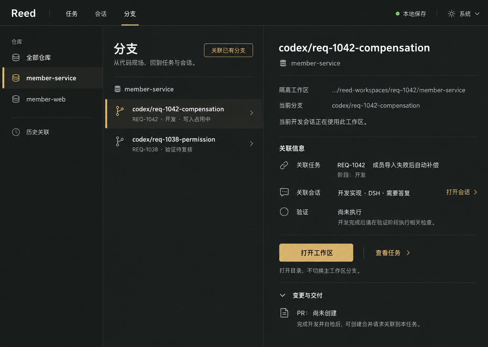
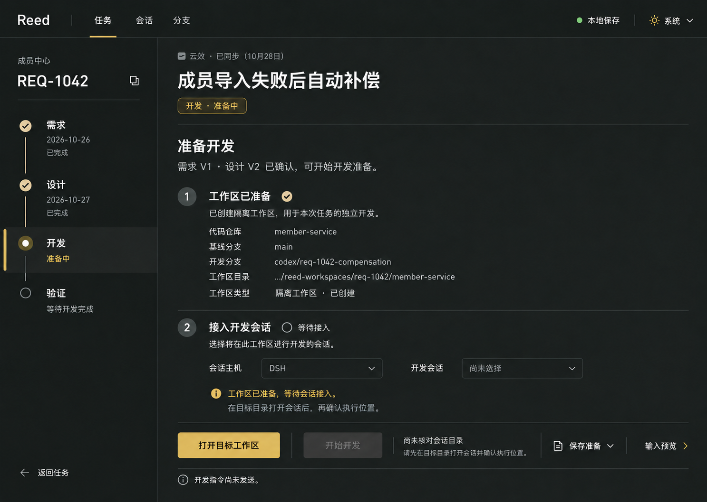
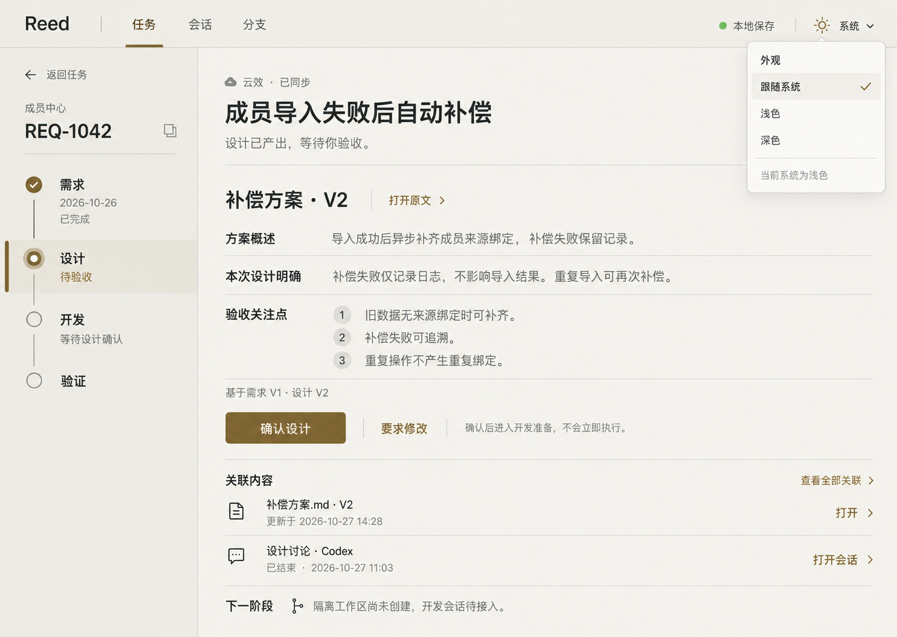

# Reed：交互设计与视觉规格

日期：2026-10-28（Asia/Shanghai）。状态：交互规格与本地前端 Demo。用户已确认平衡版 R，并授权开始 Demo；真实宿主执行、Git 操作、云效接入及正式插件发行尚未实现。

用户决定：产品名为 **Reed**，不设中文名。2026-10-28 用户在浅色升级的三张稿中暂定**第一张「原生留白」**，随后认可交织 R 图标形态，并提出以图标承担首字母、后接 `eed`；本轮已制作该组合稿。本稿以这一轮选择为当前视觉基准，支持跟随系统颜色。更早的第三张深色/古铜方向已被本轮升级替代，不混用不同轮次的选项编号。本文保留任务列表、任务详情、关联会话、分支视图及关键过渡，不进入代码开发。

关联资料：[业务领域模型](2026-10-28-reed-business-domain-model.md)、[架构与实施方案](../../../../docs/design/2026-10-27-workflow-workbench-architecture-and-plan.md)、[竞品研究](../../../../docs/design/2026-10-27-workflow-workbench-product-research.md)、[名称核查](2026-10-28-reed-name-check.md)。现有设计材料和模拟 Demo 暂存 `plugins/reed/`，没有正式清单、catalog 注册或安装入口。

2026-10-29 当前工程决定：独立 Reed 工程承载 Core、共享 React UI、品牌资产和 Tauri；ai-code/plugins/reed 仅承载四端插件适配。沿用已确认的视觉和交互，任务/验收/同步数据由同 profile 的 Core 共享，选中项/抽屉等窗口状态分别保留。Core-only 安装不要求打开 Tauri；未来其他壳通过相同契约接入。本文与 Demo 尚未搬迁，迁移和资源验收见架构方案，本次没有改 UI 代码。

操作的前置、实际结果与失败恢复详见[业务操作流](2026-10-28-reed-business-operation-flows.md)。以下界面动作使用相同规则，准备、导航、执行、验收与同步不能互相冒充完成。

## 1. 产品表达与品味

Reed 帮助个人开发者把需求、设计、Agent 执行、代码与验证串在同一件工作里。界面首先回答：进行到哪里、什么需要我判断、下一步去哪里。

- 名称只写 Reed，不使用音译、中文别名或云效品牌作为产品名。
- 用户已确认副标题为 **Many agents. One flow.**，表达跨 Agent、跨会话的工作汇成完整流程。此前的编织表述作为文案探索历史，不再作为当前副标题。
- 副标题用于首次欢迎、关于页和介绍材料，日常工作页面保留简洁的 Reed 字标。
- 气质：安静、有秩序、清楚、从容；浅色使用中性白、浅灰分区、墨色文字、克制灰蓝状态色和深色主按钮。去除暖纸底色、古铜主色和装饰性纹理；深色沿用相同层级的中性灰映射，另行出图校核。
- 独立 R 明确用于插件图标；页面左上角用「同一 R 图形＋eed」，整体读作 Reed，不再额外印一个 R。2026-10-28 补充平衡修订 v2：增强左侧支撑、减少右下斜腿墨量、统一基线并清理交织细缝，用户已确认该版形态，Demo 直接使用同一透明图像资产。字标与符号的重量、字顶和基线光学对齐，转接间距约 1–3px，组合目标高度约 24–26px。插件图标则按方形画布独立光学居中。搜索、无障碍名称和文本场景仍为 Reed，插件 ID 不变。图标与组合稿见[视觉升级与图标记录](2026-10-28-reed-visual-refinement.md)。
- 阶段导航表达连续性；不把编织意象画成需要解读的线团、航线或节点编辑器。
- 使用连续底面、间距、对齐和细分隔组织内容。任务是行，会话是行，关联也是行，不把每条信息包装成卡片。
- 每个当前上下文有一个主要动作。具体分支、会话和输入在行动时出现；端口、哈希、协议等进入诊断详情。

## 2. 主题、排版与四端尺寸

### 2.1 系统、浅色、深色

默认选项为「跟随系统」。右上角外观入口显示「系统」；菜单包含「跟随系统／浅色／深色」，选中项有勾选和文字，不只依赖颜色。

| 情况 | 必须呈现的行为 |
| --- | --- |
| 首次打开 | 使用系统当前颜色，不先显示错误主题再闪切 |
| 跟随系统时 OS 变色 | 当前页面随之变化，保留任务、筛选、选中会话、展开区域、滚动和未保存输入 |
| 显式选浅色或深色 | Reed 保持该选择；再次选系统才恢复跟随；不修改系统或宿主全局配置 |
| 四端分别打开 | 共享本地 profile 的外观偏好；系统颜色按各界面所在设备实际求值，显示当前有效颜色 |
| 宿主无法直接报告 OS 颜色 | 使用已验证的渲染环境颜色信号；标明宿主限制，不把固定深色叫作系统跟随 |
| 宿主锁定组件颜色 | 保留语义、层级和对比度；该端的覆盖能力需单独验收，不声称图中像素完全可复制 |
| 本地服务离线 | 外观选择可在本地界面暂存；重连后合并偏好，不覆盖任务输入 |

系统模式是同一套信息架构的两种表面，不依赖重建页面。DSH/ZCode/Codex Web 适配与 Claude Mod 分别验证颜色信号和实时变更；未完成实测前这是产品目标。

### 2.2 设计令牌目标

下表为本轮升级后的语义目标：浅色依据已选新稿；深色为待出图验证的映射草案。生成概念图不构成逐像素色值证明，旧古铜令牌不再作为当前设计依据。

| 用途 | 深色 | 浅色 |
| --- | --- | --- |
| 主底面 | `#1C1E21` | `#FFFFFF` |
| 导航底面 | `#17191C` | `#F5F5F4` |
| 主要文字 | `#ECEFF2` | `#202124` |
| 次要文字 | `#ADB4BD` | `#646B74` |
| 重点文字、选中标识 | `#A5B7CE` | `#526B87` |
| 主按钮底色 | `#E5E8EC` | `#2F353A` |
| 主按钮文字 | `#1C1E21` | `#FFFFFF` |

阶段不各自分配彩色。当前用灰蓝标识，完成用勾和文字，未来为空心标识；警示和失败颜色只表达业务意义并同时写明原因，不作为品牌装饰。底部「本地保存」与来源的「已同步」分别呈现。

以 1440px 逻辑视口为基准，正文 14–15、辅助文字 12–13、任务标题 24–28；中文采用清楚的系统无衬线字体，常规正文降低字重，分支和路径局部使用等宽字体。正文保持可读行长，优先通过间距而非连续粗体/横线分组；按钮最小高度 36，主要动作 36–40。焦点环、禁用说明和文字对比度按最终组件验收；减少动态效果时不依赖阶段滑动或旋转传达状态。

### 2.3 自适应结构

| 可用宽度 | 结构 |
| --- | --- |
| 1280 及以上 | 全局导航尽量复用侧栏；任务列表为视图栏＋列表；详情为导航＋阅读区＋可折叠关联栏，阶段收成紧凑导航；会话/分支为筛选＋资源列表＋详情 |
| 900–1279 | 收起筛选栏；资源详情占剩余空间，长分支换行；保留明确的返回位置 |
| 600–899 | 列表与详情分两层显示；上下文筛选保留，不水平堆三栏 |
| 360–599 宿主侧栏 | 单列、顶部入口切换、紧凑阶段导航；关联内容按组展开；主要动作保留可见 |

侧栏容器按自身宽度适配，不用设备名判断。宽屏不强制挤进原生窄侧栏；窄屏不隐藏关键阻塞或用图标代替操作文字。

## 3. 信息架构与导航契约

全局主入口为**任务／会话／分支**。全局外观和本地服务状态为轻量入口，连接配置在导入或同步需要时展开。文档归属任务和阶段，首版不另建无边界文件管理器。

| 入口 | 主问题 | 可以进入 |
| --- | --- | --- |
| 任务 | 哪件工作需要我处理，当前到哪一步 | 任务详情、当前阶段、文档、关联会话/分支、同步差异 |
| 会话 | 这段讨论属于什么工作，现在需要我做什么 | 原生会话、任务/阶段、实际工作区、执行记录 |
| 分支 | 这份代码为哪个任务开发，对应哪段会话和验证 | 工作区目录、任务、会话、代码/验证及交付引用 |

入口间共享上下文，例如从 REQ-1042 点击会话数，进入带「关联任务：REQ-1042」的会话列表；移除筛选显示全部，不修改绑定。返回任务列表恢复筛选、排序和原行位置。

选中资源仅改变浏览上下文。以下动作独立：打开任务、打开原生会话、打开工作区、准备阶段、发送阶段指令、确认阶段。点击关联或切换全局视图不会 checkout、迁移会话、自动发送或改变阶段验收。

设计中的位置标识表达任务、阶段或资源的稳定身份，不能用会话标题、行号或分支名字代替真实归属。历史引用可导航但不自动授予执行控制。

## 4. 贯穿样本与画面

**当前视觉基准是本节首先展示的原生浅色升级稿。** 后面的 4.1–4.6 为上一轮交互场景历史稿，继续说明操作与状态；其古铜颜色、重型阶段栏和较大字重不作为后续视觉实现依据。任务列表、会话、分支及开发准备的完整新版出图尚待按当前基准逐项延展。

已保存[插件图标 v2](assets/2026-10-28/reed-plugin-icon-v2.png)和[页面字标 v2](assets/2026-10-28/reed-wordmark-icon-eed-v2.png)，两者为透明背景设计稿。它们尚未制作正式发行资源或注册图形标识。产品名与副标题保持 Reed / Many agents. One flow.

以下全部为虚构设计数据，不是已调用云效或四端的证明。初稿开始于 2026-10-27，完成于 10-28；列表中的「今天」以 **10-27 的演示日期**解释。开发准备修订稿的来源核对日期为 10-28，不参与阶段先后或真实耗时推导。

- 主任务 REQ-1042「成员导入失败后自动补偿」，来源云效，项目成员中心。
- 时刻 A：需求 V1 已确认，设计 V2 已产出、会话结束，但设计待用户验收。
- 时刻 B：用户确认设计，开发准备中，隔离工作区已创建，开发会话尚未接入。
- 时刻 C：目录核对、用户发送后开始开发；DSH 的开发会话需要用户答复。
- 仓库 member-service；示例分支 `codex/req-1042-compensation`。名称使用示例前缀不代表 Reed 强制所有项目采用该前缀。

任务列表和任务详情展示 A，开发准备展示 B，会话与分支展示 C；同一任务不同时间的画面不能作为同时发生的状态对比。

### 4.1 任务列表

### 4.2 任务详情与设计审阅

### 4.3 关联会话

### 4.4 分支与工作区

### 4.5 准备开发，等待会话接入

### 4.6 同布局浅色与系统跟随

## 5. 任务列表：扫描、进入与建立任务

### 5.1 列表规则

默认进入「全部任务」中的未归档待办范围，范围包含活动、暂停和阻塞工作；侧栏另有待我处理、最近访问、已完成、已归档。任务状态筛选可清除，包含已取消的非归档任务，取消不使任务失去访问入口。待我处理聚合需要答复、待验收、验证失败、同步冲突/结果待核查；计数按任务去重，详情展开所有事项。

已归档任务若仍有未决同步，也在全局待我处理显示并标明归档；打开事项不会恢复任务或解除暂停。

主列是任务名称与来源编号，其后为当前阶段、当前情况、关联内容、更新时间。当前情况可显示正常执行；只有真正需要用户处理的事项才进入「待我处理」。任务状态只有在暂停、阻塞等影响理解时补充显示；不同时堆五种状态徽章。来源无法读取时保留上次内容和时间，并写「来源暂不可用」，不显示为空或被删除。

| 操作 | 交互结果 | 保持的事实 |
| --- | --- | --- |
| 点击任务行/Enter | 打开该任务当前阶段 | 不自动启动阶段 |
| 点击待验收等关注项 | 进入准确阶段并定位事项 | 已读不等于已验收 |
| 点击会话/分支数量 | 进入相应视图，带任务筛选 | 不改变执行绑定 |
| 搜索和筛选 | 本地任务范围内搜索，保留阶段/来源筛选 | 不默认扫描所有聊天或拉取全部外部数据 |
| 切列表/看板 | 保留任务范围和选中任务 | 只改变投影 |
| 看板拖阶段 | 提交阶段转换请求，展示条件和结果 | 不能绕过验收；不支持的跨越回到原位并解释 |
| 选择多个任务 | 显式进入批量模式，展示可用的整理动作和逐项结果 | 首版不批量自动发送 Agent 或批量覆盖云效状态 |

新进入的注意事项不抢走用户正在查看的行；在列表顶部提示有更新，由用户展开。无结果时区分「没有任务」和「筛选无匹配」，分别提供新建/导入和清除筛选。

### 5.2 本地新建与来源导入

本地新建打开轻量表单：标题必填，目标/验收条件、项目仓库可稍后补充，默认四阶段模板可切换。保存后进入任务详情的需求阶段「待开始」，不自动创建会话或执行。未保存关闭时保留草稿或明确放弃，不把必填错误清空。

导入打开来源抽屉：选择已配置来源→项目和过滤→浏览工作项→选择记录→预览本地流程与字段→导入。没有连接时在此配置账号范围；浏览不会自动建立本地任务。重复导入显示「已关联，打开任务」。同一外部需求的派生本地子任务必须显式创建，写明主同步负责人。

导入完成提示「已保存到本地」；只有实际远端核对通过才显示「已同步」。未配置云效时新建和整个本地流程仍可用。

### 5.3 个人看板：按推进状态看自己的工作

2026-10-28 用户补充：个人看板使用「待办、进行中、评审中、完成」。Demo 已新增独立「我的看板」入口；任务页的阶段看板继续保留。两者读取同一任务，个人进展与需求／设计／开发／验证阶段分开表达。

| 个人看板列 | 归类含义 | 卡片仍显示 |
| --- | --- | --- |
| 待办 | 尚未实际开工；草稿、仅接入会话或准备目录不算开工 | 当前阶段、来源、关联数量 |
| 进行中 | 已开工但尚未完成当前交付；包含阶段衔接、需要答复、失败重试和结果待核查 | 当前阶段与准确提示，暂停仍保留暂停标记 |
| 评审中 | 任意阶段已有产出，等待人工审阅／验收 | 对应需求／设计／开发／验证阶段 |
| 完成 | 当前任务全部阶段已明确验收通过 | 最终阶段、材料、会话和分支 |

需求评审通过后，任务进入设计准备并回到进行中；不会因为一个阶段审阅通过就完成整项任务。修改反馈、返工回需求或已知停止不会把已经开工的任务误算成新待办。归档单独管理，恢复后保留真实进展；同步冲突是并行提示，不直接改变个人工作列。

卡片点击以右侧抽屉打开详情，背景看板保持挂载，保留查询、项目／阶段筛选和滚动位置；关闭后焦点返回卡片。抽屉可以显式切为完整页面。文档、关联会话和工作区在当前上下文预览，避免关联导航意外关闭看板。桌面横向四列；窄窗口重排，抽屉适配到全宽。

2026-10-28 用户进一步确认拖拽流转。Demo 使用指针拖拽、触屏拖拽手柄及键盘「移动」入口，共用以下规则；松开并不代表所有变更已经提交。

| 目标或路径 | 必须经过的操作 |
| --- | --- |
| 待办 → 进行中 | 打开抽屉与准备操作，核对材料、会话和目录；明确开始后才算开工 |
| 进行中／待办 → 评审中 | 当前阶段有准确、非空且本轮有效的产出，前序已验收，无运行／等待／未知会话或失败事项；查看准确版本并明确提交 |
| 评审中 → 进行中 | 填写修改反馈，旧产出保留但本轮过期；更新版本后再评审 |
| 完成 → 进行中 | 明确返工阶段与理由，目标和下游阶段重新验收；历史材料保留并标为待更新 |
| 移到完成 | 仅最终验证阶段且处于待验收，前序逐一通过、验证产出有效、执行已结束；审阅准确版本，明确勾选并确认最终验收 |
| 已开工 → 待办、暂停或未知等受限迁移 | 说明条件并保留原位，提供详情入口；不清除历史或假装停止执行 |

流转检查由模型再次执行，普通验收按钮与拖拽使用同一门禁。确认绑定任务阶段、文档 ID 和版本；陈旧确认不能误验收新阶段或新材料。失败／未知报告不能通过重试清状态后直接复用；无有效来源标识的旧缓存 idle 材料需要新执行或人工保存新版本。确认窗口中的文档预览锁定准确版本。过期产出保留原文和版本，界面明确提示它仅供历史参考。

当前 Demo 的个人集合是本地工作台内的任务，尚未实现真实团队的负责人筛选。后续接入团队来源时，必须以明确的负责人和参与关系确定个人范围，不能把全团队来源列表直接称为「我的任务」。

### 5.4 Connector 配置与逐条数据来源

2026-10-28 用户补充 Connector 配置入口，以及每条数据所属来源。Demo 已增加侧栏「连接器」；窄窗口改为顶部插头入口。路径为添加连接→填写名称、组织标识／名称、项目范围和同步模式→保存→模拟测试→选择该连接及项目导入。

连接类型与连接实例分开：云效是一种 Provider，「云效 · 团队 A」是具名实例。实例名称在本地 profile 内唯一，稳定 ID 用于关联；组织或接入点改变会要求重新测试。已有数据引用时，组织／接入点固定，切换主体应新建连接。停用保留旧数据与来源，仅限制导入与同步。

| 对象 | 自身来源 | 另行保留的关联 |
| --- | --- | --- |
| 导入需求／任务 | Connector ID + 原始工作项编号；不同实例的相同编号各自独立 | 本地工作流、文档、会话和分支 |
| 文档版本 | 外部导入标对应连接；Agent 产出标准确宿主；手工保存标本地 Reed | 所属任务及任务的 Connector，不继承为文档自身来源 |
| 会话 | 实际记录的执行宿主 | 关联任务及其需求来源 |
| 分支／工作区 | 当前 Demo 为本地 Git 与仓库 | 开发任务、原生会话与第三方需求 |
| 活动记录 | 当前 Demo 为 Reed 本地操作 | 被操作任务及连接；未来真实远端活动需标其实际 Connector |

任务列表、阶段看板、个人看板、详情抽屉、文档与关联资源均显示来源。点击来源可查看实例、组织、项目范围、权限模式和外部编号；来源弹窗关闭后回到原文档／上下文。文档同时区分「文档来源」与「关联任务来源」。

导入与筛选使用明确连接 ID，搜索支持外部编号；显示名不能作为去重键。重命名、停用不改已有 origin，缺失来源不能通过关联任务猜测。旧云效缓存进入独立「旧演示来源」，旧文档标「来源待确认」；不静默归到新配置的连接。历史重名连接显示稳定 ID 以作区分。

当前配置是本地模拟，不提供真实 Token 输入、不请求云效 API。真实认证仍由计划中的本地服务与系统安全存储承担。仅拉取／停用／失效连接在模型和界面都不能回写，本地编辑与阶段流转保持独立。

## 6. 任务详情：以阶段和材料推进工作

### 6.1 稳定结构

左侧为简洁的全局/项目导航；主体为任务标题、来源、紧凑阶段导航、本阶段材料、当前结果与一个主要动作；宽屏关联内容置于可折叠右栏，窄屏放入下方。正文不被长聊天占满；全部活动记录按需展开。任务和阶段身份持续可辨，不要求保留旧稿的大型垂直阶段栏。

点击历史阶段可查看当时输入、产物与验收，不隐式返工。点击未来阶段展示前置条件；不能直接伪造通过。任务标题/范围编辑与阶段执行分开；编辑有未保存、本地保存、保存失败或并发更新提示。

### 6.2 各阶段与动作

| 当前情况 | 主要动作 | 点击后的具体结果 |
| --- | --- | --- |
| 需求待开始、材料不完整 | 补充需求 | 编辑目标/验收条件、登记来源材料；需要 Agent 时再进入执行准备 |
| 草稿完整、尚未采纳范围 | 确认需求范围 | 预览并固化准确版本为范围 V1，随后才可准备受范围约束阶段；无需求阶段模板同样有此入口 |
| 阶段待开始、前置齐备 | 准备设计/开发/验证 | 固定输入、选择会话与目标工作区；先准备，随后显式发送 |
| 材料已产出、待验收 | 审阅结果；进入审阅后为确认设计/确认结果 | 打开准确版本、显示检查项；确认登记人和范围，不自动发送下一阶段 |
| 需要修改 | 要求修改 | 填写反馈并预览引用版本，按宿主能力交接或人工提交；业务输入/标准未变时新增尝试，变更时新建阶段轮次，保留旧产物 |
| 原生会话执行中 | 打开原生会话 | 进入准确会话；停止执行在独立次要动作内 |
| 等待用户答复 | 前往答复 | 打开准确原生会话；宿主不支持时说明替代导航 |
| 执行结束但缺产物 | 补齐材料 | 列出缺失内容，不显示为已通过 |
| 验证失败 | 查看失败原因 | 展开报告并带版本返回开发，用户选择返工范围 |
| 输入/代码变化导致待复核 | 查看变更 | 比较旧、新输入并重新评估关联阶段；历史验收保留 |
| 失联或提交结果未知 | 核查执行 | 提供观测、恢复绑定、已确认终态的证据入口；不显示盲重试 |
| 满足当前范围全部完成条件 | 完成本轮任务 | 同时核对必要阶段/依赖、子交付、证据和未决执行，形成完成决定；不推断已合并/上线 |

暂停任务阻止新派发和后续自动推进，既有活动与人工审阅仍可见；恢复后重新核对，不直接发送旧准备。取消先禁新派发并处理活动执行，再记录实际结果。活动/阻塞任务使用「暂停并归档」，归档前先处置活动/待核查执行并撤回未交接准备；恢复归档只恢复显示并保留暂停/完成/取消状态。归档不删除文档、会话、分支或工作区，也不丢未决同步。

### 6.3 设计确认与开发交接

1. 在任务详情审阅设计 V2，必要项与需求范围可核查。
2. 点击「确认设计」，登记确认；若材料/范围已被修改，保持待处理并定位新差异。
3. 进入「准备开发」，输入固定为需求 V1、设计 V2；可返回，确认不因返回丢失。
4. 选择仓库、基线及隔离工作区；已准备资源可复用，切换配置说明影响。
5. 工作区准备成功后，显示「工作区已准备，等待会话接入」。从这里创建/打开目标目录会话，或使用宿主支持的人工打开＋重新绑定。
6. 准确身份、实际目录、仓库和分支核对通过，且宿主已验证支持本次提交后，「开始开发」才可用。旧目录会话仅显示待调整，不能靠提示词假装已迁移。
7. 直接提交端可展开输入预览，点击「开始开发」后提交一次；显示准备、发送中、已接纳、执行中，不把接纳显示成完成。提交结果不明进入核查，不自动重发。

各端交接按实际能力呈现，不能只凭正确身份推导支持发送：

| 已验证能力 | 准备区动作 | 成功边界 |
| --- | --- | --- |
| 可直接提交并关联回执 | 开始开发 | 收到准确接纳/开始证据后更新相应状态 |
| 仅打开并预填 | 在宿主打开并预填 | 先显示「待用户发送」；用户真实发送、身份/目录重新核对及匹配回执到达后才记已接纳/执行 |
| 无可信提交、只能导航 | 打开执行位置或查看操作指引 | 只记导航/人工交接；未有准确执行证据不能推进 AgentAttempt |
| 尚未验证或能力不可用 | 查看受限原因、切换明确支持的执行目标 | 保持未发送；不能静默改用其他宿主或独立 Agent |

图中的 DSH 仅代表候选直接提交端的设计场景，仍须 P0 证明真实能力。预填后用户修改内容或目录时，原准备快照不得继续冒充实际执行输入。

保存准备不发送指令。准备失败保留已建立资源及明确恢复动作；重复点击不重复建分支。正在执行时更换展示关联不会转移执行所有权。多仓库按仓库展开；缺少多根访问能力时显示分开执行的子任务，不默认给一个会话所有目录权限。

### 6.4 文档与反馈

文档行显示类别、名称、版本、产生阶段/会话和有效状态；点击预览或按宿主能力打开原文。外链有来源提示，缺失文件写明缺失，不清空历史。可关联已有文档或接收阶段产物，正文编辑不在首版重复实现完整编辑器。

人工完成阶段时可提交已有材料，记录适用输入和来源，再按相同验收条件确认；不要求伪造一段 Agent 会话或执行记录。复用材料也须核对本轮适用性，不能把旧通过标记直接复制到新范围。

新候选不自动替换已接受版本；明确采用或旧证据实际失效时，才定位最早受影响阶段及待复核项。已完成任务保留历史完成并显示当前适用性待复核，继续工作须明确重开；本轮复用按接受复用、补证、重做逐项处理。

从段落/报告生成反馈时携带文档版本、位置与任务阶段，先预览再发往所选原生会话。替换设计文档后，展示受影响的开发/验证待复核项；不能把旧验证套到新内容。

## 7. 关联会话：关系、活动与执行所有权

会话视图浏览 **Reed 已登记的会话**。不会默认枚举或上传所有宿主私有聊天；摘要是最近可观测内容，非全文副本。全局可以跨宿主查关联，任务内则默认带任务过滤。

列表显示标题、宿主、活动状态、关联阶段和最近观察时间。选中后展示任务/阶段、实际工作区、当前执行、相关产物和最近活动；当前执行关系与历史关联分开。一个任务多会话、一个会话关联多个历史任务均可表达。

| 动作/状态 | 交互约定 |
| --- | --- |
| 关联会话 | 选择宿主和任务/阶段；优先可信当前会话或已登记列表；显示是历史引用还是可执行绑定 |
| 粘贴会话链接 | 只能建立导航引用；显示「尚未验证执行上下文」，不能获得发送或取消权限 |
| 新建原生会话 | 仅在宿主验证支持时提供；选定目录后获得真实身份，再进入可执行状态 |
| 打开原生会话 | 精确导航，保留任务上下文；失败时保留此页并提供可用替代，不能转到最近会话 |
| 当前会话忙于另一任务 | 显示占用任务和跳转；可等待或选择另一准确会话；不自动抢占 |
| 编辑标题/历史关联 | 仅影响展示或关联，不把活动执行改绑 |
| 解除关联 | 先显示影响；活动执行绑定不能直接解除，历史引用可以移除但保留执行历史 |
| Fork 或会话重建 | 新会话单独登记，显示父子/继承来源；不默认继承原会话执行权限和 cwd |
| 失联/会话不存在 | 保留历史并显示最后观测；重新接入须核对身份，未确认停止不能释放占用 |

正常页面不暴露可编辑原生 ID。需要答复的会话保持原生输入入口，不在 Reed 仿制另一套聊天发送框；工作流阶段指令从任务准备区发出，二者归属可分辨。

## 8. 分支视图：从代码反查工作

以仓库过滤→分支/工作区列表→关联详情组织。默认仅显示已关联资源，用户显式选择仓库后才扫描和关联已有分支。多仓库同名分支独立显示，身份包含仓库和实际工作区；分支名字不是全局主键。

选中后显示当前观察分支、基线、工作区位置、占用、关联任务/会话及验证/交付。列表选中仅浏览；主动作「打开工作区」打开既有目录，不 checkout 主工作区，也不直接启动 Agent。

| 情况 | 显示与下一步 |
| --- | --- |
| 已有关联与目录可用 | 打开工作区、查看任务、打开准确会话 |
| 关联已有分支 | 选择仓库、真实分支、任务及用途，核对目录后登记；不凭分支名称自动接受 LLM 推测 |
| 尚无工作区 | 从任务进入开发准备；不把裸分支当成已隔离执行目录 |
| 当前实际分支与期望不同 | 同时显示两者，提示重新核对；不自动 checkout 或更改记录掩盖漂移 |
| Detached HEAD | 明确写未处于命名分支，不用期望名字填充观察结果 |
| 分支删除/改名、目录移动 | 保留历史，重新定位/关联；删除后同名重建不自动接管旧历史 |
| 任务多仓库 | 按仓库分组，分别显示状态；某仓验证通过不能代表所有仓通过 |
| PR 已合并 | 显示交付事实，任务验收、发布和工作区清理独立处理 |
| 清理候选工作区 | 独立操作列出路径、占用和未提交内容；无法证明归属/停止时保留，不提供强制一键删 |

首版复用宿主已有差异/审阅能力；分支页面不扩成完整 Git 客户端。关联建议可预览并由用户接受，不能自动 checkout、写入或判完成。

## 9. 本地保存与云效同步交互

本地任务状态始终可查看。来源行表达云效/未来其他系统的同步结果，首版界面不将 provider 写死为全局导航。

| 状态 | 用户可理解的表达 | 可用动作 |
| --- | --- | --- |
| 本地已保存、待发送 | 本地已保存，云效待同步 | 查看待同步修改；允许时同步 |
| 远端已核对 | 已同步，含最近核对时间 | 查看远端、刷新 |
| 当前值相同但请求未确认 | 当前值一致，操作结果待核查 | 查看核查详情；不展示请求已成功 |
| 双方同字段有修改 | 同步冲突 | 并排比较基线、本地期望、远端当前值，逐字段处理 |
| 权限/登录失效 | 来源暂不可用 | 重连原账号；不把空列表当删除 |
| 远端写入结果未知 | 同步结果待核查 | 保留暂停、解除绑定保留历史、明确人工风险处置 |
| 账号或组织切换 | 此连接属于原账号 | 创建新的连接；旧队列不自动迁移或用新主体发送 |

冲突抽屉先列业务字段，再展示状态映射；用户选择保留/合并/放弃，预览将写入的差异后形成新意图。默认只写允许的字段，不整条覆盖。错误、冲突和未知结果不会让本地任务自动回退或消失。

用户直接修改云效状态时，预览说明只改来源状态，本地阶段和验收仍按本地事实显示；该外部操作独立记录并核对权限/流转。基于本地完成的自动关闭另需有效完成决定，不能借手动入口绕过。

手动来源字段编辑的预览还说明该字段自动映射将暂停；已有在途操作先核查，后续规则只形成建议。用户明确恢复自动映射时预览当前期望，避免下一次阶段事件悄悄覆盖手动修改。

人工恢复必须让用户看到原未知操作、当前远端值、待发后续意图和迟到写入风险；明确记录本次决定。不能用一个普通「重试」按钮偷偷释放同对象队列。操作已被策略授权时不对内部每一步重复弹确认。

## 10. 共用异常、键盘与恢复

| 场景 | 统一处理 |
| --- | --- |
| 首次空白 | 简短说明＋新建/导入，不先要求配置云效或模型 |
| 加载 | 局部骨架和状态文字，不清空已加载任务或全屏无限转圈 |
| 本地服务未启动/依赖缺失 | 显示可操作的启动/依赖诊断入口；不能宣称任务已保存；恢复后保留草稿 |
| 服务断开 | 可用的已有投影只读，标记最后更新时间；待发送文本可留草稿，不假称已发送 |
| 并发编辑 | 告知此内容已更新，比较差异并重基线；不静默覆盖另一端 |
| 原生能力不支持 | 说明当前端可做的操作，提供明确导航；受限替代不冒充完整控制 |
| 重复点击/发送结果未知 | 保持同一操作状态，未知时进入核查；不自动创建第二次执行 |
| 保存失败 | 表单内容保留，可重试可确定未写入的本地保存；未保存状态持续可见 |
| 页面切换 | 可保存的本地草稿保留；不能保存时明确选择保留/放弃，不清空输入 |

键盘：Tab 按视觉顺序进入；Enter 打开选中行，Esc 关闭当前菜单/抽屉并回到触发点；列表上下键不自动发消息。可在产品自身焦点范围提供搜索快捷键，不抢占宿主既有快捷键；所有关键操作有可见入口。

长标题允许换行，列表摘要截断但有完整访问方式。200% 缩放和窄栏仍能访问主动作；状态同时包含文字和形状，不依赖色觉。动态结果以不抢焦点的方式通知；跳转后聚焦页标题或对应事项。

## 11. 从入口到闭环的设计走查

以下是未来可点击原型及真实宿主验收的任务，当前图稿并未执行这些交互。

| 编号 | 起点与操作 | 应到达的结果 |
| --- | --- | --- |
| I01 | 本地新建，不配置云效 | 任务需求阶段待开始，输入保留，没有原生执行 |
| I02 | 浏览云效后导入、再导入一次 | 一次主任务；第二次打开已有任务，来源浏览不批量建单 |
| I03 | 待我处理→设计待验收→确认 | 记录准确版本，进入开发准备，尚未发送 |
| I04 | 准备 worktree，但会话仍在旧目录 | 等待接入，开始开发禁用；解释如何到正确位置 |
| I05 | 接入准确会话→预览→开始开发 | 只有一次交接，接纳和执行分别显示 |
| I06 | 需要答复→打开会话→返回任务 | 准确原生会话、同一任务/阶段，已读不改验收 |
| I07 | 查看已结束的历史会话并改标题 | 历史可见，活动执行所有权不变 |
| I08 | 从任务打开关联分支，再打开目录 | 不 checkout 主工作区，不发送消息；能返回原任务 |
| I09 | 两个仓库存在同名分支 | 独立关联和路径，不合并身份或验证 |
| I10 | 测试失败、修改设计后返工 | 精确报告/输入版本，旧通过结果保留且当前待复核 |
| I11 | 云效冲突/未知结果与账号切换 | 本地继续可用，差异可见，旧意图不以新身份误发 |
| I12 | 活动任务暂停、取消和归档 | 每个动作说明真实范围；未确认停止不释放执行占用 |
| I13 | 系统模式 OS 颜色切换、手动覆盖再恢复 | 两种主题一致，选择和草稿不丢失，无系统配置修改 |
| I14 | 窄栏、键盘、200% 缩放、减少动态效果 | 可理解阶段/阻塞和主操作，焦点返回准确 |
| I15 | 直接提交、仅预填、无可信提交通路，以及本地服务断开 | 动作名称与能力相符；仅预填等待用户真实发送，无假保存、假跳转或假执行 |

## 12. 交付状态与下一步

交付包含交互规格、静态高保真概念稿和名称核查。上一轮六张场景图由内置 Image Gen 基于当时选中的深色第三张生成；2026-10-28 用户又选择新浅色三稿的第一张，本轮已保存该稿、透明候选图标和加图标装配稿，详见[视觉升级与图标记录](2026-10-28-reed-visual-refinement.md)。图中数据均为样本，未连接真实系统。

本规格定义完整操作路径和关键失败分支，图片承载视觉方向。用户随后确认图标并授权实现前端 Demo；本地流转、关联视图、文档版本和实时主题响应已在浏览器中验证，详见 [Demo 说明](../../prototype/README.zh-CN.md)与[视觉验收](../../prototype/design-qa.md)。真实宿主跳转与执行仍须逐端验收，静态图和模拟结果均不能作为原生能力证据。

本轮独立只读复核指出的提交能力分支和未定义共用工作区选项已分别修订正文与图稿。最终采用第 4 节所链接版本；未链接的初稿保留作设计过程记录。界面验收以文字契约和逐项走查为准，生成图片不证明系统跟随、请求提交或关联数据正确执行。

用户原先要求暂不写代码；在后续明确回复「确认这版图标，开始 Demo」后，2026-10-28 已在 `plugins/reed/prototype/` 实现完整可点击前端。当时采用插件工程内聚；2026-10-29 已决定后续迁入独立 Reed 工程，本次只记录新边界，未搬代码。尚未新增正式产品清单、市场注册或发布。当前评审可走通「设计确认→开发准备→模拟会话接入→执行→验证与返工」，四端名称仅作为交互选择，未调用真实宿主。
